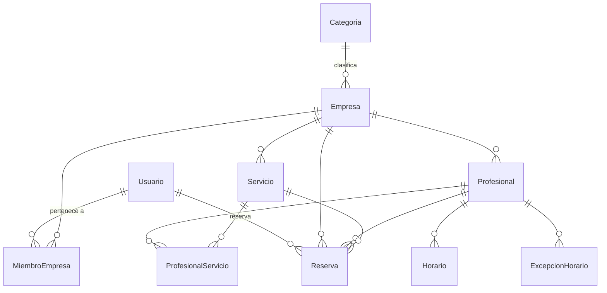

# TFM — Plataforma web de reservas y gestión de servicios

**Versión 3.0 — especificación revisada (Fase 0) con nomenclatura en castellano.**

Este documento es la **única fuente de verdad** del proyecto.
Sustituye por completo a las versiones anteriores y a `BACKLOG.md`, que queda eliminado.
`PROJECT_PLAN.md` queda reducido exclusivamente a calendario y puntos de control.

Cualquier cosa que no esté en este documento **no forma parte del alcance**.

---

# 1. Propósito

## 1.1. Objetivo funcional

Plataforma web **multiempresa (multi-tenant, modelo SaaS)** con arquitectura de monolito modular que permite:

- A un visitante: buscar establecimientos por ciudad y categoría, consultar su ficha pública y sus servicios, ver disponibilidad real y reservar.
- A un cliente registrado: gestionar sus reservas (consultar, ver detalle, cancelar).
- A una empresa: registrarse, configurar servicios, profesionales, horarios y políticas de reserva, publicar su ficha y gestionar sus reservas.

## 1.2. Objetivo académico

El producto **no incorpora IA**. La IA se usa exclusivamente como herramienta del proceso de desarrollo (Claude Code, Codex, Copilot u otras).

## 1.3. Restricción temporal

```text
122,75 h en total, en 6 semanas a ~20 h (D-24)
   de las cuales 16,75 h son modelado y documentación (fases 0–3 y 20)
   y 106 h son desarrollo efectivo (fases 4–19)
```

La redacción de la memoria del TFM se contabiliza **aparte**.

El alcance está dimensionado para ese presupuesto y ya incorpora los recortes de §5.1. Si una fase se desvía, se recorta alcance antes que ampliar el plazo (§18).

---

# 2. Principios

1. MVP funcional por encima de completitud.
2. Evitar sobreingeniería. Sin microservicios, sin CQRS con buses, sin event sourcing, sin MediatR.
3. Arquitectura limpia y modular: dominio, aplicación, infraestructura y presentación separados.
4. Toda regla de negocio importante debe poder probarse sin la interfaz.
5. El motor de disponibilidad, la prevención de solapamientos y el aislamiento entre empresas son el núcleo técnico del TFM.
6. La protección multi-tenant vive en aplicación y persistencia, nunca solo en la interfaz.
7. Todo código generado por IA se revisa y valida.
8. Cada fase produce un resultado ejecutable o verificable.
9. Lo no esencial se documenta como trabajo futuro, no se implementa.

---

# 3. Nomenclatura

Decisión deliberada y de aplicación obligatoria en todo el proyecto.

| Elemento | Idioma | Ejemplo |
|---|---|---|
| Entidades, clases, interfaces, métodos, propiedades | **Castellano** | `Reserva`, `IMotorDisponibilidad`, `DuracionMinutos` |
| Namespaces y nombres de proyecto | **Castellano** | `PlataformaReservas.Dominio` |
| Tablas y columnas de base de datos | **Castellano**, `snake_case` | `reservas`, `profesional_id` |
| Ficheros de documentación | **Castellano** | `docs/motor-disponibilidad.md` |
| Comentarios y mensajes de error | **Castellano** | |
| **Rutas web** | **Inglés** | `/businesses/{slug}` |
| Tipos del BCL y de terceros | Su nombre original | `DayOfWeek`, `TimeOnly`, `IdentityUser` |
| **Excepción de carpeta**: `Dominio/ValueObjects/` | Inglés | Término técnico consolidado; *ObjetosValor* no se usa en la práctica. **Los tipos que contiene sí van en castellano** (`PoliticasReserva`, `FranjaHoraria`) |
| **Excepción de sufijo**: clases de excepción | Raíz en castellano, sufijo `Exception` | `DominioException`. Lo exige el analizador CA1710 (error con `TreatWarningsAsErrors`). *Decidido en la Fase 5* |
| Mensajes de commit | Libre | Sin formato obligatorio. *Decidido el 2026-10-12*: sustituye a los prefijos convencionales |

## 3.1. Regla de acentos y eñes

**Ningún identificador de código lleva tilde, diéresis ni eñe**, aunque C# lo permita. Los acentos causan problemas con herramientas, codificación de ficheros, terminales y búsquedas.

```text
Correcto:    Descripcion   DiaSemana   Telefono   Anio   Tamanio
Incorrecto:  Descripción   DíaSemana   Teléfono   Año    Tamaño
```

La ortografía correcta **sí** se usa en textos de interfaz, comentarios, mensajes de error y documentación.

## 3.2. Vocabulario del dominio

Un concepto, un nombre. No se alternan sinónimos.

| Concepto | Nombre en el modelo | Cómo se llama en la interfaz pública |
|---|---|---|
| Negocio que presta servicios | `Empresa` | "establecimiento" |
| Persona que presta el servicio | `Profesional` | "profesional" |
| Persona que reserva | `Usuario` (con rol `Cliente`) | "cliente" |
| Franja reservable calculada | `HuecoDisponible` | "hora disponible" |

Que la interfaz diga "establecimiento" y el modelo diga `Empresa` es una decisión consciente: el modelo habla del inquilino del SaaS, la interfaz habla del sitio al que vas. No se mezclan.

## 3.3. Rutas en inglés

Las rutas son parte de la URL pública y del contrato HTTP. Se mantienen en inglés, en minúsculas, con guiones y en plural para colecciones, siguiendo la práctica habitual de diseño de URLs.

---

# 4. Decisiones cerradas

Quedan fijadas y **no se reabren** durante la implementación.

| # | Decisión | Resolución |
|---|---|---|
| D-01 | Render mode de Blazor | SSR estático en páginas públicas; `InteractiveServer` en reserva, área de cliente y área de empresa |
| D-02 | Reserva como invitado | **No existe.** Reservar exige cuenta. `Reserva.UsuarioId` obligatorio |
| D-03 | Modelo de cliente | Simplificado: no existen entidades intermedias de cliente. La reserva referencia a `Usuario` y guarda copia de nombre y teléfono |
| D-04 | Horarios | **Solo por profesional.** No existe horario de empresa |
| D-05 | Granularidad de huecos | Configurable: `Empresa.IntervaloHuecosMinutos` + `Servicio.IntervaloHuecosMinutos` (opcional, prevalece) |
| D-06 | Políticas de antelación | Configurables en **ambos niveles**: empresa (defecto) y servicio (opcional, prevalece) |
| D-07 | Concurrencia | Restricción `EXCLUDE` de PostgreSQL + recomprobación transaccional + protección de doble envío. Detalle en §13 |
| D-08 | Zona horaria | Única y fija: `Europe/Madrid`. Persistencia en UTC (`timestamptz`) |
| D-09 | Repositorios | Contratos en `Dominio` (`Dominio/Repositorios`), implementaciones PostgreSQL/EF Core en `Infraestructura`. *Revisado en la Fase 8 (2026-10-10): antes, interfaces en `Aplicacion`.* Separación lectura pública / escritura por empresa |
| D-10 | Backlog | Eliminado. Este SPEC y las especificaciones de fase son la fuente de verdad |
| D-11 | Multi-tenancy | `IContextoEmpresa` + repositorios filtrados en origen + validación explícita de `EmpresaId`. **Sin filtros globales de consulta de EF Core** |
| D-12 | Nomenclatura | Castellano en modelo, código y base de datos; inglés en rutas web (§3) |
| D-13 | Convención de base de datos | `snake_case` mediante `UseSnakeCaseNamingConvention()`, para evitar el entrecomillado permanente en PostgreSQL |
| D-14 | Estilo de modelo | **Modelo rico**: las entidades protegen sus invariantes con métodos, sin `set` público. Nada de modelo anémico con la lógica en servicios |
| D-15 | Agregados | **Siete agregados pequeños**, referenciados entre sí por identificador. `Horario` y `ExcepcionHorario` son hijos de `Profesional`. Límites y justificación en `docs/modelo-dominio.md` §2 |
| D-16 | Identificadores | `Guid` versión 7 (`Guid.CreateVersion7()`), generados en `Aplicacion`. Sin identificadores tipados |
| D-17 | Casos de uso | **Una clase por caso de uso** con un único `EjecutarAsync`. Devuelven `Resultado`/`Resultado<T>`, nunca entidades. Sin mediador ni bus. Detalle en `docs/arquitectura.md` §5 y §6 |
| D-18 | Contexto de empresa | Se resuelve del **claim `empresa_id`** del `ClaimsPrincipal`, no con una consulta por operación. Invalidación por `SecurityStamp` con revalidación cada 5 min (`docs/arquitectura.md` §8) |
| D-19 | Ciclo de vida del contexto de datos | Scoped construido desde `IDbContextFactory` (Identity lo exige), con `NoTracking` por defecto y seguimiento explícito donde se modifica (`docs/arquitectura.md` §9) |
| D-20 | **Notificaciones por correo** | **Dentro del MVP.** 11 correos y recuperación de contraseña (§16). SMS, mensajería y recordatorios siguen fuera |
| D-21 | Eventos de dominio | Las entidades los registran; **el caso de uso los publica después del commit**. Cola en memoria (`Channel<T>`) y `BackgroundService`. Nunca dentro de `SaveChanges` (`docs/arquitectura.md` §13) |
| D-22 | **Cifrado de datos personales en reposo** | `ProtectPersonalData` de ASP.NET Core Identity con AES-256-GCM propio, más conversores de EF Core para las copias de `Reserva`. **Los datos de la empresa no se cifran: son públicos** (§15.1) |
| D-23 | **Endurecimiento de seguridad** | Las seis medidas de §15.2 **entran todas** en el alcance, incluida la CSP. La Fase 19 pasa de 3 h a 7,25 h |
| D-24 | Calendario | **Seis semanas** a ~20 h, no cuatro a 30. Reparto cerrado en `PROJECT_PLAN.md` §2 |
| D-25 | Base técnica de la solución | Solución **`.slnx`**. **FluentAssertions 7.x** y **xUnit 2.x** con `xunit.runner.visualstudio`. `Microsoft.EntityFrameworkCore.Design` en **`Web`**, el proyecto de arranque. Supresión de analizadores solo en `.editorconfig`, justificada. Detalle en `docs/arquitectura.md` A-17, A-18, §2.2 y §3.3. *Decidido al revisar la especificación de la Fase 4* |
| D-26 | Base de datos local | `docker-compose.yml` con el servicio `postgres` **desde la Fase 5**; la Fase 18 le añade `web` y el `Dockerfile`. Contraseña en `.env` sin versionar, cadena de conexión en User Secrets, `dotnet-ef` como herramienta local fijada. (§17, `docs/arquitectura.md` §11.4) |

## 4.1. Regla de precedencia de políticas

Para los tres parámetros configurables (`IntervaloHuecosMinutos`, `AntelacionMinimaMinutos`, `AntelacionMaximaDias`):

```text
valor efectivo = Servicio.X ?? Empresa.X
```

`Empresa.X` es **obligatorio y no nulo** (siempre hay valor por defecto).
`Servicio.X` es **nullable**; si es `null`, el servicio hereda la política de la empresa.

Esta resolución se implementa **una sola vez**, en el dominio, y se usa desde el motor de disponibilidad y desde la validación de creación de reserva. No se duplica.

`PoliticasReserva` es un **objeto de valor con invariantes**: los rangos válidos se comprueban al construirlo, de modo que es imposible obtener una instancia fuera de rango y ningún valor inválido puede llegar al motor.

```csharp
public sealed record PoliticasReserva
{
    public const int IntervaloMinimo = 1,    IntervaloMaximo = 480;    // minutos
    public const int AntelacionMinima = 0,   AntelacionMaxima = 43_200; // minutos (30 días)
    public const int VentanaMinima = 1,      VentanaMaxima = 365;       // días

    public int IntervaloHuecosMinutos { get; }
    public int AntelacionMinimaMinutos { get; }
    public int AntelacionMaximaDias { get; }

    public PoliticasReserva(int intervalo, int antelacion, int ventana)
    {
        // Cada comprobación lanza si el valor está fuera de rango.
        // Un intervalo de cero o negativo provocaria un bucle infinito en §12.2.
        ...
    }

    public static PoliticasReserva Resolver(Empresa empresa, Servicio servicio) => new(
        servicio.IntervaloHuecosMinutos  ?? empresa.IntervaloHuecosMinutos,
        servicio.AntelacionMinimaMinutos ?? empresa.AntelacionMinimaMinutos,
        servicio.AntelacionMaximaDias    ?? empresa.AntelacionMaximaDias);
}
```

**Rangos válidos**, aplicables por igual al valor obligatorio de la empresa y al valor opcional del servicio cuando no es `null`:

| Parámetro | Rango | Motivo del límite |
|---|---|---|
| `IntervaloHuecosMinutos` | 1 – 480 | **Cero o negativo cuelga el motor**: el paso 5.4 de §12.2 avanza con `cursor + intervalo`. El techo es una jornada |
| `AntelacionMinimaMinutos` | 0 – 43 200 | Cero significa "hasta el último momento". El techo son 30 días |
| `AntelacionMaximaDias` | 1 – 365 | Con cero no se podría reservar ninguna fecha futura y la empresa se quedaría sin reservas sin entender por qué |

Detalle y justificación en `docs/reglas-negocio.md`, RN-26 a RN-29.

---

# 5. Alcance del MVP

## 5.1. Público (sin autenticación)

- Landing única con: hero, propuesta de valor, cómo funciona, categorías, preguntas frecuentes, llamada a la acción para clientes, llamada a la acción para empresas y pie de página.
- Búsqueda de establecimientos por **ciudad (texto libre, obligatoria) y categoría (selector, opcional)**, con resultados paginados y tamaño de página fijado en servidor. Sin ciudad no hay resultados: evita que la ruta sea un volcado completo del catálogo (RN-110, RN-113).
- Ficha pública del establecimiento: nombre, categoría, descripción, dirección, teléfono, servicios, profesionales, horario resumido y botón de reserva.
- Consulta de disponibilidad real.

## 5.2. Cliente autenticado

- Registro, inicio y cierre de sesión.
- Flujo de reserva completo.
- Listado de sus reservas (próximas e históricas).
- Detalle de reserva.
- Cancelación de reserva.
- Perfil y **baja de cuenta**, que cancela sus reservas futuras (RN-136, RN-137).
- **Recuperación de contraseña** por correo, igual para clientes y propietarios (CU-24).

## 5.3. Empresa

- Registro (cuenta + empresa en un único formulario).
- Configuración de la empresa: datos, categoría y políticas de reserva.
- Mantenimiento de servicios.
- Mantenimiento de profesionales, con asociación a servicios en la misma pantalla.
- Configuración de horario semanal y excepciones, en la misma pantalla.
- Panel de resumen: reservas de hoy y próximas.
- Listado y gestión de reservas: cancelar y marcar como completada.
- **Baja y reactivación del establecimiento**, con cancelación de las reservas futuras (RN-130 a RN-134).

## 5.4. Administración de plataforma

**Fuera del MVP.** Las categorías se cargan por datos iniciales. No existe área de administración.

---

# 6. Fuera de alcance

## 6.1. Recortado respecto a la versión original

| Elemento original | Motivo |
|---|---|
| Asistente de alta en 8 pasos | Sustituido por alta simple + configuración desde el panel con los mismos mantenimientos |
| Vista de calendario de la empresa | Sustituida por listado de reservas con selector de fecha |
| Pantalla de clientes de la empresa | Los clientes son derivables de las reservas |
| Pantalla independiente de excepciones | Integrada en la pantalla de horarios |
| Área de administración de plataforma | Categorías por datos iniciales |
| Páginas "cómo funciona", "preguntas frecuentes" y "contacto" | Convertidas en secciones de la landing |
| Reserva como invitado | Ver D-02 |
| Filtros por código postal y provincia | Solo ciudad |
| Latitud, longitud, provincia y país | Sin geolocalización en el MVP |
| Excepciones de horario personalizado | Solo indisponibilidad de día completo |
| Estados "pendiente" y "no presentado" | Máquina de estados reducida a tres |
| Entidades intermedias de cliente por empresa | Ver D-03 |
| API REST pública y OpenAPI | Blazor consume los servicios de aplicación directamente |
| ~~Pantalla de perfil de cliente~~ | **Recuperada al alcance.** `/my-account/profile` es donde vive la baja de cuenta (CU-22) |
| Rol de administrador de plataforma | Sin área que administrar |

## 6.2. Trabajo futuro

Pagos y pasarela · suscripciones · SMS y mensajería · recordatorios antes de la cita · verificación de la dirección de correo · patrón *outbox* · reintento de correos fallidos · integración con calendarios externos · reservas periódicas · reservas de grupo · lista de espera · cupones · fidelización · valoraciones · favoritos · aplicación móvil · búsqueda por radio y geolocalización · multiidioma · multidivisa · varias zonas horarias · horario propio por servicio · margen entre reservas · notas privadas de la empresa sobre el cliente · IA en producto · microservicios · analítica avanzada.

---

# 7. Stack tecnológico

## Backend
- .NET 10 (LTS), C#, ASP.NET Core.
- Entity Framework Core + Npgsql.
- ASP.NET Core Identity.
- FluentValidation (**solo en la capa `Aplicacion`**; la interfaz usa `EditForm` con anotaciones de datos. No se duplica la misma regla en ambos sistemas).
- Serilog.
- `EFCore.NamingConventions` para `snake_case` (D-13).

## Frontend
- Blazor Web App.
- **SSR estático**: landing, búsqueda, ficha pública, inicio de sesión, registro y alta de empresa.
- **InteractiveServer**: flujo de reserva, área de cliente y área de empresa.
- JavaScript solo si es estrictamente necesario.

> Justificación de D-01 para la memoria: el SSR estático en las páginas públicas da indexabilidad real y coste cero de conexión persistente. Blazor WebAssembly o el modo automático habrían obligado a construir una API REST, un proyecto cliente, objetos de transferencia compartidos y autenticación por token, incompatible con el presupuesto disponible.

## Base de datos
- PostgreSQL 16+.
- Extensión `btree_gist` (obligatoria, ver §13).

## Pruebas
- **xUnit 2.x** + **FluentAssertions 7.x**, con versiones mayores fijadas (D-25). FluentAssertions 8 tiene licencia comercial; xUnit v3 cambia la firma de los fixtures.
- **Testcontainers para PostgreSQL: obligatorio, no opcional.** La prueba de concurrencia y la restricción `EXCLUDE` solo son verificables contra PostgreSQL real; con proveedores en memoria o SQLite la prueba no demuestra nada.

## Infraestructura
- Docker y Docker Compose.

## Documentación
- Markdown, diagramas Mermaid.
- Sin OpenAPI (no hay API REST).

---

# 8. Arquitectura

```text
PlataformaReservas.slnx

src/
├── PlataformaReservas.Dominio
├── PlataformaReservas.Aplicacion
├── PlataformaReservas.Infraestructura
└── PlataformaReservas.Web

tests/
├── PlataformaReservas.PruebasUnitarias
└── PlataformaReservas.PruebasIntegracion
```

Dependencias (sin ciclos):

```text
Dominio ← Aplicacion ← Infraestructura ← Web

PruebasUnitarias   → Dominio, Aplicacion
PruebasIntegracion → Aplicacion, Infraestructura
```

## 8.1. Dominio
Entidades, enumeraciones, objetos de valor, invariantes, reglas puras y contratos de repositorio (`Dominio/Repositorios`). Sin dependencias externas salvo la biblioteca base.

**Modelo rico** (D-14): las entidades protegen sus propias invariantes y no exponen `set` público. Detalle en `docs/modelo-dominio.md`.

Aquí viven la **regla de solapamiento** (§12.4, en `FranjaHoraria`) y la **resolución de políticas** (§4.1), porque son reglas puras y deben poder probarse sin infraestructura.

## 8.2. Aplicacion
Casos de uso, objetos de transferencia, validadores, `IContextoEmpresa`, interfaces de consulta pública, unidad de trabajo y demás puertos de aplicación, e `IMotorDisponibilidad`. Los contratos de repositorio están en `Dominio` (D-09, revisado en la Fase 8).

## 8.3. Infraestructura
`ContextoDatos`, configuraciones con Fluent API, migraciones, Identity, implementaciones de repositorios y de consultas públicas, y traducción de errores de PostgreSQL a errores de dominio.

## 8.4. Web
Blazor: páginas, componentes, plantillas, autenticación, autorización y navegación. **Sin reglas de negocio.**

## 8.5. Qué es una prueba de integración aquí

En este proyecto una prueba de integración **no pasa por HTTP**. Con Blazor Server no hay endpoints que ejercitar con `WebApplicationFactory`.

> Prueba de integración = caso de uso de `Aplicacion` ejecutado contra `Infraestructura` y una instancia real de PostgreSQL levantada con Testcontainers.

---

# 9. Modelo de dominio

Este apartado fija **qué datos** tiene cada entidad. Los **límites de agregado, las invariantes, el comportamiento y los objetos de valor** están en `docs/modelo-dominio.md`, que es el desarrollo de esta sección y no la contradice en ningún punto.

Todos los identificadores son `Guid` versión 7 (generados en aplicación, `uuid` en PostgreSQL).
Todos los `DateTime` persistidos son **UTC** (`timestamptz`). Todos los `TimeOnly` son hora local de la empresa (`Europe/Madrid`).

Los nombres de tabla y columna que aparecen en las tablas siguientes son los que genera la convención `snake_case` a partir del nombre de la propiedad.

## 9.1. Usuario

```csharp
public class Usuario : IdentityUser<Guid>
```

| Propiedad | Tipo | Columna | Notas |
|---|---|---|---|
| Id | Guid | `id` | de Identity |
| Email, UserName, PasswordHash… | — | — | gestionados por Identity |
| NombreCompleto | string(120) | `nombre_completo` | obligatorio |
| Telefono | string(20) | `telefono` | **opcional al registrarse, obligatorio para reservar** (RN-81) |
| FechaAlta | DateTime | `fecha_alta` | UTC |
| Activo | bool | `activo` | `false` = cuenta dada de baja: **no puede iniciar sesión** (RN-135) |

Roles: `Cliente` y `Propietario`.
Un mismo usuario puede tener ambos. El rol autoriza el **área**; la pertenencia (`MiembroEmpresa`) determina **qué empresa**.

## 9.2. Categoria

| Propiedad | Tipo | Notas |
|---|---|---|
| Id | Guid | clave primaria |
| Nombre | string(80) | único |
| Slug | string(80) | único, índice |
| Activa | bool | |

Sin mantenimiento. Se cargan por datos iniciales: Peluquería, Barbería, Estética, Fisioterapia, Psicología, Taller, Academia, Entrenamiento personal.

## 9.3. Empresa

| Propiedad | Tipo | Notas |
|---|---|---|
| Id | Guid | clave primaria |
| Nombre | string(120) | obligatorio |
| Slug | string(120) | **único**, índice único |
| Descripcion | string(1000) | opcional |
| **CategoriaId** | Guid | clave ajena → `Categoria` |
| Email | string(160) | válido |
| Telefono | string(20) | |
| Direccion | string(200) | |
| CodigoPostal | string(10) | almacenado, no usado como filtro |
| Ciudad | string(80) | índice (búsqueda) |
| ZonaHoraria | string(60) | fijo `"Europe/Madrid"` en el MVP. Punto de extensión documentado, **no se lee** |
| **IntervaloHuecosMinutos** | int | no nulo, defecto 15 |
| **AntelacionMinimaMinutos** | int | no nulo, defecto 60 |
| **AntelacionMaximaDias** | int | no nulo, defecto 60 |
| Activa | bool | condición necesaria, no suficiente, para aparecer en el buscador (ver publicación abajo). `false` = dada de baja por su propietario (RN-130) |
| FechaAlta / FechaModificacion | DateTime | UTC |

Dirección pública: `/businesses/{slug}`.

**Publicación.** Una empresa solo es visible al público si está activa **y es publicable**: existe al menos un camino completo servicio activo → profesional activo asociado a ese servicio → ese profesional con horario. Sin ese camino el motor de disponibilidad no puede producir ni un hueco, así que publicar la ficha solo serviría para enseñar un establecimiento donde no se puede reservar.

La condición **se calcula en cada consulta** con un `EXISTS`; no hay campo `Publicada` ni acción de publicar. La búsqueda ya acota por ciudad y categoría antes de evaluarla (§5.1), de modo que se evalúa sobre un conjunto pequeño. Detalle y justificación en `docs/reglas-negocio.md`, RN-16 a RN-19.

Consecuencia para los datos iniciales (§14): las empresas de demostración deben crearse **completamente configuradas**, o no aparecerán en el buscador.

## 9.4. MiembroEmpresa

| Propiedad | Tipo | Notas |
|---|---|---|
| Id | Guid | clave primaria |
| EmpresaId | Guid | clave ajena |
| UsuarioId | Guid | clave ajena |
| Rol | `RolMiembro` | `Propietario` (único valor en el MVP) |
| FechaAlta | DateTime | UTC |

Índice **único** sobre `(EmpresaId, UsuarioId)`.

En el MVP un usuario tiene **como máximo una** pertenencia; la tabla queda preparada para varias sin migración. Es la entidad que resuelve `IContextoEmpresa.EmpresaActualId`.

## 9.5. Servicio

| Propiedad | Tipo | Notas |
|---|---|---|
| Id | Guid | clave primaria |
| EmpresaId | Guid | clave ajena, discriminador de empresa |
| Nombre | string(120) | obligatorio |
| Descripcion | string(500) | opcional |
| DuracionMinutos | int | > 0 |
| Precio | decimal(10,2) | >= 0 |
| **IntervaloHuecosMinutos** | int? | `null` ⇒ hereda de la empresa |
| **AntelacionMinimaMinutos** | int? | `null` ⇒ hereda de la empresa |
| **AntelacionMaximaDias** | int? | `null` ⇒ hereda de la empresa |
| Activo | bool | |
| FechaAlta / FechaModificacion | DateTime | UTC |

## 9.6. Profesional

| Propiedad | Tipo | Notas |
|---|---|---|
| Id | Guid | clave primaria |
| EmpresaId | Guid | clave ajena, discriminador de empresa |
| NombreCompleto | string(120) | obligatorio |
| Email | string(160) | opcional |
| Telefono | string(20) | opcional |
| Activo | bool | |
| FechaAlta | DateTime | UTC |

Un profesional pertenece a una única empresa.

## 9.7. ProfesionalServicio

| Propiedad | Tipo |
|---|---|
| ProfesionalId | Guid |
| ServicioId | Guid |

Clave primaria compuesta `(ProfesionalId, ServicioId)`, lo que garantiza la unicidad sin índice adicional.

**Invariante:** `Profesional.EmpresaId == Servicio.EmpresaId`. Se valida en el caso de uso; no es expresable como clave ajena.

## 9.8. Horario

| Propiedad | Tipo | Notas |
|---|---|---|
| Id | Guid | clave primaria |
| EmpresaId | Guid | discriminador (desnormalizado, permite filtrar sin join) |
| ProfesionalId | Guid | clave ajena, **obligatorio** |
| DiaSemana | `DayOfWeek` | tipo del BCL |
| HoraInicio | TimeOnly | hora local |
| HoraFin | TimeOnly | hora local |

Varias filas por profesional y día permiten jornada partida (09:00–14:00 y 16:00–20:00).

Validaciones: `HoraInicio < HoraFin`; dos intervalos del mismo profesional y día no pueden solaparse.

## 9.9. ExcepcionHorario

| Propiedad | Tipo | Notas |
|---|---|---|
| Id | Guid | clave primaria |
| EmpresaId | Guid | discriminador |
| ProfesionalId | Guid | clave ajena, obligatorio |
| Fecha | DateOnly | día local |
| Motivo | string(200) | opcional |

**Solo indisponibilidad de día completo** (vacaciones, festivo, día libre, ausencia). El horario personalizado va a trabajo futuro.

Índice único sobre `(ProfesionalId, Fecha)`.

## 9.10. Reserva

| Propiedad | Tipo | Notas |
|---|---|---|
| Id | Guid | clave primaria |
| EmpresaId | Guid | discriminador |
| **UsuarioId** | Guid | quién reserva, obligatorio |
| ProfesionalId | Guid | clave ajena |
| ServicioId | Guid | clave ajena |
| InicioUtc | DateTime | **UTC** |
| FinUtc | DateTime | **UTC**, persistido (no calculado) — lo exige la restricción `EXCLUDE` |
| **PrecioAplicado** | decimal(10,2) | copia del precio en el momento de reservar |
| **DuracionAplicadaMinutos** | int | copia de la duración |
| **NombreCliente** | string(120) | copia, **obligatorio** |
| **TelefonoCliente** | string(20) | copia, **obligatorio** — única vía de contacto mientras no haya notificaciones (RN-82) |
| Estado | `EstadoReserva` | ver §9.11 |
| Observaciones | string(500) | opcional, del cliente |
| FechaAlta / FechaModificacion | DateTime | UTC |
| FechaCancelacion | DateTime? | UTC |

> Las cuatro copias evitan que un cambio de precio del servicio o del teléfono del usuario reescriba el histórico. Es una decisión de modelado deliberada y conviene justificarla en la memoria.

## 9.11. EstadoReserva

```csharp
public enum EstadoReserva
{
    Confirmada = 0,
    Cancelada  = 1,
    Completada = 2
}
```

Transiciones legales; todo lo demás se rechaza:

```text
[creación] ──────────────► Confirmada
Confirmada ──cancelar────► Cancelada    (terminal)
Confirmada ──completar───► Completada   (terminal)
```

Reglas:

- No existe estado "pendiente": una reserva nace confirmada.
- El **cliente** puede cancelar mientras `InicioUtc > ahora`.
- La **empresa** puede cancelar en cualquier momento.
- Marcar como `Completada` es **manual**, desde `/app/bookings`, y solo si `FinUtc < ahora`. No hay proceso automático.
- `Cancelada` y `Completada` son terminales.
- Una reserva `Cancelada` **libera el hueco** (ver la cláusula `WHERE` de §13).

## 9.12. Diagrama



---

# 10. Multi-tenancy

Modelo SaaS con **base de datos compartida** y discriminador `EmpresaId`.

Entidades con `EmpresaId`: `Servicio`, `Profesional`, `Horario`, `ExcepcionHorario`, `Reserva`, `MiembroEmpresa`.

## 10.1. Regla crítica

Un usuario asociado a la empresa A **nunca** puede leer, modificar, eliminar ni enumerar recursos de la empresa B, ni aunque manipule identificadores en la dirección.

## 10.2. Por qué no se usan filtros globales de consulta

Un `HasQueryFilter(e => e.EmpresaId == _contexto.EmpresaActualId)` se aplicaría a **todas** las consultas del contexto, incluidas las de la web pública, que por definición leen empresas ajenas y sin usuario autenticado. Eso obligaría a sembrar `IgnoreQueryFilters()` por el código, y cada una de esas llamadas es exactamente el agujero que se pretendía cerrar.

Se opta por una separación explícita, más fácil de auditar y de probar.

## 10.3. Diseño

```csharp
public interface IContextoEmpresa
{
    Guid EmpresaActualId { get; }   // lanza si no hay empresa resuelta
    bool TieneEmpresa { get; }
}
```

Se resuelve una vez por circuito o petición a partir del `MiembroEmpresa` del usuario autenticado, al entrar en `/app/*`.

**Dos familias de acceso a datos, sin solape:**

Un repositorio por raíz de agregado que se escribe. **No hay repositorio de horarios**: se guardan con su profesional (`docs/modelo-dominio.md` §2.1).

| | Repositorios de empresa | Consultas públicas |
|---|---|---|
| Interfaces | `IRepositorioEmpresas`, `IRepositorioServicios`, `IRepositorioProfesionales`, `IRepositorioReservas`, `IRepositorioMiembros` | `IConsultasCatalogoPublico` |
| Reciben `IContextoEmpresa` | Sí | **No** (no puede filtrar mal por construcción) |
| Filtrado | Toda consulta filtra por `EmpresaActualId` **en origen** | Solo empresas activas **y publicables** (RN-109, §9.3) |
| Escritura | Sí | No, solo lectura |
| Devuelven | Entidades de dominio | Objetos de transferencia de lectura |

**Defensa en profundidad.** Además del filtro en origen, toda modificación valida explícitamente `entidad.EmpresaId == _contexto.EmpresaActualId` antes de persistir. Un identificador manipulado en la dirección devuelve "no encontrado", no "prohibido" (no se revela la existencia del recurso ajeno).

**Área de cliente.** `/my-account/*` no filtra por empresa: filtra por `UsuarioId`, que es un eje distinto. Un cliente ve sus reservas en todas las empresas.

## 10.4. Pruebas obligatorias

Una prueba por tipo de recurso (`Servicio`, `Profesional`, `Horario`, `ExcepcionHorario`, `Reserva`): un usuario de la empresa A intenta leer, modificar y eliminar un recurso de la empresa B por identificador directo → "no encontrado" en los tres casos, y el recurso de B permanece intacto.

---

# 11. Rutas

Las rutas van en inglés (§3.3). Los textos de las páginas, en castellano.

## Públicas — SSR estático

```text
/                              landing (cómo funciona, categorías, preguntas frecuentes, contacto, llamadas a la acción)
/businesses                    búsqueda: ciudad (obligatoria) + categoría (opcional), paginada
/businesses/{slug}             ficha pública del establecimiento
```

> `/businesses` sin ciudad muestra el formulario, no un listado. Las categorías de la landing enlazan aquí con la categoría preseleccionada y la ciudad pendiente de indicar.

## Autenticación — SSR (plantilla de Identity)

```text
/login
/register                      alta de cliente
/for-business/register         alta de empresa: cuenta + empresa en un solo formulario
```

> El alta de empresa cuelga de `/for-business` y no de `/businesses/register` para no competir con el parámetro `{slug}`. El enrutador de Blazor resolvería bien el segmento literal, pero la separación deja más clara la intención y evita sorpresas si mañana el slug admite más formas.

## Reserva — InteractiveServer

```text
/book/{slug}                   flujo completo por pasos en un único componente
```

Es el **único** punto de entrada al flujo. El botón de la ficha pública navega aquí.

## Área de cliente — InteractiveServer, requiere rol `Cliente`

```text
/my-account/bookings           próximas e históricas (pestañas)
/my-account/bookings/{id}      detalle y cancelación
/my-account/profile            perfil y baja de cuenta
```

## Área de empresa — InteractiveServer, requiere rol `Propietario` y pertenencia

```text
/app                           resumen: reservas de hoy y próximas
/app/bookings                  listado con selector de fecha; cancelar y completar
/app/services                  mantenimiento de servicios
/app/staff                     mantenimiento de profesionales + asociación a servicios
/app/schedules                 horario semanal + excepciones
/app/settings                  datos de la empresa + políticas + baja y reactivación
```

**Total: 16 vistas.** Es el presupuesto de interfaz del proyecto y no debe crecer.

---

# 12. Motor de disponibilidad

Es el componente técnico central del TFM. Vive en `Aplicacion`, es independiente de la interfaz y **lo usan exactamente igual el flujo público y el área de empresa**. No se duplica lógica.

## 12.1. Contrato

```csharp
public interface IMotorDisponibilidad
{
    Task<IReadOnlyList<HuecoDisponible>> ObtenerHuecosAsync(
        Guid empresaId,
        Guid servicioId,
        Guid? profesionalId,      // null = todos los que prestan el servicio
        DateOnly fecha,
        CancellationToken ct);
}

public sealed record HuecoDisponible(
    Guid ProfesionalId,
    string NombreProfesional,
    DateTime InicioUtc,
    DateTime FinUtc);
```

## 12.2. Algoritmo

```text
1. Cargar el servicio. Si no existe, no está activo o no pertenece a empresaId → vacío.
2. Resolver las politicas efectivas (§4.1):
       intervalo  = Servicio.IntervaloHuecosMinutos    ?? Empresa.IntervaloHuecosMinutos
       antelacion = Servicio.AntelacionMinimaMinutos   ?? Empresa.AntelacionMinimaMinutos
       ventana    = Servicio.AntelacionMaximaDias      ?? Empresa.AntelacionMaximaDias
3. Si fecha > hoy + ventana → vacío.
4. Determinar profesionales candidatos:
       activos, de la empresa, asociados al servicio via ProfesionalServicio,
       filtrados por profesionalId si se ha indicado.
5. Para cada profesional candidato:
   5.1. Si existe ExcepcionHorario para (profesional, fecha) → pasar al siguiente.
   5.2. Cargar los Horario de (profesional, fecha.DayOfWeek).
   5.3. Cargar sus reservas de ese dia con Estado != Cancelada.
   5.4. Para cada intervalo de horario [H.HoraInicio, H.HoraFin):
          cursor = H.HoraInicio
          mientras cursor + Servicio.DuracionMinutos <= H.HoraFin:
              candidato = [cursor, cursor + DuracionMinutos)
              descartar si candidato se solapa con alguna reserva existente  (§12.4)
              descartar si candidato.InicioUtc < ahora + antelacion
              en otro caso → emitir HuecoDisponible
              cursor = cursor + intervalo
6. Ordenar por InicioUtc y despues por nombre de profesional.
```

Conversión de zona horaria: los `TimeOnly` del horario se combinan con `fecha` en hora local `Europe/Madrid` y se convierten a UTC antes de compararlos con reservas o con el instante actual. La conversión ocurre **dentro** del motor, en un único punto.

## 12.3. Semántica del intervalo de huecos

`IntervaloHuecosMinutos` es la distancia entre el inicio de un hueco candidato y el siguiente. Con horario 09:00–14:00 y servicio de 45 minutos:

- `intervalo = 45` → 09:00, 09:45, 10:30, 11:15, 12:00, 12:45
- `intervalo = 15` → 09:00, 09:15, 09:30, 09:45, 10:00, … (más huecos, agenda más fragmentada)

Un intervalo menor que la duración es legítimo y es justo el motivo de hacerlo configurable: permite a la empresa decidir entre densidad de oferta y fragmentación de la agenda.

## 12.4. Intervalos y solapamiento

Los intervalos son **semiabiertos**: `[inicio, fin)`.

- 09:00–10:00 y 10:00–11:00 **no** se solapan.
- 09:30–10:30 **sí** se solapa con 09:00–10:00.

Regla única, implementada en `Dominio` y reutilizada en todas partes:

```csharp
public sealed record FranjaHoraria(DateTime InicioUtc, DateTime FinUtc)
{
    // El constructor exige Kind = Utc en ambos y FinUtc > InicioUtc.
    public bool SeSolapaCon(FranjaHoraria otra)
        => InicioUtc < otra.FinUtc && FinUtc > otra.InicioUtc;
}
```

Esta regla es exactamente la del operador `&&` de PostgreSQL sobre un `tstzrange` con límites `'[)'`, lo que garantiza que aplicación y base de datos **no puedan discrepar**.

---

# 13. Creación de reserva y concurrencia

Tres capas. Solo la tercera es una garantía; las dos primeras son ergonomía.

## Capa 1 — Interfaz

Botón de confirmación deshabilitado al primer clic y testigo de idempotencia en el estado del componente. Cubre el doble envío accidental, que en la práctica es el caso más frecuente. No protege frente a usuarios distintos.

## Capa 2 — Aplicación

Recomprobación de disponibilidad con el mismo `IMotorDisponibilidad`, dentro de la transacción, justo antes de insertar. Produce un mensaje de error limpio.

**No es suficiente por sí sola:** entre la lectura y la escritura existe una ventana de tiempo y, con el nivel de aislamiento `READ COMMITTED`, dos transacciones simultáneas no se ven entre sí. Ambas superarían la comprobación.

## Capa 3 — Base de datos (la garantía)

```sql
CREATE EXTENSION IF NOT EXISTS btree_gist;

ALTER TABLE reservas
ADD CONSTRAINT ex_reservas_sin_solape
EXCLUDE USING gist (
    profesional_id WITH =,
    tstzrange(inicio_utc, fin_utc, '[)') WITH &&
)
WHERE (estado <> 1);   -- 1 = Cancelada
```

- `'[)'` reproduce literalmente la semántica de §12.4. La regla de solapamiento no se reimplementa en SQL: es la definición de `&&`.
- La cláusula `WHERE` hace que una reserva cancelada libere el hueco automáticamente.
- `btree_gist` es necesaria para poder usar `=` sobre `profesional_id` dentro de un índice GiST.
- El índice GiST resultante sirve también para las consultas del motor de disponibilidad (`profesional_id` + rango de fechas), por lo que **no se crea** un índice B-tree adicional sobre `(profesional_id, inicio_utc)`.

EF Core no puede modelar esta restricción. Se añade a mano en la migración:

```csharp
migrationBuilder.Sql("CREATE EXTENSION IF NOT EXISTS btree_gist;");
migrationBuilder.Sql(@"
    ALTER TABLE reservas
    ADD CONSTRAINT ex_reservas_sin_solape
    EXCLUDE USING gist (
        profesional_id WITH =,
        tstzrange(inicio_utc, fin_utc, '[)') WITH &&
    )
    WHERE (estado <> 1);");

// En Down(): ALTER TABLE reservas DROP CONSTRAINT ex_reservas_sin_solape;
```

> La convención `snake_case` de D-13 es lo que permite escribir este SQL sin entrecomillar cada identificador. Con nombres en PascalCase, PostgreSQL obligaría a escribir `"Reservas"` y `"ProfesionalId"` en todas partes, para siempre.

## Manejo del error

`Infraestructura` captura `PostgresException` con `SqlState == "23P01"` (`exclusion_violation`) y lo traduce a un error de dominio `HuecoYaNoDisponible`. La traducción vive en `Infraestructura` porque es un detalle de PostgreSQL. La interfaz recarga los huecos del día y pide al usuario que elija otro.

## Alternativas descartadas (justificación para la memoria)

| Alternativa | Por qué no |
|---|---|
| Concurrencia optimista de EF Core (`RowVersion`) | **No aplica.** Son dos inserciones sobre filas distintas; no existe fila en conflicto que comparar |
| Nivel de aislamiento `SERIALIZABLE` | Funcionaría, pero obliga a lógica de reintento en toda la aplicación y penaliza transacciones sin relación con las reservas |
| Bloqueo pesimista (`SELECT … FOR UPDATE` sobre el profesional, o bloqueo consultivo) | Funciona, pero serializa todas las reservas de un profesional aunque no se solapen, y la corrección depende de que ningún desarrollador olvide tomar el bloqueo |

La restricción es **declarativa**: es imposible eludirla, ni siquiera desde SQL manual. Ese es el argumento central.

## Validaciones de la creación

1. El servicio existe, está activo y pertenece a la empresa.
2. El profesional existe, está activo y pertenece a la empresa.
3. El profesional presta ese servicio (`ProfesionalServicio`).
4. `FinUtc = InicioUtc + Servicio.DuracionMinutos`, calculado en servidor. **Nunca se acepta del cliente.**
5. El inicio respeta la antelación mínima y la ventana máxima efectivas.
6. El hueco está libre (recomprobación).
7. El usuario está autenticado.

---

# 14. Persistencia

EF Core Code First con Fluent API. Sin anotaciones de datos en las entidades de dominio.
Convención `snake_case` activada en el contexto (D-13):

```csharp
optionsBuilder.UseNpgsql(cadenaConexion).UseSnakeCaseNamingConvention();
```

Las tablas propias de Identity se dejan como las genera EF con esa convención; no se renombran.

## Índices y restricciones

```text
UNIQUE   empresas.slug
UNIQUE   categorias.nombre
UNIQUE   categorias.slug
UNIQUE   miembros_empresa (empresa_id, usuario_id)
UNIQUE   excepciones_horario (profesional_id, fecha)
PK       profesional_servicio (profesional_id, servicio_id)
EXCLUDE  reservas  ex_reservas_sin_solape                (§13)

INDEX    empresas (ciudad, categoria_id)       -- consulta del buscador
INDEX    empresas (activa)
INDEX    servicios (empresa_id)
INDEX    profesionales (empresa_id)
INDEX    reservas (empresa_id, inicio_utc)
INDEX    reservas (usuario_id, inicio_utc)
INDEX    horarios (profesional_id, dia_semana)

CHECK    servicios.duracion_minutos > 0
CHECK    servicios.precio >= 0
CHECK    reservas.fin_utc > reservas.inicio_utc
```

`DeleteBehavior.Restrict` en todas las claves ajenas que apuntan a `reservas`.

## Borrado

**No existe borrado físico de entidades de negocio.** `Servicio` y `Profesional` se desactivan con `Activo = false`. Una entidad inactiva:

- no aparece en la ficha pública ni en el flujo de reserva;
- no genera nuevos huecos;
- conserva intactas sus reservas existentes.

`Horario` y `ExcepcionHorario` sí se borran físicamente (no tienen histórico asociado).

## Datos iniciales

Solo en entorno `Development`. Cargan las 8 categorías, 2 empresas de demostración con sus servicios, profesionales y horarios, y usuarios de prueba con contraseñas de desarrollo tomadas de la configuración. **Nunca contraseñas reales ni en el repositorio.**

---

# 15. Seguridad

- ASP.NET Core Identity con su algoritmo de hash por defecto. Nunca se gestionan contraseñas a mano.
- Autorización por roles (`Cliente`, `Propietario`) y por política para el área de empresa (rol + pertenencia).
- Validación siempre en servidor; la validación de interfaz es solo ergonomía.
- Aislamiento entre empresas según §10, con pruebas.
- Sin secretos en Git. Configuración por variables de entorno y User Secrets en desarrollo.
- Antifalsificación en los formularios SSR.
- Serilog registra: inicio de sesión, alta de empresa, creación y cancelación de reserva, errores de aplicación, intentos de acceso entre empresas y violaciones de la restricción de solapamiento. **Nunca** contraseñas, testigos ni datos personales innecesarios.

## 15.1. Cifrado de datos personales en reposo (D-22)

Objetivo: que una filtración de la base de datos —copia de seguridad robada, volcado, puerto expuesto, acceso de solo lectura mal concedido— **no exponga datos personales en claro**.

### Qué se cifra

| Dato | Mecanismo |
|---|---|
| `Usuario.Email`, `UserName`, `PhoneNumber` | Identity, ya marcados `[ProtectedPersonalData]` de fábrica |
| `Usuario.NombreCompleto`, `Usuario.Telefono` | Identity, añadiendo el atributo |
| `Reserva.NombreCliente`, `Reserva.TelefonoCliente` | **Conversores de valor de EF Core**: son entidades propias, fuera del alcance de Identity |

### Qué NO se cifra, y por qué

**Los datos de la empresa** (`Nombre`, `Email`, `Telefono`, `Direccion`, `CodigoPostal`, `Ciudad`) **se dejan en claro**. Son datos **publicados** en la ficha pública del establecimiento: cifrarlos no protege nada y `Ciudad` es el filtro obligatorio del buscador (RN-110), que dejaría de funcionar.

Las contraseñas tampoco: siguen con el hash irreversible de Identity, que es lo correcto.

### El problema del correo, y cómo lo resuelve Identity

Una columna cifrada con nonce aleatorio **no se puede consultar**, y el correo se busca en tres sitios: iniciar sesión, comprobar unicidad y recuperar contraseña.

Identity lo resuelve con `ILookupProtector`: aplica una transformación **determinista** (HMAC-SHA256) a `NormalizedEmail`, que es la columna que usa para buscar. Se consulta por ese valor y se descifra el registro encontrado. `FindByEmailAsync`, el índice único y CU-24 siguen funcionando sin cambios.

Contrapartida declarada: el índice determinista **filtra la igualdad**. Quien vea la base de datos no sabe qué correo es, pero sí sabe que dos filas comparten el mismo. Es inevitable si se quiere poder iniciar sesión.

### Modelo de amenaza — qué protege y qué no

| Escenario | ¿Protegido? |
|---|---|
| Copia de seguridad o volcado robado | **Sí** |
| Puerto 5432 expuesto, o acceso de solo lectura mal concedido | **Sí** |
| Inyección SQL que vuelca tablas | **Sí** (además de que EF parametriza) |
| Compromiso del servidor de aplicación | **No**: la clave vive ahí, porque la aplicación necesita descifrar para mostrar |

Hay que declararlo así en la memoria. La respuesta completa es un servicio externo de gestión de claves con cifrado en sobre, que queda como trabajo futuro.

### Gestión de la clave

Clave de 256 bits desde variable de entorno o User Secrets, **nunca en el repositorio**. El diseño de Identity usa un anillo de claves indexado por identificador, de modo que la rotación queda preparada aunque en el MVP haya una sola clave.

> **Perder la clave equivale a perder las cuentas.** No hay recuperación: ni acceso, ni búsqueda por correo, ni restablecimiento. La clave necesita copia de seguridad tan en serio como la propia base de datos, y guardada en otro sitio.

Detalle de implementación en `docs/arquitectura.md` §8.5.

## 15.2. Endurecimiento (D-23)

Seis medidas, todas dentro del alcance. Se implementan en la Fase 19 y su detalle técnico está en `docs/arquitectura.md` §14.

| # | Medida | Qué cierra | h |
|---|---|---|---|
| E-1 | **Bloqueo tras intentos fallidos**: 5 intentos, 15 min de bloqueo | Fuerza bruta contra `/login`. Identity lo trae; hay que configurarlo explícitamente | 0,25 |
| E-2 | **Análisis de dependencias vulnerables**: auditoría de NuGet en la compilación (`NuGetAuditMode=all`, incluidas las transitivas); con `TreatWarningsAsErrors`, un paquete vulnerable hace fallar `dotnet build` | OWASP A06 completo | 0,25 |
| E-3 | **Revisión y escapado en plantillas de correo** | Vector real de este diseño: `Empresa.Descripcion` es texto libre del propietario y acaba en HTML dentro de los correos (RN-171) | 0,5 |
| E-4 | **Registro de intentos fallidos de inicio de sesión**, con nivel `Warning` | Deja rastro de ataques de fuerza bruta. Sin esto, E-1 bloquea pero nadie se entera | 0,25 |
| E-5 | **Limitación de frecuencia** en `/login`, `/register`, `/Account/ForgotPassword` y `/businesses` | Fuerza bruta distribuida y extracción masiva del catálogo. Cierra el hueco que RN-110 y RN-113 dejaban abierto a propósito | 0,75 |
| E-6 | **Cabeceras de seguridad**: HSTS, `X-Content-Type-Options`, `Referrer-Policy`, `X-Frame-Options` y **CSP** | Secuestro de clic, adivinación de tipo MIME, degradación a HTTP y ejecución de script inyectado | 0,75 |

Además, la Fase 19 incluye 1,5 h de refactorización y limpieza, 2,5 h de revisión de seguridad por lectura de código —ahora con correo, eventos y criptografía en la superficie— y 0,5 h para redactar `docs/seguridad.md`. **Total de la fase: 7,25 h.**

> **La CSP con Blazor Server es la medida arriesgada.** El arranque del circuito necesita permisos concretos y **una CSP mal puesta rompe la aplicación sin error visible en pantalla**: la página carga y no responde. Se implementa la última de las seis, se prueba a mano antes de darla por buena, y si consume más de 1 h se saca y se documenta como trabajo futuro con su motivo. Riesgo R-12 en `docs/arquitectura.md`.

## 15.3. Correspondencia con OWASP Top 10 (2021)

Estado real al cerrar el MVP. Lo parcial se declara como parcial: una tabla en la que todo sale cubierto no la cree nadie.

| | Riesgo | Estado | Cómo |
|---|---|---|---|
| **A01** | Control de acceso roto | **Cubierto** | Repositorios filtrados en origen, validación explícita de `EmpresaId`, "no encontrado" en vez de "prohibido", políticas por rol y pertenencia. **5 pruebas de aislamiento** (§16.2) |
| **A02** | Fallos criptográficos | **Cubierto** | Hash PBKDF2 para contraseñas, cifrado AES-256-GCM de datos personales (D-22), TLS con HSTS (E-6), secretos fuera del repositorio |
| **A03** | Inyección | **Cubierto** | EF Core parametriza todo; el único SQL a mano es la restricción `EXCLUDE`, estática y sin entrada de usuario. Blazor codifica por defecto y las plantillas de correo se revisan (E-3) |
| **A04** | Diseño inseguro | **Parcial** | Limitación de frecuencia (E-5) y validación en servidor. **No hay límite de reservas por cliente**: un usuario podría ocupar toda la agenda de un establecimiento. Declarado en `reglas-negocio.md` §13 |
| **A05** | Configuración insegura | **Cubierto** | Cabeceras (E-6), trazas nunca al usuario, datos iniciales solo en desarrollo, correo desactivado por defecto, sin secretos en Git |
| **A06** | Componentes vulnerables | **Cubierto** | Auditoría de NuGet en la compilación, que la hace fallar (E-2) |
| **A07** | Fallos de identificación y autenticación | **Parcial** | Identity, política de contraseña, bloqueo (E-1), restablecimiento con token de un solo uso, sello de seguridad, respuesta indistinguible (RN-158). **Sin verificación de la dirección de correo y sin segundo factor**, ambos declarados |
| **A08** | Fallos de integridad | **Parcial** | Compilación reproducible, gestión centralizada de paquetes con versiones fijadas, sin deserialización de datos no confiables. **Sin firma de artefactos** |
| **A09** | Fallos de registro y supervisión | **Cubierto** | Serilog con los eventos de seguridad: inicio de sesión, **intentos fallidos** (E-4), acceso entre empresas, violaciones de solapamiento. Nunca contraseñas ni datos personales innecesarios |
| **A10** | Falsificación de petición del lado del servidor | **No aplica** | La aplicación no hace peticiones salientes a direcciones que provengan de entrada de usuario |

Los tres puntos parciales son **decisiones conscientes con su motivo escrito**, no descuidos:

- **A04**: limitar reservas por cliente exige decidir el umbral y el periodo, y abre la pregunta de qué pasa con un cliente legítimo que reserva mucho. Trabajo futuro.
- **A07**: la verificación de correo rompe el flujo de reserva de CU-07 alt. 1a, que retoma la reserva donde estaba. El segundo factor queda fuera del alcance de un MVP.
- **A08**: firmar artefactos exige infraestructura de claves de firma que no aporta al objeto de estudio del TFM.

`docs/seguridad.md`, entregable de la Fase 19, desarrolla esta tabla añadiendo para cada fila la prueba o el fichero concreto que la sostiene. *(Hecho en la Fase 19. Allí consta también que, en A02, el TLS lo pone el proxy del despliegue: la aplicación sirve HTTP (`fase-18.md`, duda 4) y HSTS solo actúa detrás de TLS.)*

---

# 16. Pruebas

## 16.1. Unitarias — `MotorDisponibilidad` (prioridad máxima)

Trece casos. Los doce primeros son el núcleo; el decimotercero cierra un caso de baja frecuencia y alto impacto.

1. Profesional sin horario ese día → sin huecos.
2. Horario simple, sin reservas → huecos completos y correctos.
3. Jornada partida → dos bloques, sin huecos en el intermedio.
4. Excepción (vacaciones) ese día → sin huecos.
5. Reserva existente en medio → se excluyen los solapados.
6. Reserva al inicio y al final del horario.
7. Hueco insuficiente para la duración → no se emite.
8. Reservas consecutivas y límites exactos (`[inicio, fin)`) → sin falsos solapamientos.
9. Intervalo menor que la duración → huecos solapados entre sí generados correctamente.
10. Intervalo heredado de la empresa frente a sobrescrito en el servicio.
11. Antelación mínima y ventana máxima, efectivas y heredadas.
12. Varios profesionales: solo los asociados al servicio, agregados y ordenados.
13. **Cambio de hora estacional**: un día de marzo y otro de octubre en que la hora local cambia, comprobando que los huecos siguen alineados con el horario del profesional (RN-104).

> **El caso 13 no es un lujo.** El motor combina `TimeOnly` local con una fecha y convierte a UTC (§12.2). En el día del cambio de hora, una hora local no existe o existe dos veces, y una conversión ingenua desplaza toda la agenda de ese día. Ocurre dos veces al año y afecta a todas las reservas de la jornada.

## 16.2. Integración (Testcontainers + PostgreSQL real)

Registro e inicio de sesión · alta de empresa · mantenimiento de servicio y profesional · configuración de horario · creación de reserva · reserva de hueco ocupado → error · cancelación · autorización de rutas privadas · **aislamiento entre empresas (5 pruebas, §10.4)** · validaciones de entrada.

## 16.3. Concurrencia

N tareas en paralelo intentando reservar el mismo hueco contra PostgreSQL real.
**Resultado esperado: exactamente 1 éxito y N−1 errores `HuecoYaNoDisponible`.** Repetido varias iteraciones para descartar que pase por azar.

Es la prueba que justifica técnicamente el proyecto. No es negociable.

---

# 16 bis. Notificaciones por correo

Incorporadas al MVP (D-20). Once correos más la recuperación de contraseña. Reglas en `docs/reglas-negocio.md` §11 ter; diseño en `docs/arquitectura.md` §13.

## Qué se notifica

| Evento | Destinatario |
|---|---|
| Reserva confirmada | Cliente **y** negocio |
| Reserva cancelada por el cliente | Negocio |
| Reserva cancelada por la empresa | Cliente |
| Reserva cancelada por baja de la empresa | Cliente (uno por cada cita anulada) |
| Reserva cancelada por baja de la cuenta | Negocio (uno por cada cita anulada) |
| Empresa registrada y empresa dada de baja | Propietario |
| Cuenta registrada y cuenta dada de baja | Usuario |
| Restablecimiento de contraseña | Usuario, sea cliente o propietario |

## Las tres reglas que no se negocian

1. **Ningún correo se envía dentro de una transacción.** La operación confirma primero; el evento se encola después (RN-140).
2. **Un fallo de correo nunca deshace la operación** que lo originó. Se registra y se sigue (RN-141).
3. **El envío real está desactivado por defecto.** Olvidar una variable de entorno significa no enviar nada, no enviar de verdad.

## Por qué obliga a montar eventos y cola

Dar de baja una empresa con 300 reservas futuras son 300 correos. En línea, el botón se queda colgado minutos. Encolarlos cuesta microsegundos y el envío ocurre fuera de la petición.

Esa necesidad convierte los eventos de dominio en una **decisión demostrable** y no en una preferencia de estilo, que es exactamente el tipo de justificación que interesa a la memoria.

## Limitación declarada

La cola es **volátil**: si el proceso muere entre el commit y el envío, ese correo se pierde en silencio (RN-144). Es aceptable en un MVP y se declara como tal. La respuesta de producción —el patrón *outbox*— queda diseñada como trabajo futuro, con la ventaja de que sustituirla no tocaría ni los casos de uso ni los manejadores.

---

# 17. Infraestructura y entrega

`docker-compose.yml` en la raíz, construido en dos momentos (D-26):

| Fase | Qué se añade | Para qué |
|---|---|---|
| **5** | Servicio `postgres` (imagen `postgres:latest`, la misma que Testcontainers; volumen persistente, comprobación de salud) y `.env` ignorado, sin plantilla versionada | Base de datos local de desarrollo, necesaria desde la primera migración |
| **18** | `Dockerfile` multietapa para `PlataformaReservas.Web` y servicio `web` que depende de `postgres` | Ejecutar la aplicación entera sin nada instalado salvo Docker |

La cadena de conexión vive en **User Secrets** en desarrollo y en **variables de entorno** dentro de la composición; nunca en `appsettings.json`. Detalle en `docs/arquitectura.md` §11.4.

Las pruebas de integración **no usan** esta base: Testcontainers levanta la suya en cada ejecución (`docs/arquitectura.md` §12.2).

`dotnet-ef` se registra como **herramienta local** en `.config/dotnet-tools.json`, con versión fijada, de modo que `dotnet tool restore` deja el entorno listo en cualquier máquina.

---

# 18. Documentación

```text
README.md
AGENTS.md      instrucciones para agentes de IA — canonico, compartido por todas las herramientas
CLAUDE.md      importa AGENTS.md y anade lo especifico de Claude Code
docs/
├── casos-uso.md              (Fase 1)  ✔
├── reglas-negocio.md         (Fase 1)  ✔
├── modelo-dominio.md         (Fase 2)  ✔
├── arquitectura.md           (Fase 3)  ✔
├── base-datos.md             (Fase 5)   ✔
├── motor-disponibilidad.md   (Fase 10)  ✔ escrito en la Fase 20
├── concurrencia.md           (Fase 11)  ✔ escrito en la Fase 20
├── seguridad.md              (Fase 19)  ✔
└── pruebas.md                (Fase 17)  ✔
```

Las reglas de negocio se identifican como **RN-xx** y los casos de uso como **CU-xx**. Ambos catálogos son estables: un identificador no se reutiliza aunque su elemento se elimine. Toda regla cita la sección del SPEC de la que deriva, y toda prueba cita la regla que verifica.

---

# 19. Fases

Las horas son el presupuesto, no una estimación optimista. El detalle de calendario está en `PROJECT_PLAN.md`.

| Fase | Contenido | Horas |
|---|---|---|
| 0 | Auditoría de especificación *(completada: este documento)* | 2 |
| 1 | Casos de uso y reglas de negocio | 3 |
| 2 | Modelo de dominio y diagrama entidad-relación | 3 |
| 3 | Arquitectura técnica | 2 |
| 4 | Solución, proyectos, referencias, nullable, analizadores, pruebas, **`AGENTS.md` y las 4 pruebas de arquitectura** | 4,5 |
| 5 | Entidades, contexto, Fluent API, índices, `EXCLUDE`, migraciones, datos iniciales, **conversores de cifrado**, **base de datos local** (`postgres` en Docker Compose, `dotnet-ef` local) | 7 |
| 6 | Identity: registro, sesión, roles, políticas, cuentas inactivas, recuperación de contraseña, **cifrado de datos personales** | 8,5 |
| 7 | Multi-tenancy: `IContextoEmpresa`, repositorios, pruebas de aislamiento | 5 |
| 8 | Alta y configuración de empresa, servicios, profesionales, asociación, **baja y reactivación** | 8,5 |
| 9 | Horarios y excepciones (dominio + pantalla) | 4 |
| 10 | **Motor de disponibilidad + 13 pruebas unitarias**, incluidos los invariantes de `PoliticasReserva` | 8,5 |
| 11 | **Reservas: creación transaccional, concurrencia, cancelación, completar** | 7 |
| 11b | **Eventos de dominio, publicador, cola en memoria y procesador**, con pruebas | 6 |
| 12 | Landing pública SSR | 4 |
| 13 | Buscador y ficha pública | 4 |
| 14 | Flujo de reserva público, **incluida la petición de teléfono** | 5,5 |
| 15 | Área de cliente, **perfil y baja de cuenta** | 4,5 |
| 16 | Panel y gestión de reservas de la empresa | 4 |
| 16b | **Notificaciones: servicio de correo, 11 plantillas, manejadores y pruebas** | 9 |
| 17 | Pruebas finales: integración, autorización, concurrencia, regresión, **cifrado** | 6 |
| 18 | `Dockerfile` y servicio `web` en la composición | 2,75 |
| 19 | **Endurecimiento (6 medidas), refactorización, revisión de seguridad y `docs/seguridad.md`** | 7,25 |
| 20 | Documentación técnica | 6,75 |
| | **Total** | **122,75** |
| | *de las cuales: modelado y documentación (0–3, 20)* | *16,75* |
| | *desarrollo efectivo (4–19)* | *106* |

**Recorrido del presupuesto**, para que quede rastro de cada ampliación:

| Origen | h |
|---|---|
| Alcance inicial tras la auditoría (Fase 0) | 90 |
| Revisión crítica de la Fase 1: rangos de políticas, teléfono obligatorio, bajas con cascada | +4,5 |
| Ficheros guía para agentes y cuatro pruebas de arquitectura (Fase 4) | +1,5 |
| **Notificaciones por correo, eventos, cola y recuperación de contraseña** | **+17** |
| **Cifrado de datos personales en reposo (D-22)** | **+5,5** |
| **Endurecimiento completo de la Fase 19 (D-23)** | **+4,25** |
| | **122,75** |

Las 17 h del correo se reparten en tres sitios: 1 h en la Fase 6 (recuperación de contraseña), 6 h en la nueva Fase 11b (eventos y cola), 9 h en la nueva Fase 16b (servicio de correo, plantillas, manejadores y pruebas) y 1 h en la Fase 20 (documentación).

Las 5,5 h del cifrado van a la Fase 6 (3 h: las tres interfaces, la opción y los atributos), Fase 5 (0,75 h: conversores para `Reserva`), Fase 17 (1 h: pruebas) y Fase 20 (0,75 h: modelo de amenaza y gestión de la clave).

Las 4,25 h del endurecimiento van íntegras a la Fase 19: 2,75 h de las seis medidas, 1 h de revisión adicional por la superficie nueva (correo, eventos y criptografía) y 0,5 h de `docs/seguridad.md`.

Ninguna de las cinco ampliaciones toca el núcleo de disponibilidad y concurrencia de las fases 10 y 11.

**Traslado sin cambio de total (D-26):** 0,25 h pasan de la Fase 18 a la Fase 5, porque la base de datos local —`postgres` en la composición y `dotnet-ef` como herramienta local— hace falta desde la primera migración y no al final.

**No queda ninguna ampliación pendiente de decidir.** El alcance está cerrado en 122,75 h.

> El presupuesto asume que la IA genera la mayor parte del código y que el esfuerzo humano se concentra en revisión. Las fases 10 y 11 (15,5 h, el núcleo técnico) son las únicas donde conviene no ir rápido.
>
> **El calendario queda cerrado en seis semanas a ~20 h** (D-24), no en cuatro a 30. El reparto de fases por semana está en `PROJECT_PLAN.md` §2 y no se reabre.
>
> **Si durante la ejecución hubiera desviación**, el orden de recorte es: 16b → 16 → 15 → 13 → 12. En ese orden y no en otro.
>
> **Nunca se recortan** las fases 10, 11, 11b, 17 ni 19. Son las cinco que sostienen el valor técnico: motor, concurrencia, eventos, pruebas y seguridad.
>
> La 11b no se recorta ni aunque se recortaran los correos: los eventos y la cola son el argumento arquitectónico, y sin ellos las cascadas de RN-150 y RN-151 no tienen dónde apoyarse.

---

# 20. Metodología con IA

Cada fase sigue:

```text
ESPECIFICACION → DISEÑO → PROMPT → GENERACION → REVISION HUMANA
    → COMPILACION → PRUEBAS → CORRECCION → REFACTORIZACION → COMMIT
```

Reglas:

1. Nunca pedir "construye toda la aplicación".
2. Cada fase empieza con un documento de especificación acotado.
3. La IA debe: analizar la especificación, proponer diseño, esperar validación de las decisiones relevantes, implementar, crear pruebas, ejecutarlas, corregir y explicar sus decisiones.
4. Se acota siempre el radio de cambio ("no modifiques `Infraestructura` ni `Web`").
5. En las fases 10 y 11, **pruebas primero**.
6. La IA es copiloto. La decisión final es humana.
7. **Las instrucciones permanentes viven en `AGENTS.md`**, no en los prompts. Es el fichero canónico y lo comparten todas las herramientas, para que todas sigan las mismas reglas. `CLAUDE.md` solo lo importa y añade lo específico de Claude Code.
8. **Lo que se puede comprobar con una prueba, se comprueba con una prueba.** Las cinco pruebas de arquitectura (las cuatro de la Fase 4: modelo rico, colecciones inmutables, constructores y dependencias del dominio; y la de métodos que reciben objetos de valor en lugar de primitivos, `AGENTS.md` §7) valen más que cualquier recordatorio.

## Ejemplo de prompt correcto

```text
Implementa MotorDisponibilidad en PlataformaReservas.Aplicacion siguiendo §12
del SPEC.

Contrato: §12.1. Algoritmo: §12.2. Regla de solapamiento: §12.4 (ya existe en
Dominio como FranjaHoraria.SeSolapaCon, reutilizala, no la reimplementes).

Nomenclatura obligatoria (§3): todo en castellano sin tildes ni enies. Nombres
exactos de entidades y propiedades segun §9.

Primero crea las 13 pruebas unitarias de §16.1 con dobles en memoria de los
repositorios. Despues implementa lo necesario para hacerlas pasar.

No modifiques Infraestructura ni Web. No anadas funcionalidad fuera de §12.
```

## Otras convenciones

- `Guid` para todos los identificadores.
- `async`/`await` con `CancellationToken` en toda operación de entrada/salida.
- Tipos de referencia nulos activados y tratados en serio.
- Todo `DateTime` persistido es un instante UTC. El sufijo `Utc` en el nombre no es obligatorio (decidido en la Fase 5).

---

# 21. Criterios de aceptación del MVP

El MVP está terminado cuando:

- [x] La solución compila desde cero y `dotnet test` pasa en verde. *(Fase 20, T8, 2026-10-25: clon limpio del commit `96f05dd`; `dotnet build` sin avisos, 449 unitarias y 536 de integración en verde)*
- [x] `docker compose up` levanta aplicación y base de datos sin nada más instalado. *(Fase 18, 2026-10-25: proyecto aislado desde un volumen vacío; `/`, `/businesses` y `/login` 200, privadas 302, 8 categorías sembradas y `ex_reservas_sin_solape` en `pg_constraint`. Repetido por el desarrollador con su `.env`, desde cero, en el Control 6 el 2026-10-25)*
- [x] Una empresa puede registrarse, configurar servicios, profesionales, horarios, excepciones y políticas, y publicar su ficha. *(Fases 8, 9 y 13: `PruebasRegistrarEmpresa`, `PruebasActualizarEmpresa`, `PruebasCrearServicio`, `PruebasCrearProfesional`, `PruebasAsociarServicio`, `PruebasAgregarIntervalo`, `PruebasMarcarNoDisponible`; la ficha aparece al ser publicable, `PruebasConsultasCatalogoPublico`)*
- [x] Un visitante puede buscar por ciudad y categoría, abrir una ficha y ver disponibilidad real. *(Fases 13 y 14: `PruebasBuscarEstablecimientos`, `PruebasFichaEstablecimiento` y `PruebasConsultarDisponibilidad`, sobre el motor de `docs/motor-disponibilidad.md`)*
- [x] Un cliente registrado puede completar una reserva. *(Fases 11 y 14: `PruebasCrearReserva`; flujo `/book/{slug}`)*
- [x] El cliente puede consultar y cancelar sus reservas. *(Fase 15: `PruebasConsultarMisReservas`, `PruebasConsultarDetalleReserva` y `PruebasCancelarReservaCliente`)*
- [x] La empresa puede ver, cancelar y completar sus reservas. *(Fase 16: `PruebasConsultarPanelEmpresa`, `PruebasConsultarReservasEmpresa`, `PruebasCancelarReservaEmpresa` y `PruebasCompletarReserva`; guion del Control 4 recorrido a mano el 2026-10-18)*
- [x] **No es posible crear dos reservas solapadas para el mismo profesional**, y existe una prueba de concurrencia que lo demuestra contra PostgreSQL real. *(Fase 11 y Fase 17: `Reservas/PruebasConcurrenciaReservas.cs`, también sobre un hueco recién cancelado; la restricción existe en `pg_constraint`, `PruebasEsquema`)*
- [x] **No existe acceso entre empresas**, y existen 5 pruebas que lo demuestran. *(comprobado el 2026-10-04: `Multiempresa/PruebasAislamientoEmpresas.cs`, Control 1 (`fase-07.md` §7); se vuelve a comprobar en la Fase 17)*
- [x] Las 13 pruebas del motor de disponibilidad pasan. *(`Disponibilidad/PruebasMotorDisponibilidad.cs`, Fase 10; en verde en la Fase 17)*
- [x] Existe documentación técnica. *(Fase 20: los nueve documentos de §18, README con puesta en marcha local y en contenedores, correo y copia de las claves, y recuentos coherentes en todos los documentos)*
- [x] La nomenclatura de §3 se respeta en todo el código. *(Fase 19: `comprobaciones.sh` sin hallazgos de nomenclatura; lo que queda en inglés es la excepción de plantilla de `Web/Cuenta/`, AGENTS §5)*
- [x] **Con el servicio de correo caído, las reservas se crean igualmente** y el fallo queda registrado. *(Fase 16b: `PruebasProcesadorEventos`; la reserva se confirma antes de encolar)*
- [x] Dar de baja una empresa con muchas reservas futuras responde igual de rápido que con pocas. *(Fase 16b: `Con_300_reservas_futuras…`; la baja solo encola y no envía ningún correo dentro)*
- [x] Un cliente y un propietario pueden recuperar su contraseña. *(Fase 16b: `PruebasSolicitudRestablecimientoClave` con el remitente real; falta la comprobación manual con Mailtrap)*
- [x] **Un `SELECT` directo sobre `asp_net_users` y sobre `reservas` no muestra ningún nombre, correo ni teléfono en claro.** *(comprobado el 2026-10-04: `PruebasUsuario` y `PruebasConfiguracionReserva` (`fase-06.md` §7); se vuelve a comprobar en la Fase 17)*
- [x] Iniciar sesión, registrar un correo duplicado y recuperar la contraseña siguen funcionando con el cifrado activo. *(comprobado el 2026-10-04: `PruebasUsuario`, `PruebasRegistroCliente` y `PruebasSolicitudRestablecimientoClave` (`fase-06.md` §7, Control 1); se vuelve a comprobar en la Fase 17)*
- [x] Los datos de la empresa **sí** están en claro, y el buscador por ciudad funciona. *(Fase 17: `Persistencia/PruebasCifradoEnReposo.cs`, SQL crudo sobre `empresas` y búsqueda por su ciudad)*
- [x] Cinco intentos fallidos de inicio de sesión bloquean la cuenta 15 minutos, y quedan registrados. *(Fase 19: `Identidad/PruebasInicioSesion`, con sabotaje de `lockoutOnFailure`)*
- [x] La limitación de frecuencia responde `429` en `/login` y en `/businesses` al superar el umbral. *(Fase 19: `PruebasLimitacionFrecuencia` y `curl` contra una instancia propia: sexto `POST` a `/login` y petición 61 a `/businesses`, `429`)*
- [x] Las cabeceras de seguridad están presentes y **la aplicación funciona con la CSP activa**. *(Fase 19: `PruebasCabecerasSeguridad` y `curl`; sin scripts ni estilos en línea; navegación manual por las tres áreas con la consola abierta, sin errores, hecha por el desarrollador el 2026-10-25, Control 5)*
- [x] Una descripción de empresa con `<script>` **no se ejecuta** ni en la ficha pública ni en el correo. *(Fase 19: `PruebasFichaEstablecimiento`, con sabotaje de `MarkupString`; Fase 16b: `PruebasRenderizadorPlantillas`)*
- [x] La auditoría de dependencias vulnerables hace fallar la compilación si encuentra alguna. *(Fase 19: `NuGetAudit` en `Directory.Build.props`; con `Pkcs` 10.0.12, `dotnet build` falla con `NU1902` y `NU1903`)*
- [x] `docs/seguridad.md` existe y su tabla OWASP cita, en cada fila, la prueba o el fichero que la sostiene. *(Fase 19)*

---

# 21 bis. Estado de cierre

Las fases 0 a 20 están completas (estado de cada una en `PROJECT_PLAN.md` §7). **No queda ninguna decisión abierta** en ninguno de los documentos.

## 21bis.1. Qué está cerrado

| Ámbito | Dónde | Estado |
|---|---|---|
| Alcance y recortes | §5, §6 | 26 decisiones D-01 a D-26 |
| Reglas de negocio | `docs/reglas-negocio.md` | 140 reglas RN-xx (numeradas hasta RN-179; los números no se reutilizan), 29 críticas, todas con origen y prueba |
| Casos de uso | `docs/casos-uso.md` | 24 casos CU-xx trazados a 16 vistas propias |
| Modelo de dominio | `docs/modelo-dominio.md` | 7 decisiones M-xx, 7 agregados, 10 entidades, 22 objetos de valor (`AGENTS.md` §7) |
| Arquitectura | `docs/arquitectura.md` | 18 decisiones A-xx, 14 riesgos, 18 alternativas descartadas |
| Seguridad | §15, §15.1, §15.2, §15.3 | Cifrado en reposo, 6 medidas de endurecimiento, tabla OWASP completa |
| Calendario | `PROJECT_PLAN.md` | 6 semanas, 122,75 h, 6 puntos de control |
| Instrucciones para IA | `AGENTS.md`, `CLAUDE.md` | Canónico compartido más lo específico de Claude Code |

## 21bis.2. Qué NO está cerrado, y por qué no puede estarlo

Tres comprobaciones que **solo se pueden hacer con código delante**. No son ambigüedades: cada una tiene fase asignada y plan B escrito (`PROJECT_PLAN.md` §6).

| Qué verificar | Fase | Plan B |
|---|---|---|
| ~~Monotonía real de `Guid` v7 tal y como Npgsql almacena el `uuid`~~ | 5 | **Resuelta en la Fase 5: se conserva** (`docs/base-datos.md` §8) |
| ~~Compatibilidad de la CSP con Blazor Server~~ | 19 | **Resuelta en la Fase 19**: compatible, sin `<ImportMap />`; navegación manual del Control 5 sin errores |
| Entregabilidad de correo (SPF, DKIM, spam) | 16b | **No presupuestada en horas.** Cuenta con que se lleve una tarde |

## 21bis.3. Limitaciones declaradas

Se enumeran juntas porque **la memoria las necesita en un solo sitio**. Ninguna es un descuido: todas tienen su motivo escrito en el documento correspondiente.

| Limitación | Dónde se justifica |
|---|---|
| La cola de eventos es volátil: un reinicio pierde los correos pendientes | §16 bis, RN-144 |
| Sin verificación de la dirección de correo al registrarse | `docs/arquitectura.md` §8.1 |
| El cifrado no protege contra el compromiso del servidor, solo contra la filtración de la base de datos | §15.1 |
| La baja de cuenta desactiva, no borra: no satisface el derecho de supresión del RGPD | `docs/reglas-negocio.md` §11 bis |
| Sin límite de reservas por cliente (OWASP A04) | §15.3 |
| Limitación de frecuencia en memoria: por instancia, no global | RN-174 |
| Zona horaria única `Europe/Madrid` | D-08 |
| Sin segundo factor ni firma de artefactos | §15.3 |
| Crear una excepción de horario no cancela las reservas de ese día | RN-46 |
| El índice determinista del correo filtra la igualdad | §15.1 |

---

# 22. Estado final

El MVP está implementado (fases 0 a 20) y todos los criterios de §21 están marcados con su evidencia. El desarrollador hizo el 2026-10-25 las comprobaciones manuales que no puede hacer la IA, todas correctas:

- `docker compose up` desde cero con su `.env` (Control 6);
- el token de restablecimiento de un solo uso;
- la petición de teléfono en el navegador;
- el Control 4b con Mailtrap.

Queda la deuda técnica declarada en `PROJECT_PLAN.md` §7.

*Antes de la Fase 20 esta sección decía "Próximo paso: Fase 1", el estado al cerrar la auditoría de la especificación.*
