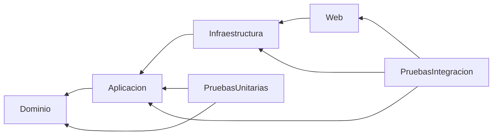
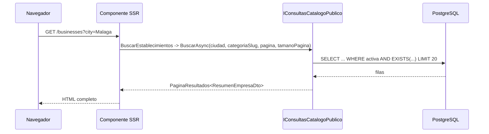
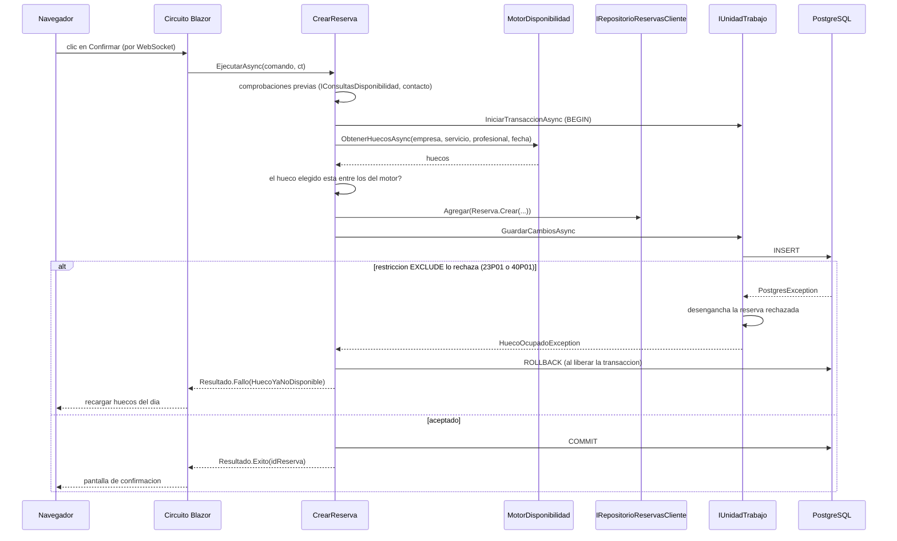

# Arquitectura técnica

**Fase 3.** Ubicación final: `docs/arquitectura.md`.

Convierte el modelo de dominio (Fase 2) en una solución ejecutable. Su objetivo es que las fases 4 a 7 sean **mecánicas**: si este documento está bien, no queda ninguna decisión que tomar sobre la marcha.

Entradas: SPEC §4 (decisiones D-xx), §8 (capas), §10 (multi-tenancy), §12 y §13 (motor y concurrencia), `docs/modelo-dominio.md`.

---

# 1. Decisiones de arquitectura

| # | Decisión | Resolución |
|---|---|---|
| A-01 | Forma de los casos de uso | **Una clase por caso de uso**, con un único método `EjecutarAsync`. Sin mediador, sin bus |
| A-02 | Resultado de los casos de uso | `Resultado` / `Resultado<T>` para desenlaces de negocio previstos. `DominioException` **solo** para estados imposibles (§6) |
| A-03 | Resolución del contexto de empresa | **Claim `empresa_id`** en el `ClaimsPrincipal`, emitido al iniciar sesión. Sin consulta a base de datos por operación (§8) |
| A-04 | Ciclo de vida del `ContextoDatos` | Scoped, **construido desde `IDbContextFactory`** para que convivan Identity y Blazor Server (§9.2) |
| A-05 | Seguimiento de cambios de EF | `NoTracking` **por defecto**; seguimiento explícito con `AsTracking()` donde se carga para modificar (§9.3) |
| A-06 | Invalidación de sesión | `SecurityStamp` más revalidación cada 5 minutos, para que RN-135 alcance a las sesiones ya abiertas (§8.4) |
| A-07 | Gestión de paquetes | **Central Package Management** (`Directory.Packages.props`) y ajustes comunes en `Directory.Build.props` (§3) |
| A-08 | Avisos del compilador | `TreatWarningsAsErrors` activado en toda la solución desde el primer día (§3.2) |
| A-09 | Validación | Tres capas con responsabilidades disjuntas y **sin duplicar reglas** (§7) |
| A-10 | Contenedor de pruebas de integración | **Uno solo para toda la suite**, compartido con `ICollectionFixture` (§12.2) |
| A-11 | Despacho de eventos | **Después del commit**, publicado explícitamente por el caso de uso. Nunca dentro de `SaveChanges` (§13.1) |
| A-12 | Transporte de eventos | `Channel<T>` en memoria más un `BackgroundService`, con un ámbito de DI nuevo por evento (§13.2) |
| A-13 | Envío de correo | `IServicioEmail` en `Aplicacion`, MailKit en `Infraestructura`, implementación falsa en desarrollo y pruebas (§13.3) |
| A-14 | Plantillas de correo | Componentes Razor renderizados a cadena con `HtmlRenderer`. Sin motor de plantillas propio (§13.4) |
| A-15 | Cifrado de datos personales | `ProtectPersonalData` de Identity con AES-256-GCM e índice determinista propios, más conversores de EF para `Reserva`. **Sin paquetes nuevos** (§8.5) |
| A-16 | Endurecimiento | Las seis medidas E-1 a E-6 entran **todas**, incluida la CSP. `AddRateLimiter` del marco, sin paquetes. `MarkupString` prohibido en plantillas y ficha pública (§14) |
| A-17 | Formato de solución y versiones de pruebas | Solución **`.slnx`**, el formato por defecto del SDK de .NET 10. **FluentAssertions 7.x** (Apache 2.0) y **xUnit 2.x** con `xunit.runner.visualstudio`. No se sube de versión mayor sin decidirlo antes (§2.2) |
| A-18 | Supresión de analizadores | Solo mediante `.editorconfig`, con comentario del motivo en cada regla y registro en §3.3. Nunca `#pragma` ni `NoWarn` (§3.3) |

---

# 2. Mapa de la solución

```text
PlataformaReservas.slnx        solucion (formato XML del SDK de .NET 10)
Directory.Build.props          ajustes comunes de compilacion
Directory.Packages.props       versiones centralizadas de paquetes
.editorconfig                  supresiones de analizadores justificadas (§3.3)
.gitignore
.gitattributes                 finales de linea LF para los scripts de hook
AGENTS.md  CLAUDE.md  README.md
docker-compose.yml             servicio postgres desde la Fase 5; servicio web en la Fase 18 (§11.4)
.env                           credenciales locales de PostgreSQL (NO se versiona)
.config/dotnet-tools.json      herramientas locales: dotnet-ef con version fijada
Dockerfile                     Fase 18: multietapa (sdk:10.0 compila y publica, aspnet:10.0 ejecuta como usuario no root)
.dockerignore                  Fase 18: deja fuera del contexto secretos, artefactos de compilacion, documentacion y pruebas

.claude/                       herramientas de Claude Code
├── settings.json              permisos y hook de compilacion
├── hooks/compilar.sh
├── skills/                    procedimientos: /fase, /revisar, /auditar-pruebas
└── agents/                    revisores en solo lectura (arquitectura, seguridad, pruebas)

src/
├── PlataformaReservas.Dominio
├── PlataformaReservas.Aplicacion
├── PlataformaReservas.Infraestructura
└── PlataformaReservas.Web

tests/
├── PlataformaReservas.PruebasUnitarias
└── PlataformaReservas.PruebasIntegracion

docs/
├── TFM_PlataformaReservas_SPEC.md
├── PROJECT_PLAN.md
├── casos-uso.md  reglas-negocio.md  modelo-dominio.md  arquitectura.md
├── seguridad.md  ...
└── fases/                     especificaciones de fase generadas con /fase
```

`.claude/` y `.gitattributes` son **herramientas del proceso de desarrollo**, no parte del producto: no los crea ninguna fase, los instala el desarrollador.

**Qué se versiona en GitHub:** solo el producto —código, proyectos, configuración sin secretos, `docker-compose.yml` y `.config/dotnet-tools.json`—. **La documentación (`*.md`) y `.claude/` se mantienen en local y no se versionan**, por decisión del desarrollador: el máster no exige entregar la documentación del proceso. Que un fichero de `docs/` o de `.claude/` no aparezca en `git status` **no es un hallazgo de revisión**.

## 2.1. Dependencias entre proyectos



`PruebasIntegracion` referencia a `Web` para leer por reflexión los atributos de ruta y de autorización de los componentes (`Autorizacion/PruebasAutorizacionRutas.cs`). *Fase 17, duda 2.* **Desde la Fase 19** prueba además, directamente, las clases de `Web` que no son páginas: `LimitacionFrecuencia`, `CabecerasSeguridad` (con un `ApplicationBuilder` mínimo, solo su *middleware*) e `IdentityRedirectManager`; y renderiza `FichaEstablecimiento` con `HtmlRenderer` para RN-171. No arranca la aplicación entera. *Autorizado por el desarrollador el 2026-10-25 (`fase-19.md` §6 y `/revisar 19`).*

`Web` referencia a `Infraestructura` **solo para registrar servicios** en el arranque. Ningún componente Blazor usa un tipo de `Infraestructura`: todos hablan con interfaces de `Aplicacion`.

**Única excepción: `Web/Cuenta/**`**, las páginas de Identity que vienen de la plantilla (§2.3). Por fuerza trabajan con `Usuario`, `UserManager<Usuario>` y `SignInManager<Usuario>`, y delegan el registro y la solicitud de restablecimiento en `RegistroCliente` y `SolicitudRestablecimientoClave` (`Infraestructura/Identidad/`); desde la Fase 19 también el inicio de sesión (`InicioSesion`) y el restablecimiento (`RestablecimientoClave`). Ningún otro componente puede usar tipos de `Infraestructura`. *Decidido en la Fase 6.*

**Excepción acotada: las constantes de política de `RolesIdentidad`** (`PoliticaPropietario`, `PoliticaCliente`). `Components/App/_Imports.razor`, `Components/MiCuenta/_Imports.razor` y `Layout/MenuNavegacion.razor` las usan en `[Authorize(Policy = ...)]` y en `<AuthorizeView Policy="...">`, en lugar de repetir los literales `"EsPropietario"` y `"EsCliente"`. Son constantes de texto, sin comportamiento ni dependencias: el nombre de la política queda definido en un solo sitio, y un error tipográfico pasa a ser un error de compilación. Ningún otro tipo de `Infraestructura` entra en esos componentes. *R8 de la Fase 19, autorizado por el desarrollador el 2026-10-25 (`/revisar 19`).*

Esa dependencia de arranque es la concesión habitual de Clean Architecture y conviene nombrarla en la memoria. La alternativa ortodoxa —un proyecto `Arranque` aparte que sea el único que conoce `Infraestructura`— añade un proyecto para resolver un problema que aquí no se da.

## 2.2. Paquetes por proyecto

| Proyecto | Paquetes |
|---|---|
| `Dominio` | **Ninguno.** Solo la biblioteca base |
| `Aplicacion` | `FluentValidation`, `Microsoft.Extensions.DependencyInjection.Abstractions`, `Microsoft.Extensions.Logging.Abstractions` |
| `Infraestructura` | `Microsoft.EntityFrameworkCore`, `Npgsql.EntityFrameworkCore.PostgreSQL`, `EFCore.NamingConventions`, `Microsoft.AspNetCore.Identity.EntityFrameworkCore`, **`MailKit`**. Además, `<FrameworkReference Include="Microsoft.AspNetCore.App" />` (ver la nota) |
| `Web` | `Serilog.AspNetCore`, `Serilog.Sinks.Console`, `Microsoft.AspNetCore.Components.QuickGrid`, **`Microsoft.EntityFrameworkCore.Design`** |
| `PruebasUnitarias` | `xunit` **2.x**, `xunit.runner.visualstudio`, `FluentAssertions` **7.x**, `Microsoft.NET.Test.Sdk` |
| `PruebasIntegracion` | lo anterior más `Testcontainers.PostgreSql`, `Respawn` |

> **`Microsoft.EntityFrameworkCore.Design` va en `Web`, no en `Infraestructura`.** Las herramientas `dotnet ef` lo exigen en el **proyecto de arranque**, que es `Web` (todos los comandos de `AGENTS.md` §11 usan `-s src/PlataformaReservas.Web`). Además, ese paquete se instala como dependencia solo de desarrollo y **no se propaga** de un proyecto a otro, así que ponerlo en `Infraestructura` no sirve: el primer `dotnet ef migrations add` fallaría con *"Your startup project doesn't reference Microsoft.EntityFrameworkCore.Design"*. Las migraciones siguen viviendo en `Infraestructura/Persistencia/Migraciones/`: el código generado solo usa EF Core, no el paquete de diseño.
>
> *Corrección aplicada al revisar la especificación de la Fase 4: la versión anterior de este documento lo situaba en `Infraestructura`.*

> **`Infraestructura` expone sus tipos internos solo a `PlataformaReservas.PruebasIntegracion`** (`InternalsVisibleTo` en su `.csproj`). Lo usa la prueba de `RevalidadorIdentidad.SelloVigenteAsync`, que no tiene otra vía de acceso. *2026-10-04.* **`Web` hace lo mismo desde la Fase 19**, para probar `IdentityRedirectManager` (`internal`, de la plantilla de Identity). *Autorizado por el desarrollador el 2026-10-25.*

> **`Infraestructura` referencia el marco compartido `Microsoft.AspNetCore.App`.** No es un paquete NuGet: es el mismo marco que ya usa `Web`. Lo exigen `AddSignInManager`, `SignInManager<Usuario>`, las cookies de Identity y `RevalidatingServerAuthenticationStateProvider`, de los que dependen `AgregarInfraestructura` y `RevalidadorIdentidad` (§8). *Aprobado por el desarrollador en la Fase 6.*

**Versiones mayores fijadas (A-17):**

| Paquete | Versión | Motivo |
|---|---|---|
| `FluentAssertions` | **7.x** | Desde la 8.0 la licencia es comercial (Xceed), gratuita solo para uso no comercial. La 7.x es Apache 2.0, sin dudas de licencia en un trabajo que se publica |
| `xunit` | **2.x** | xUnit v3 cambia de paquete (`xunit.v3`) y la firma de `IAsyncLifetime` pasa a `ValueTask`. El `BaseDatosFixture` de §12.2 está escrito para v2 |
| `xunit.runner.visualstudio` | la que corresponda a xUnit 2.x | Imprescindible para que `dotnet test` descubra las pruebas |

Subir cualquiera de las dos a su siguiente versión mayor es una decisión, no una actualización: se decide antes y se refleja aquí.

> `Dominio` sin paquetes **no es cosmético**: es lo que hace que las 13 pruebas del motor corran en milisegundos y sin base de datos. Hay una prueba de arquitectura que lo comprueba (`modelo-dominio.md` §9.1).

`QuickGrid` se usa para los listados de reservas y de servicios: viene en el paquete de componentes de ASP.NET Core y evita escribir paginación y ordenación a mano en cuatro pantallas.

`Respawn` está referenciado para limpiar la base de datos entre pruebas, pero hoy no se usa: las pruebas se aíslan por datos únicos (§12.2).

## 2.3. Estructura interna

```text
Dominio/
├── Compartido/       EntidadBase, DominioException, Validacion (interna)
├── Entidades/        Empresa, Servicio, Profesional, Horario, ...
├── ValueObjects/     PoliticasReserva, IntervaloHorario, FranjaHoraria, Slug
├── Repositorios/     IRepositorioEmpresas, IRepositorioServicios, IRepositorioProfesionales,
│                     IRepositorioReservas, IRepositorioMiembros, IRepositorioReservasCliente
├── Eventos/          IEventoDominio y los seis eventos
└── Enumeraciones/    EstadoReserva, RolMiembro, OrigenCancelacion

Aplicacion/
├── Compartido/       Resultado, Resultado<T>, CodigoError, HuecoOcupadoException, OrdenEspanol
├── Abstracciones/    IContextoEmpresa, IContextoUsuario, IConsultasCatalogoPublico, IConsultasReservaPublica, IConsultasDisponibilidad, IConsultasReservasCliente, IConsultasReservasEmpresa, IRelojSistema,
│                     IUnidadTrabajo, ITransaccion, IServicioCuentas,
│                     IPublicadorEventos, IManejadorEvento, IServicioEmail, IConsultasNotificacion
├── Notificaciones/   manejadores de evento
├── Disponibilidad/   IMotorDisponibilidad, MotorDisponibilidad, HuecoDisponible
├── CasosUso/
│   ├── Empresas/     RegistrarEmpresa, ObtenerConfiguracionEmpresa, ActualizarEmpresa, DarDeBajaEmpresa, ReactivarEmpresa,
│   │                 BuscarEstablecimientos
│   ├── Servicios/    ListarServicios, CrearServicio, ActualizarServicio, DesactivarServicio
│   ├── Profesionales/ ListarProfesionales, CrearProfesional, ActualizarProfesional, DesactivarProfesional,
│   │                  AsociarServicio, DesasociarServicio
│   ├── Horarios/     ObtenerHorarioProfesional, AgregarIntervalo, EliminarIntervalo, MarcarNoDisponible, QuitarExcepcion
│   ├── Reservas/     CrearReserva, CancelarReservaCliente, CancelarReservaEmpresa, CompletarReserva, ConsultarDisponibilidad,
│   │                 ConsultarMisReservas, ConsultarDetalleReserva, ConsultarReservasEmpresa, ConsultarPanelEmpresa
│   └── Cuenta/       EstablecerTelefono, ConsultarPerfil, ActualizarPerfil, DarDeBajaCuenta
└── Dtos/           una subcarpeta por agregado: Categorias/, Empresas/, Servicios/, Profesionales/, Reservas/; y Cuenta/ para el perfil del usuario.
                    Cada DTO se construye con su método estático ConvertirADto(entidad, ...) (Fase 10)

Infraestructura/
├── RelojSistema.cs
├── EventosSeguridad.cs        mensajes de registro compartidos de los eventos de seguridad (Fase 19)
├── Persistencia/
│   ├── ContextoDatos.cs
│   ├── UnidadTrabajo.cs       IUnidadTrabajo sobre el ContextoDatos del ambito
│   ├── Configuraciones/   una clase IEntityTypeConfiguration por entidad
│   ├── Conversores/       ValueConverter de cada objeto de valor y ConversorCifrado
│   ├── Migraciones/
│   └── DatosIniciales/
├── Repositorios/
├── Consultas/             ConsultasCatalogoPublico, ConsultasReservasCliente, ConsultasReservasEmpresa, ConsultasNotificacion, CondicionPublicable
├── Identidad/             FabricaClaimsUsuario, ContextoEmpresa, ContextoUsuario, ClaimsSesion, RemitenteIdentity,
│                          ProtectorDatosPersonales, ProtectorBusqueda, AnilloClaves,
│                          ConfirmacionUsuarioActivo, SolicitudRestablecimientoClave,
│                          RegistroCliente, RolesIdentidad, ServicioCuentas,
│                          InicioSesion, RestablecimientoClave (Fase 19)
├── Eventos/               ColaEventos, ProcesadorEventos
├── Correo/                ServicioEmailSmtp, ServicioEmailRegistro, EnmascaradoCorreo, plantillas Razor
├── Errores/               TraductorErroresPostgres
└── InyeccionDependencias.cs

Web/
├── Components/
│   ├── Compartido/   Dialogo (ventana emergente reutilizable)
│   ├── Layout/       MainLayout, MenuNavegacion; AppLayout (area de empresa) y CuentaLayout (paginas de Identity)
│   ├── Publico/       landing, buscador, ficha
│   ├── Reserva/       flujo de reserva
│   ├── MiCuenta/
│   └── App/           area de empresa
├── Cuenta/            paginas SSR de Identity; DestinoInicioSesion (area privada tras iniciar sesion, segun las politicas)
├── LimitacionFrecuencia.cs   E-5 (Fase 19, §14.5)
├── CabecerasSeguridad.cs     E-6 (Fase 19, §14.6)
├── wwwroot/app.css           sistema de diseño: variables, base y componentes comunes
└── Program.cs
```

> **Los contratos de repositorio viven en `Dominio/Repositorios`, no en `Aplicacion/Abstracciones`.** Un repositorio es un concepto del modelo (una colección de agregados, en el sentido de DDD), y sus firmas solo usan entidades, objetos de valor y tipos de la biblioteca base, así que `Dominio` sigue sin referenciar nada. En `Aplicacion/Abstracciones` quedan los puertos que pertenecen a la aplicación: los que devuelven DTOs (`IConsultasCatalogoPublico`), `IConsultasDisponibilidad`, la transacción (`IUnidadTrabajo`, `ITransaccion`, que abre y cierra el caso de uso), el contexto de sesión (`IContextoEmpresa`, `IContextoUsuario`), el reloj, las cuentas de Identity, el correo y los eventos. *Decidido en la Fase 8 (2026-10-10), a propuesta del desarrollador.*

Una carpeta de casos de uso **por agregado**, no por tipo de operación. Buscar "todo lo que le puede pasar a una reserva" es una pregunta frecuente; buscar "todos los comandos de la aplicación" no lo es.

### Dos apuntes sobre los nombres de carpeta

**`ValueObjects` se queda en inglés**, como excepción de carpeta a la nomenclatura en castellano (SPEC §3; la otra excepción es el sufijo `Exception` de las clases de excepción, que exige CA1710). Es un término técnico consolidado del diseño dirigido por el dominio y su traducción literal, *ObjetosValor*, no se usa en la práctica ni se lee bien. La excepción es exactamente esa carpeta: **`Entidades`, `Eventos`, `Enumeraciones` y el resto siguen en castellano**, y los tipos que contiene también (`PoliticasReserva`, `FranjaHoraria`).

**`Compartido` en lugar de `Comun`.** Recoge lo transversal de cada capa: `EntidadBase`, `DominioException` y `Validacion` en `Dominio` (esta última `internal`: las comprobaciones de invariantes comunes a las fábricas `Crear`, añadida en la Fase 5), `Resultado` y `CodigoError` en `Aplicacion`.

Se descarta un **proyecto `Compartido` separado**. Con seis proyectos y cuatro o cinco tipos transversales, un séptimo proyecto añade una referencia más que gestionar y una tentación permanente: acaba convirtiéndose en el cajón donde va a parar todo lo que no se sabe dónde poner, y desde ahí crea dependencias que la arquitectura de §2.1 prohíbe. Con una carpeta por capa, cada tipo transversal pertenece a la capa donde se usa y no puede filtrarse a otra.

Si algún día un tipo tuviera que compartirse entre `Dominio` y `Aplicacion`, la respuesta correcta sería ponerlo en `Dominio`, que es de quien depende `Aplicacion`.

### Estilos de la interfaz

Hay CSS propio y ninguna biblioteca: ni Bootstrap, ni Tailwind, ni fuentes externas. *Tarea ad hoc fuera de SPEC §19, autorizada por el desarrollador el 2026-10-25.*

- **`wwwroot/app.css`.** Define las variables de color, radio, sombra y espaciado en `:root`:
  - principal verde azulado `#0F766E` y acento violeta `#7C3AED`;
  - el modo oscuro solo redefine esas variables con `prefers-color-scheme`.

  Además, la base tipográfica (pila del sistema) y los componentes comunes: botones, formularios, avisos, tablas, `.resumen`, `.estado` y `.pestanas`.
- **Cada página** tiene en su `.razor.css` solo su maquetación, y la escribe con esas variables.
- **Compatibilidad con la plantilla.** `app.css` define también las clases de la plantilla de Identity que usan `Web/Cuenta/` y algunas páginas de `App/`: `form-control`, `form-floating`, `btn-*`, `alert-*`, `row`/`col-*`, `mb-3`… Son la excepción de plantilla de `AGENTS.md` §5; así no se reescriben sus formularios.
- **Restricciones de la CSP (§14.6):**
  - ningún atributo `style` ni `<style>` en el marcado;
  - iconos como `<svg>` en línea, sin colores con `var()` en los atributos;
  - el menú del móvil es un `<details>` y el enlace activo lo marca `NavLink`, porque las páginas públicas son SSR estático y no hay JavaScript propio.
- **Listado y ventana emergente.** Servicios y Profesionales (`App/`) muestran un listado compacto (`.listado`) con Editar y Desactivar en cada fila. Crear y editar se hacen en una ventana emergente, `Components/Compartido/Dialogo.razor`: Blazor puro, foco con `FocusAsync` y cierre con Escape, sin JavaScript propio. Desactivar pide confirmación en otra ventana. En Profesionales, los servicios que presta se marcan en la ventana y se aplican al guardar con `AsociarServicio` y `DesasociarServicio`, una llamada tras otra. *Desarrollador, 2026-10-25.*
- **Desplegables.** Los `select` usan `appearance: base-select` dentro de `@supports`: la lista desplegada es un *popover* de la página, con el ancho del control y sin salirse de la pantalla. Los navegadores sin soporte muestran la lista nativa. *Desarrollador, 2026-10-25.*
- **Categorías de la portada.** Son píldoras dentro de la cabecera, debajo del buscador, y siguen enlazando a `/businesses?category=…` (SPEC §5.1 y §11). Sustituyen a la rejilla de tarjetas, por decisión del desarrollador del 2026-10-25.
- **Navegación.** `MenuNavegacion` se pinta dos veces en `MainLayout`: en la barra de escritorio y en el `<details>` del móvil. `AppLayout` añade la navegación del área de empresa: barra lateral desde 1024 px y tira horizontal por debajo.

---

# 3. Compilación

## 3.1. `Directory.Packages.props`

Gestión centralizada de paquetes: las versiones se declaran una vez y los `.csproj` solo nombran el paquete. Con seis proyectos, evita que dos acaben con versiones distintas de EF Core — un fallo que se manifiesta en tiempo de ejecución y cuesta encontrar.

```xml
<Project>
  <PropertyGroup>
    <ManagePackageVersionsCentrally>true</ManagePackageVersionsCentrally>
  </PropertyGroup>
  <ItemGroup>
    <PackageVersion Include="Npgsql.EntityFrameworkCore.PostgreSQL" Version="..." />
    <!-- ... -->
  </ItemGroup>
</Project>
```

**Dependencias transitivas vulnerables (E-2).** Si una dependencia indirecta tiene una vulnerabilidad conocida y el paquete que la trae aún no depende de la versión corregida, se fija la versión con `CentralPackageTransitivePinningEnabled` y su `PackageVersion`, con un comentario del motivo. Nunca se silencia `NU1902` ni `NU1903` (A-18). Caso actual: `System.Security.Cryptography.Pkcs` 10.0.13, transitiva de MimeKit (CVE-2026-70162 y CVE-2026-84008).

## 3.2. `Directory.Build.props`

```xml
<Project>
  <PropertyGroup>
    <TargetFramework>net10.0</TargetFramework>
    <Nullable>enable</Nullable>
    <ImplicitUsings>enable</ImplicitUsings>
    <TreatWarningsAsErrors>true</TreatWarningsAsErrors>
    <AnalysisLevel>latest-recommended</AnalysisLevel>
    <EnforceCodeStyleInBuild>true</EnforceCodeStyleInBuild>
    <InvariantGlobalization>false</InvariantGlobalization>
    <NuGetAudit>true</NuGetAudit>              <!-- E-2, Fase 19 (§14.2) -->
    <NuGetAuditMode>all</NuGetAuditMode>
  </PropertyGroup>
</Project>
```

**`TreatWarningsAsErrors` desde el primer día, no al final.** Activarlo en la Fase 19 significa enfrentarse a cientos de avisos acumulados y la tentación de desactivarlo. Activado desde el principio, cada aviso se corrige cuando aparece y cuesta segundos.

Tiene un efecto adicional que importa en este proyecto: el código generado por IA con nulabilidad descuidada **no compila**, así que el fallo se detecta al instante en lugar de convertirse en una excepción de referencia nula tres fases después.

`InvariantGlobalization` en `false` porque la comparación de ciudades ignora acentos (RN-110) y eso necesita las tablas de globalización reales.

## 3.3. `.editorconfig` y supresión de analizadores (A-18)

Con `latest-recommended` y `TreatWarningsAsErrors`, algún analizador acabará saltando sobre código correcto. La regla para esos casos es única y no admite atajos:

1. **Nunca `#pragma warning disable` ni `<NoWarn>`.** Ocultan la supresión dentro del código o de un `.csproj`, donde nadie la revisa.
2. **Solo en `.editorconfig`**, en la raíz, con **el alcance mínimo** (una carpeta o un patrón de ficheros, nunca todo el repositorio si no hace falta) y **un comentario encima de cada regla** que explique el motivo.
3. **Cada supresión se anota en la tabla de abajo.** Una supresión que no está en la tabla no está autorizada.
4. **Cualquier supresión nueva se para y se pregunta** antes de añadirla. La única aprobada de antemano es CA1707 en `tests/`.

```ini
root = true

# CA1707: los identificadores no deben contener guiones bajos.
# En pruebas, el nombre con guiones bajos es la convencion de xUnit y documenta
# el comportamiento verificado (modelo-dominio.md §9.1). Solo en tests/.
[tests/**.cs]
dotnet_diagnostic.CA1707.severity = none
```

**Supresiones autorizadas:**

| Regla | Alcance | Motivo | Aprobada |
|---|---|---|---|
| CA1707 | `tests/**.cs` | Convención de nombres de xUnit | De antemano (Fase 4) |
| Todas (`generated_code = true`) | `src/PlataformaReservas.Infraestructura/Persistencia/Migraciones/**.cs` | Código generado por `dotnet ef migrations add`, que se regenera en cada migración; CA1861 saltaba sobre él. Los `#pragma warning disable` que escribe EF en las migraciones, el designer y el snapshot (`612, 618`, `CA1814`…) los genera la herramienta: no son supresiones de este proyecto y no se tocan | Desarrollador (Fase 5) |
| Todas (`generated_code = true`) | `src/PlataformaReservas.Web/Cuenta/**` | Páginas de cuenta copiadas de la plantilla `dotnet new blazor --auth Individual` (§8.1, R-4). Reescribirlas al estilo del proyecto no cabe en el presupuesto y aumenta el riesgo de romper la integración con Identity. Solo se traducen los textos visibles | Desarrollador (Fase 6, duda 5) |
| CA1000 | `src/PlataformaReservas.Aplicacion/Compartido/ResultadoT.cs` | `Resultado<T>.Exito` y `Resultado<T>.Fallo` son estáticos dentro de un tipo genérico: es la firma literal de §6 | Desarrollador (Fase 8) |

> **Los analizadores no se ejecutan sobre ningún `.razor`**, esté o no en `Web/Cuenta/`. El código que genera Razor se trata como generado. Comprobado en la Fase 8 (2026-10-10): CA1305 y CA1861 dan error en un `.cs` de `Web` y no saltan en `@code` de ninguna página. Por eso `generated_code = true` sobre `Cuenta/**` solo afecta a sus `.cs`. La consecuencia es que la lógica de las páginas tiene que ser mínima (AGENTS §6): todo lo que merezca análisis vive en `Aplicacion` o en un `.cs`. *Decidido por el desarrollador tras la revisión de la Fase 8.*

Si al compilar las plantillas de la Fase 4 salta alguna otra regla, se para, se decide y se añade aquí con su motivo antes de tocar el `.editorconfig`.

---

# 4. Flujo de una petición

Los dos modos de render producen flujos **genuinamente distintos**, y no distinguirlos es la fuente de la mitad de los problemas de Blazor Server.

## 4.1. Página pública — SSR estático



Sin circuito, sin WebSocket, sin estado en servidor. La petición empieza y acaba. El ámbito de DI es la petición, como en cualquier aplicación web.

`IConsultasCatalogoPublico` **no recibe `IContextoEmpresa`**: por construcción no puede filtrar mal (SPEC §10.3).

El buscador pasa por el caso de uso `BuscarEstablecimientos`, que aplica RN-110, RN-112 y RN-113 (ciudad de 2 caracteres como mínimo y página de 20 como máximo) antes de llamar a `BuscarAsync`, que devuelve `PaginaResultados<ResumenEmpresaDto>` con el total. La ficha llama directamente a `ObtenerFichaAsync(slug)`, que devuelve `FichaEmpresaDto` o `null` si la empresa no existe, está inactiva o no es publicable (RN-116). Las dos consultas filtran por activa y publicable con un `EXISTS` (RN-16, RN-109). La ciudad se compara con la colación ICU no determinista `ciudad_sin_acentos` de la columna `empresas.ciudad` (RN-110). *Fase 13, dudas 2, 3 y 4.*

El flujo de reserva (`/book/{slug}`) lee sus datos con un segundo puerto público, `IConsultasReservaPublica.ObtenerDatosReservaAsync(slug)`, que devuelve `DatosReservaDto` (servicios activos con su ventana efectiva, RN-23, y los profesionales activos que los prestan) o `null` en los mismos casos que la ficha. Lo implementa la misma clase `ConsultasCatalogoPublico`, así que el filtro de publicable sigue existiendo una sola vez. *Fase 14, duda 1, modificada en la implementación.*

`IConsultasDisponibilidad`, el puerto de lectura del motor, tampoco lo recibe: el motor lo usan el flujo público y el de cliente, que no tienen el claim `empresa_id`. Filtra en cada consulta por el `empresaId` que recibe, sin seguimiento, y devuelve DTOs de lectura (`EmpresaDisponibilidadDto`, `ServicioDisponibilidadDto`, `ProfesionalDisponibilidadDto`, `ReservaOcupadaDto`): ninguna entidad cruza el puerto. *Fase 10, duda 1.*

## 4.2. Crear reserva — InteractiveServer



Aquí el ámbito de DI es **el circuito**, no la acción. De ahí A-04 y A-05.

La página es `Components/Reserva/FlujoReserva.razor`. Encadena siempre en secuencia:

1. `ConsultarDisponibilidad` (CU-03), que delega en el mismo `IMotorDisponibilidad` (RN-60).
2. `EstablecerTelefono`, si el perfil no tiene teléfono (RN-81).
3. `CrearReserva`.

El rango de fechas del selector y la hora local de los huecos salen de `MotorDisponibilidad.FechasReservables` y `MotorDisponibilidad.ALocal`, para que la conversión de zona horaria siga en un único punto (RN-102). Sin sesión, la selección viaja en el `returnUrl` del inicio de sesión (`service`, `staff`, `date`, `start`) y se restaura al volver; `start` solo se acepta si coincide con un hueco recargado. *Fase 14, dudas 2 a 5.*

## 4.3. La trampa del ámbito en Blazor Server

En una aplicación web clásica, *scoped* significa "una petición": milisegundos. **En Blazor Server significa "un circuito": potencialmente horas.** Un servicio scoped registrado sin pensar vive mientras el usuario tenga la pestaña abierta.

Consecuencias reales:

| Problema | Efecto | Mitigación adoptada |
|---|---|---|
| El `DbContext` acumula entidades en el rastreador durante todo el circuito | Memoria que crece y datos obsoletos que se sirven como buenos | `NoTracking` por defecto (A-05) |
| Dos operaciones concurrentes sobre el mismo `DbContext` | `InvalidOperationException: A second operation was started on this context` | Regla explícita: **nunca dos casos de uso en paralelo dentro de un componente** (§9.4) |
| `IContextoEmpresa` resuelto una vez por circuito | Ninguno: se lee del `ClaimsPrincipal`, que no cambia dentro del circuito | — |

---

# 5. Casos de uso

## 5.1. Forma (A-01)

Una clase por caso de uso. Un método público. Dependencias por constructor.

```csharp
public sealed class CrearReserva(
    IContextoUsuario contexto,
    IConsultasDisponibilidad consultas,
    IMotorDisponibilidad motor,
    IServicioCuentas cuentas,
    IRepositorioReservasCliente reservas,
    IUnidadTrabajo unidadTrabajo,
    IRelojSistema reloj)
{
    public async Task<Resultado<Guid>> EjecutarAsync(
        CrearReservaComando comando, CancellationToken ct) { /* ... */ }
}
```

Los casos de uso no usan `IValidator`: validan construyendo objetos de valor (un `DominioException` se convierte en `Fallo(Validacion)`) y comprobando existencia y estado con lecturas. *Fase 11, duda 7.*

**Por qué una clase por caso de uso y no un servicio con quince métodos:**

- Cada clase declara en su constructor **exactamente** lo que necesita. Un `ServicioReservas` con quince métodos acaba inyectando ocho dependencias de las que cada método usa tres.
- La prueba de un caso de uso monta solo sus dobles.
- Y el motivo que más pesa en este proyecto: **es la unidad natural de trabajo con IA.** "Implementa `CancelarReservaCliente` siguiendo CU-10" es una tarea acotada, revisable de una sentada y con un diff pequeño. "Añade un método a `ServicioReservas`" invita a tocar el resto del fichero.

Nombres: verbo más sustantivo, igual que el caso de uso que implementan. `CrearReserva`, `CancelarReservaCliente`, `DarDeBajaEmpresa`. La correspondencia con `docs/casos-uso.md` es uno a uno y se puede comprobar de un vistazo.

## 5.2. Entrada y salida

- **Entrada:** un `record` de comando con datos primitivos. Nunca entidades de dominio, nunca tipos de ASP.NET. **Un caso de uso sin datos de entrada no lleva comando**: la empresa sale de `IContextoEmpresa`, así que la firma es `EjecutarAsync(CancellationToken ct)`. Es el caso de `DarDeBajaEmpresa`, `ReactivarEmpresa`, `ObtenerConfiguracionEmpresa`, `ListarServicios` y `ListarProfesionales`. *Decidido tras la revisión de la Fase 8 (2026-10-10).*
- **Salida:** `Resultado` o `Resultado<T>`, nunca entidades. Las pantallas reciben DTOs.

Esto mantiene a `Web` sin acceso a las entidades, que es lo que impide que un componente llame a `reserva.Completar(...)` saltándose el caso de uso.

## 5.3. `IRelojSistema`

```csharp
public interface IRelojSistema { DateTime AhoraUtc { get; } }
```

Existe por una razón concreta: **las 13 pruebas del motor y las de estado de reserva dependen de "ahora"**. Sin reloj inyectable, la prueba de antelación mínima (RN-54) o la de "no se puede cancelar una reserva ya empezada" (RN-93) serían no deterministas o exigirían fechas lejanas y frágiles.

Implementación de producción: tres líneas devolviendo `DateTime.UtcNow`. En pruebas, un reloj fijo.

Es también la forma de hacer cumplir la prohibición de `DateTime.Now`: si el código necesita la hora, tiene el reloj inyectado y no hay motivo para llamar a `DateTime` directamente.

---

# 6. Resultado frente a excepción (A-02)

Distinción explícita, porque mezclarlas es la fuente habitual de flujo de control por excepciones.

| Situación | Mecanismo | Ejemplo |
|---|---|---|
| **Desenlace de negocio previsto** que la interfaz debe tratar con elegancia | `Resultado.Fallo(codigo, mensaje)` | El hueco se ocupó mientras el usuario confirmaba (RN-80); el correo ya está registrado; el recurso es de otra empresa |
| **Estado imposible**: una invariante que el código nunca debería haber intentado romper | `throw new DominioException(...)` | Completar una reserva que ya está cancelada; `HoraInicio >= HoraFin` |
| **Fallo técnico** | Excepción, sube al manejador global | Base de datos caída, tiempo de espera agotado |

```csharp
public sealed class Resultado<T>
{
    public bool EsExito { get; }
    public T? Valor { get; }
    public CodigoError? Codigo { get; }
    public string? Mensaje { get; }

    public static Resultado<T> Exito(T valor);
    public static Resultado<T> Fallo(CodigoError codigo, string mensaje);
}

public enum CodigoError
{
    NoEncontrado, Validacion, HuecoYaNoDisponible, EstadoNoValido,
    Conflicto, NoAutorizado
}
```

**Por qué `HuecoYaNoDisponible` es `Resultado` y no excepción**: ocurre en el camino caliente y en condiciones normales, cada vez que dos personas compiten por la misma hora. No es un error del programa: es el sistema funcionando. Las excepciones son caras y, sobre todo, comunican mal la intención — quien lea el código verá un desenlace esperado tratado como catástrofe.

**Por qué `NoEncontrado` también es `Resultado`**: RN-03 exige responder "no encontrado" al acceso entre empresas, que es una respuesta legítima y frecuente.

**Excepción documentada (Fase 17, duda 3):** `EstablecerTelefono` comprueba antes si el usuario ya tiene teléfono, pero conserva un `catch (DominioException)` que convierte en `Conflicto` la carrera entre dos pestañas (la otra guarda entre la lectura y la escritura). Lo fija `PruebasEstablecerTelefono`.

Los métodos del dominio **siempre lanzan**: no conocen `Resultado`, que es un tipo de `Aplicacion`. El caso de uso comprueba las precondiciones antes de llamar y convierte en `Resultado`; si aun así el dominio lanza, es un fallo de programación y debe verse.

---

# 7. Validación en tres capas (A-09)

Responsabilidades **disjuntas**. Cada regla vive en exactamente un sitio.

| Capa | Herramienta | De qué se ocupa | Ejemplo |
|---|---|---|---|
| Interfaz | `EditForm` + anotaciones | Comodidad: campo obligatorio, formato, longitud. **Nunca la única defensa** | "El nombre es obligatorio" mientras se teclea |
| Aplicación | FluentValidation sobre el comando | Forma y coherencia de la entrada, y reglas que necesitan varios campos o una consulta | `AntelacionMinimaMinutos` dentro de rango; el slug no está cogido |
| Dominio | Constructores y métodos | **Invariantes.** Lo que jamás puede ser falso en una entidad válida | `HoraInicio < HoraFin`; dos intervalos del mismo día no se solapan |

**La regla que evita la duplicación:** si una regla protege un invariante de entidad, va **solo** en el dominio; la aplicación no la repite, se limita a dejar que el dominio lance y a traducir. Si una regla es sobre la *entrada* —formato, existencia, permisos— va **solo** en el validador.

**Transiciones de estado: duplicación consciente** (*Fase 11, revisión 2026-10-12*). Las precondiciones de una transición (`Completar` exige `Confirmada` y `FinUtc < ahora`; `CancelarPorCliente`, `InicioUtc > ahora`) son a la vez invariante de la entidad y desenlace de negocio previsto que la interfaz debe tratar bien. Por eso viven en los dos sitios, cada uno con su papel:

- **El caso de uso las comprueba antes** y devuelve `Fallo(EstadoNoValido)`, como pide §6.
- **El dominio las mantiene** y lanza `DominioException`. Si llega a lanzar, es un fallo de programación y debe verse.

La regla de "un solo sitio" de arriba se aplica a las invariantes **de valor** (rangos, formatos), que el caso de uso traduce sin repetir. Además, los casos de uso no usan FluentValidation (*Fase 11, duda 7*): la capa de aplicación construye objetos de valor y comprueba existencia y estado con lecturas.

Caso frontera resuelto: los rangos de las políticas (RN-26 a RN-29) son invariante de `PoliticasReserva` y por tanto viven en el dominio. El validador de `ActualizarEmpresaComando` **no los repite**; el caso de uso construye el objeto de valor y traduce la `DominioException` a `CodigoError.Validacion`. Así solo hay un sitio donde cambiar 480 si algún día cambia.

---

# 8. Autenticación, autorización y contexto de empresa

## 8.1. Identity

```csharp
builder.Services
    .AddIdentityCore<Usuario>(opciones =>
    {
        opciones.SignIn.RequireConfirmedAccount = true;    // "confirmada" = Activo (§8.4)
        opciones.User.RequireUniqueEmail = true;
        opciones.Password.RequiredLength = 8;
    })
    .AddRoles<IdentityRole<Guid>>()
    .AddEntityFrameworkStores<ContextoDatos>()
    .AddSignInManager()
    .AddClaimsPrincipalFactory<FabricaClaimsUsuario>()
    .AddUserConfirmation<ConfirmacionUsuarioActivo>()
    .AddDefaultTokenProviders();
```

`RequireConfirmedAccount = true` **no verifica el correo**: Identity solo consulta `IUserConfirmation<Usuario>` cuando esta opción está activa, y `ConfirmacionUsuarioActivo` sustituye a la confirmación por correo con la comprobación de `Activo` (RN-135, §8.4). *Decidido en la Fase 6.* El correo sigue sin verificarse, consecuencia directa de no tener correo (§6.2 del SPEC). **Es una limitación de seguridad y hay que declararla en la memoria**: cualquiera puede registrarse con un correo que no le pertenece.

Páginas de cuenta en **SSR**, de la plantilla `dotnet new blazor --auth Individual`. No se montan a mano: la integración de Identity con Blazor Web App tiene aristas —formularios que exigen render estático, antiforgery, redirecciones— que cuestan horas si se reimplementan.

## 8.2. El claim `empresa_id` (A-03)

`FabricaClaimsUsuario` extiende `UserClaimsPrincipalFactory<Usuario, IdentityRole<Guid>>` y, al construir el principal, añade el claim con la empresa del usuario si tiene pertenencia:

```csharp
protected override async Task<ClaimsIdentity> GenerateClaimsAsync(Usuario usuario)
{
    var identidad = await base.GenerateClaimsAsync(usuario);
    var miembro = await _miembros.ObtenerPorUsuarioAsync(usuario.Id, CancellationToken.None);
    if (miembro is not null)
        identidad.AddClaim(new Claim("empresa_id", miembro.EmpresaId.ToString()));
    return identidad;
}
```

`ContextoEmpresa` lo lee del `AuthenticationStateProvider`, con la tarea de estado ya resuelta, que en el servidor siempre lo está. Si no hay estado, o el proveedor lanza porque nadie lo ha fijado, el resultado es "sin empresa": `TieneEmpresa` vale `false` y `EmpresaActualId` lanza. `IHttpContextAccessor` no sirve en `/app`, que es `InteractiveServer`. *Decidido en la Fase 7, duda 6 (a).*

```csharp
public sealed class ContextoEmpresa(AuthenticationStateProvider proveedor) : IContextoEmpresa
{
    public bool TieneEmpresa => ObtenerId() is not null;

    public Guid EmpresaActualId =>
        ObtenerId() ?? throw new InvalidOperationException(
            "No hay empresa en el contexto. Esta operacion requiere un propietario autenticado.");
}
```

**Por qué un claim y no una consulta por operación:** resolver la pertenencia contra la base de datos en cada acción son millones de consultas idénticas a lo largo de una sesión para un dato que no cambia. Con el claim, el coste es cero.

**`IRepositorioMiembros.ObtenerPorUsuarioAsync` no filtra por empresa: filtra por `UsuarioId`.** Es una de las tres excepciones a la regla de SPEC §10.3, y es deliberada. Esa consulta es la que *resuelve* la empresa al iniciar sesión, cuando todavía no hay claim, así que no puede depender de `IContextoEmpresa`. Por eso `RepositorioMiembros` no lo recibe. Es seguro porque el identificador sale del propio usuario autenticado: el mismo eje que el área de cliente (RN-05), y nunca devuelve la pertenencia de otro. *Decidido en la Fase 7, duda 2.*

**Las otras dos excepciones**, decididas en la Fase 8 y anotadas tras su revisión (2026-10-10):

- **`IRepositorioEmpresas.ExisteSlugAsync` no filtra por empresa.** El slug es único en toda la plataforma (RN-10), así que la comprobación tiene que ver todas las empresas. Solo devuelve si existe, nunca datos de otra empresa.
- **`IServicioCuentas.RenovarSelloMiembrosAsync(empresaId)` filtra por el `empresaId` que recibe**, no por el contexto, porque `RepositorioMiembros` no recibe `IContextoEmpresa` (párrafo anterior). Como defensa en profundidad, `ServicioCuentas` lanza `InvalidOperationException` si ese `empresaId` no es `EmpresaActualId` (§8.4).

**Contrapartida honesta:** el claim se queda obsoleto si la pertenencia cambia mientras hay sesión abierta. En el MVP un usuario tiene como máximo una pertenencia y no se transfiere (RN-06), así que solo puede ocurrir al dar de baja la empresa — y ese caso se resuelve con el sello de seguridad (§8.4).

**Que `EmpresaActualId` lance en vez de devolver `Guid.Empty` es deliberado.** Un identificador vacío se propagaría silenciosamente a una consulta y devolvería lista vacía, que parece un resultado legítimo. Una excepción se ve.

## 8.3. Políticas

Se registran en `AgregarInfraestructura`, junto con la autenticación por cookies de Identity, para que las pruebas de integración ejerciten el registro real (*decidido en la Fase 6*):

```csharp
servicios.AddAuthorizationBuilder()
    .AddPolicy(RolesIdentidad.PoliticaCliente, p => p.RequireRole(RolesIdentidad.Cliente))
    .AddPolicy(RolesIdentidad.PoliticaPropietario, p => p
        .RequireRole(RolesIdentidad.Propietario)
        .RequireClaim("empresa_id"));
```

`EsPropietario` exige **rol y claim**: el rol dice qué puede hacer, el claim dice sobre qué empresa. Un propietario sin pertenencia no entra en `/app` — y no debería existir, pero si existiera por un alta a medias, no pasa (RN-15).

**Un propietario tiene también el rol `Cliente`** (`CrearPropietarioAsync`, más la migración de datos `RolClienteParaPropietarios` para los que ya existían). Así puede reservar y entrar en `/my-account`: los roles son acumulativos (`casos-uso.md` l.20). *Fase 15, duda 6.*

Aplicadas con `@attribute [Authorize(Policy = "EsPropietario")]` en el `_Imports.razor` de la carpeta `App/`, y con `EsCliente` en el de `MiCuenta/`, no componente a componente. Una carpeta protegida entera es más difícil de agujerear por olvido que veinte atributos.

## 8.4. Cómo se expulsa a un usuario dado de baja (A-06)

RN-135 dice que un usuario inactivo no puede iniciar sesión. Eso es fácil. Lo difícil es **la sesión que ya está abierta** cuando se le da de baja.

Mecanismo:

1. `DarDeBajaCuenta` comprueba antes que la cuenta sigue activa (`IServicioCuentas.EstaActivaAsync`) y, dentro de la transacción, pone `Activo = false` **y llama a `UserManager.UpdateSecurityStampAsync`**.
2. `IdentityRevalidatingAuthenticationStateProvider` de la plantilla revalida el principal periódicamente contra el sello guardado.
3. Al no coincidir, el circuito pierde la autenticación y el usuario sale.
4. `SignInManager` comprueba además `Activo` al iniciar sesión, a través de `ConfirmacionUsuarioActivo : IUserConfirmation<Usuario>` (§8.1), de modo que no puede volver a entrar.

```csharp
// El intervalo por defecto de la plantilla es de 30 minutos. Se baja a 5.
public sealed class RevalidadorIdentidad : RevalidatingServerAuthenticationStateProvider
{
    protected override TimeSpan RevalidationInterval => TimeSpan.FromMinutes(5);
}
```

**Treinta minutos de ventana para un usuario dado de baja es demasiado; cinco es aceptable y el coste es una consulta ligera por circuito cada cinco minutos.** Bajarlo a segundos convertiría la revalidación en carga constante.

Esto vale igual para RN-130: al dar de baja la empresa se refresca el sello del propietario, el claim `empresa_id` se regenera en el siguiente inicio de sesión y el acceso a `/app` queda coherente.

## 8.5. Cifrado de datos personales en reposo (A-15)

Identity trae esta pieza integrada y es poco conocida: **`ProtectPersonalData`**. Cifra al guardar y descifra al leer toda propiedad marcada con `[ProtectedPersonalData]`, y —lo importante— **resuelve solo el problema de buscar por un campo cifrado**.

```csharp
builder.Services.AddIdentityCore<Usuario>(opciones =>
{
    opciones.Stores.ProtectPersonalData = true;
})
```

`IdentityUser` ya trae marcados `UserName`, `Email` y `PhoneNumber` de fábrica. Basta añadir el atributo a lo propio:

```csharp
public class Usuario : IdentityUser<Guid>
{
    [ProtectedPersonalData] public string NombreCompleto { get; set; } = "";
    [ProtectedPersonalData] public string? Telefono { get; set; }
}
```

### Las tres interfaces que hay que escribir

Microsoft define los huecos pero **no da implementación de producción**. Son tres clases pequeñas, en `Infraestructura/Identidad/`:

| Interfaz | Qué hace | Algoritmo |
|---|---|---|
| `IPersonalDataProtector` | Cifra y descifra un valor | **AES-256-GCM**, nonce aleatorio, se almacena `nonce ‖ tag ‖ texto cifrado` en base64 |
| `ILookupProtector` | Valor **determinista** para poder buscar | **HMAC-SHA256** con una clave distinta de la de cifrado |
| `ILookupProtectorKeyRing` | Devuelve la clave por identificador | Lectura de configuración; el diseño admite rotación aunque el MVP use una sola |

Ambos algoritmos están en `System.Security.Cryptography`: **cero paquetes nuevos**.

### Cómo se sigue pudiendo buscar por correo

Una columna cifrada con nonce aleatorio no se puede consultar, y el correo se busca al iniciar sesión, al comprobar unicidad y al recuperar la contraseña (CU-24).

Identity aplica `ILookupProtector` a **`NormalizedEmail` y `NormalizedUserName`**, que son justo las columnas que usa internamente para buscar. El resultado es determinista, así que el índice único sigue valiendo y `FindByEmailAsync` sigue funcionando. Se consulta por ese valor y se descifra el registro encontrado.

Es el patrón de **índice ciego**, resuelto por el framework. No hay que tocar el `UserStore`.

Contrapartida declarada: el valor determinista **filtra la igualdad** — quien vea la base de datos no sabe qué correo es, pero sí sabe que dos filas comparten el mismo. Es el precio inevitable de poder iniciar sesión.

### Lo que Identity NO cubre

**Solo protege la entidad de usuario.** `Reserva.NombreCliente` y `Reserva.TelefonoCliente` son entidades propias y quedan fuera:

```csharp
constructor.Property(r => r.TelefonoCliente)
    .HasConversion(new ConversorCifrado(protector));
```

**Sin esto no se habría protegido nada**: el nombre y el teléfono seguirían legibles en la tabla `reservas`, justo al lado. Es el paso que más fácil se olvida.

### Qué no se cifra

**Los datos de la empresa se dejan en claro**: `Nombre`, `Email`, `Telefono`, `Direccion`, `CodigoPostal` y `Ciudad` se publican en la ficha del establecimiento. Cifrarlos no protege nada, y `Ciudad` es el filtro obligatorio del buscador (RN-110): cifrada, el buscador desaparece.

### Modelo de amenaza

| Escenario | ¿Protegido? |
|---|---|
| Copia de seguridad o volcado robado | **Sí** |
| Puerto de PostgreSQL expuesto, o acceso de solo lectura mal concedido | **Sí** |
| Inyección SQL que vuelca tablas | **Sí** |
| Compromiso del servidor de aplicación | **No**: la clave vive ahí, porque hay que descifrar para mostrar |

La respuesta completa —servicio externo de gestión de claves con cifrado en sobre— queda como trabajo futuro. **Esto hay que escribirlo así en la memoria**: es lo que distingue una medida razonada de una casilla marcada.

### Gestión de la clave

Dos claves de 256 bits distintas: una para cifrar y otra para el índice determinista. Salen de variables de entorno o de User Secrets, nunca del repositorio.

| Clave de configuración | Variable de entorno | Uso | Formato |
|---|---|---|---|
| `Cifrado:ClaveDatos` | `Cifrado__ClaveDatos` | AES-256-GCM de `IPersonalDataProtector` (`ProtectorDatosPersonales`) | 32 bytes en base64 |
| `Cifrado:ClaveBusqueda` | `Cifrado__ClaveBusqueda` | HMAC-SHA256 de `ILookupProtector` (`ProtectorBusqueda`) | 32 bytes en base64 |

**Ciclo de vida.** Es el único sitio donde se describe entero; §11.4, `docs/seguridad.md` §3 y el README remiten aquí. *Fase 20, T3.*

| Paso | Qué se hace | Quién y dónde |
|---|---|---|
| 1. Generar | Dos valores de 32 bytes con un generador criptográfico (`RandomNumberGenerator` u `openssl rand -base64 32`), en dos ejecuciones para que sean distintos. Nunca un generador web | El desarrollador, en su terminal y **nunca a través de una sesión de IA**, porque quedaría en el historial (§11.4) |
| 2. Guardar | **Desarrollo:** User Secrets de `PlataformaReservas.Web` (`Cifrado:ClaveDatos` y `Cifrado:ClaveBusqueda`). **Composición:** `.env`, con `CIFRADO_CLAVE_DATOS` y `CIFRADO_CLAVE_BUSQUEDA`, que `docker-compose.yml` pasa al servicio `web`. **Otros entornos:** las variables `Cifrado__*`. Ni `.env` ni User Secrets se versionan | El desarrollador |
| 3. Copiar (R-9) | `dotnet user-secrets list --project src/PlataformaReservas.Web`, los dos valores a un gestor de contraseñas como nota segura, y limpiar la terminal. Nunca en un `.txt` sincronizado ni en un correo | El desarrollador, **antes** de crear el primer dato cifrado |
| 4. Validar al arrancar | `AnilloClaves` exige que existan las dos, que midan 32 bytes y que sean distintas. Si no, la aplicación **no arranca** (`InvalidOperationException`) | Automático (`PruebasAnilloClaves`) |
| 5. Desplegar | Todos los procesos que leen la misma base **tienen que usar las mismas claves**. En este repositorio, la aplicación en desarrollo y el servicio `web` de la composición comparten el volumen `datos-postgres`: con claves distintas, lo que uno cifra el otro no lo descifra y nadie puede iniciar sesión | El desarrollador, al rellenar `.env` |
| 6. Pérdida | **Irreversible en producción**: ni inicio de sesión, ni búsqueda por correo, ni restablecimiento, y los datos cifrados no se recuperan. En desarrollo se generan otras dos y se recrea la base (`docker compose down -v`), que se vuelve a sembrar cifrada con las nuevas | Solo lo evita la copia del paso 3 |
| 7. Compromiso | **No hay rotación en el MVP.** El texto cifrado no lleva identificador de clave (H-16, `docs/seguridad.md` §4), así que cambiar `ClaveDatos` deja ilegible todo lo anterior, y cambiar `ClaveBusqueda` rompe la búsqueda por correo. Ante una filtración de las claves, lo único posible es tratar los datos personales como expuestos. La respuesta de producción (servicio de gestión de claves, cifrado en sobre y un identificador de clave en cada valor para rotar sin perder lo anterior) queda como trabajo futuro (`docs/seguridad.md` §6) | — |

> **Perder la clave equivale a perder las cuentas.** Necesita copia de seguridad tan en serio como la base de datos, y guardada en otro sitio. En desarrollo, una clave fija en User Secrets evita que cada recreación del contenedor deje ilegibles los datos iniciales.

---

# 9. Persistencia

## 9.1. `ContextoDatos`

```csharp
public sealed class ContextoDatos(DbContextOptions<ContextoDatos> opciones)
    : IdentityDbContext<Usuario, IdentityRole<Guid>, Guid>(opciones)
{
    public DbSet<Empresa> Empresas => Set<Empresa>();
    public DbSet<Servicio> Servicios => Set<Servicio>();
    // ...

    protected override void OnModelCreating(ModelBuilder modelo)
    {
        base.OnModelCreating(modelo);      // imprescindible: configura Identity
        modelo.ApplyConfigurationsFromAssembly(typeof(ContextoDatos).Assembly);
    }
}
```

Una clase `IEntityTypeConfiguration<T>` por entidad, en `Persistencia/Configuraciones/`. Nada de configuración dentro de `OnModelCreating`: con diez entidades ese método se convierte en trescientas líneas ilegibles.

## 9.2. Registro, y por qué es raro (A-04)

Identity **exige** un `ContextoDatos` scoped. Blazor Server **desaconseja** un `DbContext` scoped, porque el ámbito es el circuito. Las dos cosas son ciertas a la vez.

Solución: registrar la fábrica y, además, un scoped que la usa.

```csharp
servicios.AddDbContextFactory<ContextoDatos>(opciones => opciones
    .UseNpgsql(cadenaConexion)
    .UseSnakeCaseNamingConvention()
    .UseQueryTrackingBehavior(QueryTrackingBehavior.NoTracking));

// Puente para Identity y para los repositorios: un contexto por ambito,
// creado por la fabrica.
servicios.AddScoped<ContextoDatos>(sp =>
    sp.GetRequiredService<IDbContextFactory<ContextoDatos>>().CreateDbContext());
```

Es el patrón documentado para Blazor Server con Identity. **Escribirlo aquí ahorra la hora de depuración** que cuesta descubrir por qué `AddDbContextFactory` a secas rompe el inicio de sesión.

## 9.3. `NoTracking` por defecto (A-05)

La mayoría de las operaciones de esta aplicación son lecturas que terminan en una pantalla: búsquedas, listados, cálculo de huecos. No necesitan rastreador y, en un circuito largo, rastrearlas es exactamente el problema descrito en §4.3.

Donde se carga para modificar, se pide seguimiento explícitamente:

```csharp
public async Task<Reserva?> ObtenerParaModificarAsync(Guid id, CancellationToken ct) =>
    await _db.Reservas
        .AsTracking()
        .FirstOrDefaultAsync(r => r.Id == id && r.EmpresaId == _contexto.EmpresaActualId, ct);
```

El nombre del método dice la intención, que es mejor que un `AsTracking()` suelto a medio repositorio.

Para **leer** el horario, `IRepositorioProfesionales.ObtenerConHorarioAsync` incluye los hijos sin seguimiento y filtra por empresa en la consulta (*Fase 9, duda 6*).

Los Id de `Horario` y `ExcepcionHorario` se configuran con `ValueGeneratedNever()` en `ConfiguracionHorario` y `ConfiguracionExcepcionHorario`: llegan desde el caso de uso (D-16), y sin esa configuración EF tomaría un hijo nuevo, añadido a la colección de un agregado rastreado, por existente (`modelo-dominio.md` §4.6, *Fase 9, duda 5*).

El agregado `Profesional` se carga con sus hijos cuando se va a modificar el horario, porque RN-42 necesita verlos todos:

```csharp
await _db.Profesionales
    .AsTracking()
    .Include(p => p.Horarios)
    .Include(p => p.Excepciones)
    .FirstOrDefaultAsync(...);
```

## 9.4. Transacciones

Regla: **un caso de uso, una transacción.** El caso de uso la abre y la cierra; los repositorios nunca llaman a `SaveChanges`.

```csharp
await using ITransaccion transaccion = await _unidadTrabajo.IniciarTransaccionAsync(ct);
// ... trabajo ...
await _unidadTrabajo.GuardarCambiosAsync(ct);
await transaccion.ConfirmarAsync(ct);   // sin confirmar, al liberarse se deshace
```

`Aplicacion` no ve `ContextoDatos`: la transacción pasa por `IUnidadTrabajo`, implementada en `Infraestructura/Persistencia/UnidadTrabajo.cs` sobre el contexto del ámbito, de modo que Identity, los repositorios y el caso de uso comparten la misma transacción. Un caso de uso que solo toca un agregado llama a `GuardarCambiosAsync` sin abrir transacción explícita: `SaveChanges` ya es atómico. *Fase 8, duda 2.*

Hay tres casos de uso que modifican varios agregados dentro de una transacción: `RegistrarEmpresa` (RN-15), `DarDeBajaEmpresa` (RN-132) y `DarDeBajaCuenta` (RN-137). Es una desviación consciente de la ortodoxia de "una transacción, un agregado", ya justificada en `modelo-dominio.md` §6: en un monolito con una sola base de datos es correcta y barata.

> **Regla de oro para los componentes Blazor:** nunca dos casos de uso en paralelo dentro del mismo componente. Nada de `Task.WhenAll(caso1, caso2)`, nada de manejadores `async void`. Comparten el `ContextoDatos` del circuito y EF Core lanzará *"a second operation was started on this context"*. Si hace falta paralelismo, cada operación necesita su propio contexto desde la fábrica — y eso hay que pedirlo, no improvisarlo.

## 9.5. La restricción `EXCLUDE`

Va escrita a mano en la migración con `migrationBuilder.Sql(...)`, con su `DROP` correspondiente en `Down()`. EF Core no la modela (SPEC §13).

`TraductorErroresPostgres`, en `Infraestructura/Errores/`, es el **único** sitio del código donde aparece el literal `"23P01"`. `Aplicacion` no sabe que existe PostgreSQL. El camino hasta `CodigoError.HuecoYaNoDisponible` es este (*Fase 11, duda 6*):

1. `UnidadTrabajo.GuardarCambiosAsync` captura la excepción del guardado y pregunta a `TraductorErroresPostgres` si es un hueco ocupado.
2. Si lo es, lanza `HuecoOcupadoException`, definida en `Aplicacion/Compartido`. Cualquier otro error sube tal cual.
3. `CrearReserva` la captura y devuelve `Fallo(HuecoYaNoDisponible)`, sin reintento (RN-80).

Antes de lanzar `HuecoOcupadoException`, `UnidadTrabajo` desengancha del rastreador las reservas rechazadas. En `InteractiveServer` el `ContextoDatos` dura lo que el circuito (§4.3): sin ese paso, el siguiente guardado del circuito volvería a insertar la reserva rechazada. *Fase 11, revisión 2026-10-12.*

**El interbloqueo también es un hueco ocupado al insertar reservas.** Dos inserciones simultáneas que chocan en la restricción pueden esperarse mutuamente, y PostgreSQL aborta una con `40P01` (`deadlock_detected`) en vez de con `23P01`; Npgsql lo entrega envuelto como fallo transitorio. `TraductorErroresPostgres` busca la `PostgresException` en la cadena de excepciones internas y trata el `40P01` como hueco ocupado **solo** cuando el guardado inserta una `Reserva`. Un interbloqueo en cualquier otra operación sigue subiendo tal cual. Lo descubrió la prueba de concurrencia. *Fase 11, decidido por el desarrollador el 2026-10-12.*

---

# 10. Inyección de dependencias

Un método de extensión por capa. `Program.cs` no registra servicios sueltos.

```csharp
// Aplicacion/InyeccionDependencias.cs
public static IServiceCollection AgregarAplicacion(this IServiceCollection s)
{
    s.AddValidatorsFromAssembly(typeof(IAssemblyMarker).Assembly);
    s.AddScoped<IMotorDisponibilidad, MotorDisponibilidad>();
    s.Scan(...);   // o registro explicito de los casos de uso
    return s;
}
```

Los casos de uso se registran **explícitamente**, uno a uno, y no por escaneo automático. Con veinticinco clases la lista es larga pero es documentación: se ve de un vistazo qué operaciones existen, y añadir una obliga a un acto consciente.

| Servicio | Ciclo de vida | Motivo |
|---|---|---|
| `ContextoDatos` | Scoped (desde la fábrica) | §9.2 |
| Repositorios | Scoped | Dependen del contexto; también `IRepositorioReservasCliente` (fase 11, duda 2) |
| `IConsultasCatalogoPublico` | Scoped | Ídem |
| `IConsultasDisponibilidad` | Scoped | Ídem; sin `IContextoEmpresa` (fase 10, duda 1) |
| Casos de uso | Scoped | Dependen de repositorios |
| `IMotorDisponibilidad` | Scoped | Depende de `IConsultasDisponibilidad` |
| `IContextoEmpresa` | Scoped | Se lee del principal del ámbito |
| `IContextoUsuario` | Scoped | Se lee del principal del ámbito (fase 11, duda 1) |
| `IRelojSistema` | Singleton | Sin estado |
| Validadores | Singleton | Sin estado |

**Ningún servicio con estado es singleton.** Un singleton que guarde `EmpresaActualId` sería un fallo de aislamiento entre empresas que afectaría a todos los usuarios a la vez: el peor error posible en este proyecto.

## 10.1. Esqueleto de `Program.cs`

```csharp
var builder = WebApplication.CreateBuilder(args);

builder.Host.UseSerilog((ctx, cfg) => cfg.ReadFrom.Configuration(ctx.Configuration));

builder.Services.AddRazorComponents().AddInteractiveServerComponents();
builder.Services.AddCascadingAuthenticationState();
builder.Services.AddScoped<IdentityRedirectManager>();
// Desde la Fase 16b, IEmailSender<Usuario> es RemitenteIdentity, Scoped, registrado en AgregarInfraestructura (§13.7)
builder.Services.AddScoped<AuthenticationStateProvider, RevalidadorIdentidad>();

builder.Services.AgregarLimitacionFrecuencia();                   // E-5 (§14.5)
builder.Services.AgregarInfraestructura(builder.Configuration);   // BD, Identity, cookies, politicas (§8.3)
builder.Services.AgregarAplicacion();                             // casos de uso, motor, validadores

var app = builder.Build();

app.Services.ComprobarClavesCifrado();   // sin claves de cifrado, no arranca (§8.5)

if (app.Environment.IsDevelopment() || app.Configuration.GetValue<bool>("BaseDatos:MigrarAlArrancar"))
    await app.Services.MigrarYSembrarAsync(CancellationToken.None);   // RN-123; en Docker, §11.4

if (!app.Environment.IsDevelopment())
{
    app.UseExceptionHandler("/Error", createScopeForErrors: true);
    app.UseHsts();
}
app.UsarCabecerasSeguridad();   // E-6 (§14.6): tambien en el 429 y en las paginas de error
app.UseStatusCodePagesWithReExecute("/not-found", createScopeForStatusCodePages: true);
app.UseHttpsRedirection();

app.UseRateLimiter();          // antes de autenticar (§14.5)
app.UseAuthentication();
app.UseAuthorization();
app.UseAntiforgery();          // despues de autenticacion, antes de mapear

app.MapStaticAssets();
app.MapRazorComponents<App>()
    .AddInteractiveServerRenderMode(o => o.ContentSecurityFrameAncestorsPolicy = null);   // la CSP propia ya lleva frame-ancestors
app.MapAdditionalIdentityEndpoints();

app.Run();
```

*Fase 19:* el esqueleto refleja el `Program.cs` real. Serilog lee su configuración de la sección `Serilog` de `appsettings.json` (salida a consola).

`ComprobarClavesCifrado` va justo después de `Build()` para que la aplicación no arranque sin claves en ningún entorno. `dotnet ef` no lo ejecuta, porque detiene el host en `Build()`. *Fase 6.*

La cookie de Identity revalida el sello de seguridad con el mismo intervalo que el circuito (`SecurityStampValidatorOptions.ValidationInterval`, 5 minutos, A-06), configurado también en `AgregarInfraestructura`.

El orden del *middleware* no es negociable: `UseAuthentication` antes de `UseAuthorization`, y `UseAntiforgery` después de ambos y antes de mapear componentes. Invertirlos produce fallos silenciosos en los formularios SSR de Identity que son difíciles de diagnosticar.

---

# 11. Errores, registro y configuración

## 11.1. Errores

| Origen | Tratamiento |
|---|---|
| `Resultado.Fallo` | El componente muestra el mensaje. No es excepción |
| `DominioException` | `ErrorBoundary` en el layout, mensaje genérico, registro con el detalle |
| `PostgresException 23P01` | Traducida en `Infraestructura` a `HuecoYaNoDisponible` |
| Cualquier otra | Manejador global, página `/error`, registro completo |

**Al usuario nunca se le muestra una traza.** Al registro va siempre completa.

## 11.2. Serilog

Registro estructurado, no cadenas concatenadas:

```csharp
_log.LogInformation("Reserva creada {IdReserva} empresa {IdEmpresa} profesional {IdProfesional}",
    reserva.Id, reserva.EmpresaId, reserva.ProfesionalId);
```

Se registran: inicio de sesión, alta de empresa, creación y cancelación de reserva, bajas, **intentos de acceso entre empresas** y **violaciones de la restricción de solapamiento**.

Los dos últimos con nivel `Warning`: son las dos señales que dicen si el aislamiento y la concurrencia funcionan en la práctica. Y son **material directo para la memoria**: la frecuencia real de colisiones en la prueba de concurrencia es un dato medido, no una suposición.

**Implementado en la Fase 19 (duda 4): los eventos de seguridad.**

| Evento | Nivel | Dónde | Qué lleva |
|---|---|---|---|
| Inicio de sesión correcto | `Information` | `InicioSesion` | Nada personal |
| Inicio de sesión fallido o sobre cuenta bloqueada (E-4) | `Warning` | `InicioSesion` | Correo enmascarado (`a***@dominio`) e IP |
| Solicitud de restablecimiento | `Information` | `SolicitudRestablecimientoClave` | Nada: el mismo mensaje exista o no la cuenta (RN-158) |
| Baja de cuenta | `Information` | `ServicioCuentas.DarDeBajaAsync` | Identificador del usuario |
| Baja de empresa (sesiones de sus miembros invalidadas) | `Information` | `ServicioCuentas.RenovarSelloMiembrosAsync` | Identificador de la empresa |
| Acceso entre empresas rechazado por la defensa en profundidad | `Warning` | `RepositorioServicios`, `RepositorioProfesionales`, `ServicioCuentas` (`EventosSeguridad`) | Empresa de la sesión y empresa del recurso |
| Violación de solapamiento (`23P01` o interbloqueo al insertar) | `Warning` | `UnidadTrabajo`, donde se traduce a `HuecoOcupadoException` | Nada personal |

Los avisos de acceso entre empresas llevan las dos empresas y no el usuario: los repositorios de empresa solo reciben `IContextoEmpresa`, y darles `IContextoUsuario` mezclaría las familias de §8 de `AGENTS.md`. Los eventos de negocio (alta de empresa, creación y cancelación de reserva) quedan como deuda técnica (`docs/seguridad.md`).

Nunca se registran contraseñas, sellos, tokens ni datos personales innecesarios.

## 11.3. Configuración

```text
appsettings.json                 valores por defecto, sin secretos
appsettings.Development.json     desarrollo local
User Secrets                     cadena de conexion, claves de cifrado, credenciales SMTP y semillas en local
Variables de entorno             produccion y Docker
```

Sección de correo:

```json
"Correo": {
  "Habilitado": false,
  "Servidor": "", "Puerto": 587,
  "Usuario": "", "Contrasena": "",
  "Remitente": "no-reply@plataformareservas.es",
  "NombreRemitente": "Plataforma de Reservas",
  "UrlBase": ""
}
```

`Habilitado` en `false` por defecto, también en `appsettings.json`. Ver R-7. `UrlBase` es la raíz de los enlaces absolutos de los correos (ficha pública, `/app/settings`), porque en segundo plano no hay petición de la que sacar el host (Fase 16b, duda 9). Se valida en un solo sitio, `Infraestructura/Correo/UrlBaseCorreo.cs`: tiene que ser una URL `http` o `https` absoluta. Si no lo es, el restablecimiento no se envía (y responde igual, RN-158) y los correos con enlace (RN-152, RN-153) fallan al componerse, de modo que el procesador lo registra en lugar de enviar enlaces rotos.

`BaseDatos:MigrarAlArrancar` (Fase 18, duda 2): la aplicación migra y siembra al arrancar en `Development` **o** si esta clave vale `true`. No se declara en ningún `appsettings*.json`, así que vale `false` por defecto; solo la pone el servicio `web` de `docker-compose.yml`.

La cadena de conexión se llama `ConnectionStrings__PlataformaReservas`. En `docker-compose.yml` va como variable de entorno.

**Nunca un secreto en el repositorio.** El `.gitignore` incluye `appsettings.*.local.json` y `.env`.

## 11.4. Base de datos local (D-26)

La base de datos de desarrollo se levanta con Docker Compose **desde la Fase 5**, que es cuando existe la primera migración. Las pruebas de integración no la usan: Testcontainers levanta la suya (§12.2).

### `docker-compose.yml` (Fase 5: solo `postgres`)

```yaml
# Base de datos local de desarrollo (D-26, docs/arquitectura.md §11.4).
#
# Fase 5: solo el servicio postgres.
# Fase 18: se anaden el Dockerfile y el servicio web (ver mas abajo).
#
# Las credenciales salen de .env (no se versiona). Crealo antes del primer arranque
# con POSTGRES_USER y POSTGRES_PASSWORD (y POSTGRES_PUERTO si no quieres el 5432).
#
#   docker compose up -d postgres     levantar
#   docker compose ps                 comprobar que esta "healthy"
#   docker compose down               parar, conservando los datos
#   docker compose down -v            parar y BORRAR los datos

services:
  postgres:
    image: postgres:latest             # la misma que usa Testcontainers (arquitectura §12.2)
    container_name: plataformareservas-db
    restart: unless-stopped
    environment:
      POSTGRES_DB: plataforma_reservas
      POSTGRES_USER: ${POSTGRES_USER:?Falta POSTGRES_USER en .env}
      POSTGRES_PASSWORD: ${POSTGRES_PASSWORD:?Falta POSTGRES_PASSWORD en .env}
    ports:
      - "${POSTGRES_PUERTO:-5432}:5432"
    volumes:
      - datos-postgres:/var/lib/postgresql    # PostgreSQL 18+: el volumen va aqui, no en /data
    healthcheck:
      test: ["CMD-SHELL", "pg_isready -U $${POSTGRES_USER} -d plataforma_reservas"]
      interval: 5s
      timeout: 5s
      retries: 10

volumes:
  datos-postgres:
```

Si falta `POSTGRES_USER` o `POSTGRES_PASSWORD` en `.env`, `docker compose` se niega a arrancar y dice cuál falta, en vez de crear una base sin contraseña. Si ya tienes otro PostgreSQL en el 5432, cambia `POSTGRES_PUERTO` y usa el mismo puerto en la cadena de conexión.

**Imagen `latest`** (decisión del desarrollador en la Fase 5): local y pruebas usan siempre la última versión publicada de PostgreSQL. La contrapartida es que puede saltar de versión mayor sin aviso, y una versión mayor nueva no abre los datos de la anterior. Si tras un `docker compose pull` el contenedor no arranca, `docker compose down -v`, `docker compose up -d postgres` y la aplicación en desarrollo vuelve a migrar y sembrar sola.

No hay que preparar nada dentro de la base: `btree_gist` viene en la imagen oficial y la migración inicial la activa con `CREATE EXTENSION` (SPEC §13).

En la **Fase 18** se añaden el `Dockerfile` y el servicio `web`, con `depends_on: postgres: condition: service_healthy` y la cadena de conexión como variable de entorno apuntando a `Host=postgres`, el nombre del servicio, no a `localhost`.

### Servicio `web` (Fase 18)

```yaml
  web:
    build: .
    container_name: plataformareservas-web
    restart: unless-stopped
    depends_on:
      postgres:
        condition: service_healthy
    environment:
      ConnectionStrings__PlataformaReservas: Host=postgres;Database=plataforma_reservas;Username=${POSTGRES_USER};Password=${POSTGRES_PASSWORD}
      Cifrado__ClaveDatos: ${CIFRADO_CLAVE_DATOS:?Falta CIFRADO_CLAVE_DATOS en .env}
      Cifrado__ClaveBusqueda: ${CIFRADO_CLAVE_BUSQUEDA:?Falta CIFRADO_CLAVE_BUSQUEDA en .env}
      BaseDatos__MigrarAlArrancar: "true"
      Correo__UrlBase: http://localhost:${WEB_PUERTO:-8080}
    ports:
      - "127.0.0.1:${WEB_PUERTO:-8080}:8080"
    volumes:
      - claves-web:/home/app/.aspnet/DataProtection-Keys
```

- **Solo HTTP** en `localhost:${WEB_PUERTO:-8080}` (Fase 18, duda 4), publicado únicamente en `127.0.0.1`: no es accesible desde la red local. HTTPS es cosa del despliegue real, detrás de un proxy inverso; `UseHttpsRedirection` registra que no encuentra el puerto HTTPS y no redirige.
- **`claves-web`** guarda las claves de Data Protection de las *cookies* y del *antiforgery* (no las de D-22), para que recrear el contenedor no cierre las sesiones (duda 5). El `Dockerfile` crea el directorio con el propietario del usuario sin privilegios para que el volumen herede el permiso. Se guardan sin cifrar dentro del volumen (aviso `XmlKeyManager[35]` al arrancar), aceptable en local.
- **Migra y siembra al arrancar** con `BaseDatos__MigrarAlArrancar` (§11.3), aunque el entorno sea `Production`.
- **Avisos esperables en el primer arranque:** el fallo de la consulta a `__EFMigrationsHistory` en una base vacía (EF Core la crea a continuación) y `libgssapi_krb5.so.2` (Npgsql prueba Kerberos y sigue sin él). Ninguno impide arrancar.

### Secretos: quién pone qué

| Fichero | Contenido | Versionado | Quién lo crea |
|---|---|---|---|
| `.env` | `POSTGRES_USER`, `POSTGRES_PASSWORD` y, opcional, `POSTGRES_PUERTO` (por defecto 5432) | **No** (`.gitignore`) | **El desarrollador**. No hay plantilla versionada: las variables están en esta fila |
| User Secrets de `Web` | `ConnectionStrings:PlataformaReservas` con la misma contraseña | **No**: vive en el perfil del usuario, fuera del repositorio | **El desarrollador** (Fase 5) |
| User Secrets de `Web` | `Cifrado:ClaveDatos` y `Cifrado:ClaveBusqueda`, 32 bytes en base64 cada una y distintas (§8.5) | **No** | **El desarrollador** (Fase 6), con copia en un gestor de contraseñas (R-9) |
| `.env` (Fase 18) | `CIFRADO_CLAVE_DATOS` y `CIFRADO_CLAVE_BUSQUEDA`, obligatorias para el servicio `web`, y, opcional, `WEB_PUERTO` (por defecto 8080). **⚠ R-9: las mismas claves que `Cifrado:*` de User Secrets.** `web` y la aplicación en desarrollo comparten el volumen `datos-postgres`; con claves distintas, los datos personales quedan ilegibles y nadie puede iniciar sesión | **No** (`.gitignore` y `.dockerignore`) | **El desarrollador** |
| `.env` (opcionales) | `DEMO_HABILITADO` y `DEMO_CLAVE` (datos de demostración; por defecto, desactivados) y `CORREO_HABILITADO`, `CORREO_SERVIDOR`, `CORREO_PUERTO`, `CORREO_USUARIO` y `CORREO_CONTRASENA` (correo; por defecto, sin envío, R-7). La composición los pasa a `web` como `DatosDemostracion__*` y `Correo__*`. Plantilla completa en el README, apartado 6.2 | **No** (`.gitignore` y `.dockerignore`) | **El desarrollador** |

```bash
dotnet user-secrets init --project src/PlataformaReservas.Web
dotnet user-secrets set "ConnectionStrings:PlataformaReservas" \
  "Host=localhost;Port=5432;Database=plataforma_reservas;Username=reservas;Password=<la de .env>" \
  --project src/PlataformaReservas.Web
```

**Las credenciales las pone siempre el desarrollador, nunca la IA.** `settings.json` ya le impide a Claude Code leer `.env`, y la contraseña no debe pasar por ninguna conversación: quedaría en el historial.

`ConnectionStrings:PlataformaReservas` en User Secrets y `ConnectionStrings__PlataformaReservas` como variable de entorno son la misma clave de configuración: el código las lee igual.

### Claves de cifrado (Fase 6)

Se generan y se guardan en un solo paso, **en la terminal del desarrollador y nunca a través de Claude Code**: lo que pasa por una sesión de Claude Code queda en el historial de la conversación.

```powershell
$b = New-Object byte[] 32; [Security.Cryptography.RandomNumberGenerator]::Create().GetBytes($b)
dotnet user-secrets set "Cifrado:ClaveDatos" ([Convert]::ToBase64String($b)) --project src/PlataformaReservas.Web

$b = New-Object byte[] 32; [Security.Cryptography.RandomNumberGenerator]::Create().GetBytes($b)
dotnet user-secrets set "Cifrado:ClaveBusqueda" ([Convert]::ToBase64String($b)) --project src/PlataformaReservas.Web
```

Dos ejecuciones separadas para que las claves sean distintas. En Git Bash, `openssl rand -base64 32` produce lo mismo. **Nunca con generadores web.**

**Copia de seguridad, pérdida, despliegue con la composición y compromiso:** ciclo de vida completo en §8.5, "Gestión de la clave". La copia es obligatoria también en desarrollo: la exige el Control 1 y es el mismo procedimiento que hará falta en producción (R-9).

### `dotnet-ef` como herramienta local

```bash
dotnet new tool-manifest                       # crea .config/dotnet-tools.json
dotnet tool install dotnet-ef --version 10.*   # queda fijada en el manifiesto
dotnet tool restore                            # en cualquier otra maquina
```

Una instalación global haría que cada máquina usara su propia versión. Con el manifiesto versionado, `dotnet tool restore` basta.

**Si `dotnet ef` no encuentra la cadena de conexión**, falta el entorno de desarrollo, y sin él no se cargan los User Secrets: define `ASPNETCORE_ENVIRONMENT=Development` en esa terminal.

### Uso diario

```bash
docker compose up -d postgres     # levantar
docker compose ps                 # comprobar que esta "healthy"
docker compose down               # parar, conservando los datos
docker compose down -v            # parar y BORRAR los datos (vuelve a migrar al arrancar)
```

`down -v` borra el volumen. Con el cifrado de la Fase 6 activo, recrear la base es inofensivo **solo si la clave de cifrado sigue siendo la misma**: los datos se vuelven a sembrar cifrados con ella (R-9).

---

# 12. Estrategia de pruebas

## 12.1. Reparto

| Suite | Qué prueba | Base de datos |
|---|---|---|
| `PruebasUnitarias` | Invariantes del dominio, **las 13 del motor**, transiciones de estado, rangos de políticas, validadores, **las 5 de arquitectura** | No |
| `PruebasIntegracion` | Casos de uso completos, aislamiento entre empresas, autorización, **la de concurrencia** | PostgreSQL real |

Los ficheros se organizan con **uno por clase probada**, en la misma carpeta relativa que la clase en `src/` (`AGENTS.md` §11 bis).

El motor se prueba **sin base de datos**: recibe repositorios dobles. Por eso las 13 pruebas corren en milisegundos y se pueden ejecutar en cada guardado.

## 12.2. Contenedor compartido (A-10)

```csharp
public sealed class BaseDatosFixture : IAsyncLifetime
{
    public PostgreSqlContainer Contenedor { get; } = new PostgreSqlBuilder("postgres:latest")
        .Build();

    public async Task InitializeAsync()
    {
        await Contenedor.StartAsync();
        // aplicar migraciones, incluida la restriccion EXCLUDE
    }
}

[CollectionDefinition("BaseDatos")]
public sealed class ColeccionBaseDatos : ICollectionFixture<BaseDatosFixture>;
```

**Un contenedor para toda la suite**, no uno por prueba: arrancar PostgreSQL cuesta segundos, y con cincuenta pruebas eso son minutos en cada ejecución de la suite.

**No se limpia entre pruebas** (estado real, Fase 17): `Respawn` está referenciado pero no se usa. Cada prueba crea sus datos con identificadores, slugs, correos y ciudades únicos y filtra por ellos; las que usan datos fijos los recorren en un solo caso por pasos. Ver `docs/pruebas.md`.

**Las migraciones se aplican al contenedor**, no se crea el esquema con `EnsureCreated`. Es imprescindible: `EnsureCreated` **no ejecuta el SQL manual de las migraciones**, así que la restricción `EXCLUDE` no existiría y la prueba de concurrencia pasaría sin probar nada. Esa trampa merece un comentario en el propio código.

## 12.3. La prueba de concurrencia

Contra el contenedor real, N tareas en paralelo sobre el mismo hueco, **cada una con su propio ámbito de DI y su propio `ContextoDatos`** — si compartieran contexto, la prueba mediría otra cosa.

Aserción: exactamente un éxito y N−1 `HuecoYaNoDisponible`. Repetida varias iteraciones.

---

# 13. Eventos y notificaciones por correo

Desacopla los casos de uso de sus efectos secundarios. En el MVP, el único efecto secundario es el correo (RN-140 a RN-161), pero la pieza está pensada para que añadir un segundo no toque ningún caso de uso.

## 13.1. El despacho va después del commit (A-11)

Es la decisión que da sentido a todo lo demás, y **la implementación que sale por defecto la hace mal**.

Lo habitual es sobrescribir `SaveChangesAsync` en el contexto para recolectar y despachar los eventos allí mismo. Con eso, un manejador que falla **sigue tumbando la operación**: se habría montado toda la infraestructura para acabar exactamente igual que con el envío en línea.

Aquí el caso de uso es explícito:

```csharp
await _db.SaveChangesAsync(ct);
await tx.CommitAsync(ct);                              // la reserva ya existe, pase lo que pase

await _publicador.PublicarAsync(reserva.Eventos, ct);  // escritura en memoria: encola la coleccion entera
reserva.LimpiarEventos();

return Resultado<Guid>.Exito(reserva.Id);
```

`PublicarAsync` **encola**; no envía. Escribir en un canal en memoria no depende de nada externo. El envío ocurre en otro hilo (§13.2).

Consecuencia deliberada: **una reserva nunca se pierde porque el servidor de correo esté caído** (RN-141). Como mucho se pierde el correo, y queda registrado.

## 13.2. Cola en memoria y procesador (A-12)

```csharp
public sealed class ColaEventos : IPublicadorEventos
{
    private readonly Channel<IEventoDominio> _canal =
        Channel.CreateUnbounded<IEventoDominio>(new UnboundedChannelOptions { SingleReader = true });

    public async ValueTask PublicarAsync(IReadOnlyCollection<IEventoDominio> eventos, CancellationToken ct)
    {
        foreach (IEventoDominio evento in eventos)
            await _canal.Writer.WriteAsync(evento, ct);
    }

    public IAsyncEnumerable<IEventoDominio> LeerAsync(CancellationToken ct) => _canal.Reader.ReadAllAsync(ct);
}
```

`System.Threading.Channels` viene en la biblioteca base: **cero paquetes nuevos**. La cola se registra como **singleton**: es el único singleton con estado de toda la aplicación, y lo es a propósito — es un buzón compartido, no estado de usuario.

```csharp
public sealed class ProcesadorEventos(ColaEventos cola, IServiceScopeFactory ambitos, ILogger<ProcesadorEventos> log)
    : BackgroundService
{
    protected override async Task ExecuteAsync(CancellationToken ct)
    {
        await foreach (var evento in cola.LeerAsync(ct))
            await ProcesarAsync(evento, ct);
    }

    internal async Task ProcesarAsync(IEventoDominio evento, CancellationToken ct)
    {
        try
        {
            await using var ambito = ambitos.CreateAsyncScope();          // ambito propio por evento
            var tipo = typeof(IManejadorEvento<>).MakeGenericType(evento.GetType());
            foreach (var m in ambito.ServiceProvider.GetServices(tipo))
                await (Task)tipo.GetMethod("ManejarAsync")!.Invoke(m, [evento, ct])!;
        }
        catch (Exception ex) when (ex is not OperationCanceledException || !ct.IsCancellationRequested)
        {
            log.LogError(ex, "Fallo al procesar {TipoEvento}", evento.GetType().Name);
            // Se registra y se continua. Nunca se propaga: tumbaria el BackgroundService.
            // Solo pasa la cancelacion de la parada del host, que no es un fallo.
        }
    }
}
```

Los puertos, en `Aplicacion/Abstracciones`, son `IPublicadorEventos.PublicarAsync(IReadOnlyCollection<IEventoDominio>, CancellationToken)` y `IManejadorEvento<in TEvento>.ManejarAsync(TEvento, CancellationToken)`. El procesador resuelve los manejadores **por el tipo cerrado** del evento, no con servicios con clave. `ProcesarAsync` es `internal` para que las pruebas lo invoquen directamente sin levantar el servicio alojado (AGENTS §8 ter). *Fase 11b, dudas 2, 3 y 9.*

**El ámbito propio por evento no es opcional.** El `BackgroundService` es singleton y vive fuera de cualquier circuito; no puede usar un `ContextoDatos` scoped porque no hay ámbito al que pertenecer. Sin `CreateScope()`, la primera inyección falla en tiempo de ejecución.

**El `try/catch` que engloba todo el bucle tampoco es opcional.** Una excepción que escape de `ExecuteAsync` termina el `BackgroundService` en silencio: a partir de ese momento la aplicación sigue funcionando y **ningún correo vuelve a salir nunca**, sin que nada lo indique. Es un fallo especialmente traicionero porque no rompe nada visible.

## 13.3. Servicio de correo (A-13)

```csharp
// Aplicacion/Abstracciones
public interface IServicioEmail
{
    Task EnviarAsync(MensajeCorreo mensaje, CancellationToken ct);
}

public sealed record MensajeCorreo(string Para, string Asunto, string CuerpoHtml);
```

Dos implementaciones en `Infraestructura`:

| Implementación | Cuándo | Qué hace |
|---|---|---|
| `ServicioEmailSmtp` | Producción | MailKit contra el proveedor configurado |
| `ServicioEmailRegistro` | **Desarrollo y pruebas** | Escribe el correo en el registro. No sale nada |

La selección depende de la configuración, **y la falsa es la predeterminada**:

```csharp
if (config.GetValue<bool>("Correo:Habilitado"))
    servicios.AddScoped<IServicioEmail, ServicioEmailSmtp>();
else
    servicios.AddScoped<IServicioEmail, ServicioEmailRegistro>();
```

**El valor por defecto es `false` a propósito.** Si el envío real fuese lo predeterminado, bastaría olvidar una variable de entorno para que la aplicación o las pruebas mandaran correos de verdad a direcciones de prueba. Con este orden, olvidarse significa no enviar nada — que es el fallo inofensivo.

En desarrollo, apuntar a **Mailtrap** permite ver los correos sin que salgan a internet.

## 13.4. Plantillas (A-14)

Componentes Razor renderizados a cadena con `HtmlRenderer`:

```csharp
// RenderizadorPlantillas: un método por plantilla, con el DTO que lee el manejador
MensajeCorreo mensaje = await renderizador.ReservaConfirmadaClienteAsync(datos);
```

Reutiliza Blazor en vez de inventar un motor de plantillas o concatenar cadenas: se tiene sintaxis conocida, comprobación en compilación y un `LayoutCorreo` compartido por las once plantillas.

Once plantillas, una por regla de RN-146 a RN-156, cada una con su método en `RenderizadorPlantillas` (`Infraestructura/Correo/Plantillas/`). *Ejemplo corregido en la Fase 20, T2.*

## 13.5. Manejadores

```csharp
public sealed class EnviarCorreosReservaConfirmada(
    IConsultasNotificacion consultas, IRenderizadorPlantillas plantillas, IServicioEmail correo)
    : IManejadorEvento<ReservaConfirmada>
{
    public async Task ManejarAsync(ReservaConfirmada evento, CancellationToken ct)
    {
        DatosReservaNotificacionDto? datos = await consultas.ObtenerDatosReservaAsync(evento.ReservaId, ct);   // vuelve a leer
        if (datos is null) return;

        await correo.EnviarAsync(await plantillas.ReservaConfirmadaClienteAsync(datos), ct);   // RN-146
        await correo.EnviarAsync(await plantillas.ReservaConfirmadaNegocioAsync(datos), ct);   // RN-147
    }
}
```

**El manejador vuelve a leer** (RN-143). El evento solo lleva identificadores porque se procesa más tarde, en otro ámbito, cuando el contexto que cargó la entidad ya no existe.

`IConsultasNotificacion` es una consulta de solo lectura que devuelve un DTO plano con todo lo que necesitan las plantillas —establecimiento, dirección, servicio, profesional, fecha, hora, precio, cliente— en una sola consulta con joins. No pasa por los repositorios de empresa: **no hay contexto de empresa aquí**, porque no hay usuario autenticado en un hilo de segundo plano.

## 13.6. Recuperación de contraseña

No pasa por la cola: es una acción síncrona que el usuario está esperando. **Pero un fallo de envío no se le comunica**: `SolicitudRestablecimientoClave` lo registra (solo el tipo de excepción) y responde igual, porque cualquier diferencia revelaría qué correos están registrados (RN-158 ⚑, que prevalece; Fase 16b, revisión). El enlace se construye con `Correo:UrlBase`, nunca con el `Host` de la petición.

```csharp
public sealed class RemitenteIdentity(IServicioEmail email, IRenderizadorPlantillas render)
    : IEmailSender<Usuario>
{
    public Task SendPasswordResetLinkAsync(Usuario usuario, string correo, string enlace) => ...
}
```

`SendConfirmationLinkAsync` y `SendPasswordResetCodeAsync` lanzan `NotSupportedException`, porque no hay plantilla para ellos y nada los llama: no hay verificación de correo, porque `RequireConfirmedAccount` solo comprueba `Activo` (§8.1).

La página `ForgotPassword` delega en `SolicitudRestablecimientoClave` (`Infraestructura/Identidad/`), que solo genera el enlace para una cuenta existente y activa (RN-160) y no devuelve nada, de modo que la página responde siempre igual (RN-158). Desde la Fase 16b el remitente es `RemitenteIdentity` (Scoped), y el `IdentityNoOpEmailSender` de la plantilla ya no existe. El enlace lo construye `SolicitudRestablecimientoClave` con `Correo:UrlBase` (nunca con el `Host` de la petición); llega a `RemitenteIdentity` sin codificar y la plantilla Razor lo codifica una sola vez.

**Las páginas `ForgotPassword` y `ResetPassword` ya las genera la plantilla.** Hoy no funcionan **solo** porque falta este `IEmailSender<Usuario>`. Registrarlo las activa, para clientes y propietarios por igual — Identity no distingue por rol (RN-157).

Al restablecer se renueva el sello de seguridad, de modo que las sesiones abiertas caen en la siguiente revalidación (§8.4, RN-161).

## 13.7. Registro en DI

| Servicio | Ciclo de vida | Motivo |
|---|---|---|
| `ColaEventos` (`IPublicadorEventos`) | **Singleton** | Buzón compartido. Único singleton con estado |
| `ProcesadorEventos` | `AddHostedService` | Un solo lector |
| `IServicioEmail` | Scoped | Se resuelve en el ámbito del procesador |
| `IManejadorEvento<T>` | Scoped | Dependen de consultas. El procesador los resuelve por el tipo cerrado del evento |
| `IRenderizadorPlantillas` | Scoped | `HtmlRenderer` no es seguro para hilos |
| `IEmailSender<Usuario>` | Scoped | Lo exige Identity |

## 13.8. Limitación: la cola es volátil

Si el proceso muere entre el commit y el envío, **el correo se pierde en silencio** (RN-144): hay una reserva confirmada cuyo aviso nunca sale y nadie se entera.

Es aceptable en un MVP y **hay que declararlo en la memoria**, no esconderlo. La respuesta de producción es el patrón *outbox* transaccional: persistir el evento en la misma transacción que la operación, y que un proceso en segundo plano lea la tabla, envíe y marque. Exige además manejadores idempotentes, porque el *outbox* garantiza "al menos una vez" y no "exactamente una vez".

Coste estimado: 3-4 h más sobre lo ya construido, y la cola actual se sustituiría sin tocar ni los casos de uso ni los manejadores — que es precisamente lo que valida el diseño.

## 13.9. Pruebas

| Qué | Cómo |
|---|---|
| El caso de uso registra el evento | Unitaria: comprobar `entidad.Eventos` tras la operación |
| El evento se publica **después** del commit | Integración con un publicador que falla (`PublicadorCaptura` con `Fallar`): **la reserva se crea igualmente** y la excepción sube. En producción la cola en memoria no falla; la prueba demuestra el orden (*Fase 11b, duda 4*) |
| **Un correo que falla no deshace nada** (RN-141) | Integración con `IServicioEmail` que siempre lanza |
| El manejador compone el correo correcto | Unitaria con servicio de correo falso que captura el mensaje |
| La cascada encola N eventos (RN-150) | Integración: baja de empresa con N reservas futuras |
| No se revela si un correo existe (RN-158) | Integración: misma respuesta con correo válido e inválido |

En pruebas, el procesador **no se levanta como servicio alojado**: el manejador se invoca directamente, y el `try/catch` y el ámbito por evento se prueban llamando a `ProcesarAsync`. Depender de un hilo de segundo plano haría las pruebas no deterministas y lentas. **Única excepción** (*Fase 11b, duda 9*): una prueba de humo en `PruebasProcesadorEventos` arranca el procesador con `StartAsync` sobre una `ColaEventos` propia de la prueba (nunca la del contenedor de la aplicación), espera el primer evento con un plazo acotado y lo detiene con `StopAsync`.

---

# 14. Endurecimiento de seguridad

Las seis medidas de SPEC §15.2, con su configuración concreta. Se implementan en la Fase 19 y **están todas dentro del alcance** (D-23).

## 14.1. E-1 — Bloqueo por intentos fallidos

Identity lo trae, pero **hay que configurarlo explícitamente**; los valores por defecto no bastan.

```csharp
opciones.Lockout.MaxFailedAccessAttempts = 5;
opciones.Lockout.DefaultLockoutTimeSpan  = TimeSpan.FromMinutes(15);
opciones.Lockout.AllowedForNewUsers      = true;
```

Y el inicio de sesión debe pasar por la sobrecarga que lo respeta:

```csharp
await _signInManager.PasswordSignInAsync(usuario, clave, recordar, lockoutOnFailure: true);
```

> **`lockoutOnFailure: true` es el parámetro que se olvida.** Con `false` —que es el valor por defecto de la firma— el contador no se incrementa nunca y toda la configuración de arriba **no hace absolutamente nada**. Es un fallo silencioso: la aplicación se comporta igual y parece que hay bloqueo. La prueba de integración de RN-169 lo detecta.

Una cuenta bloqueada da **el mismo mensaje genérico** que una contraseña incorrecta: revelar que existe y está bloqueada sería enumerar cuentas.

## 14.2. E-2 — Dependencias vulnerables

La auditoría de NuGet que trae el SDK, sin paquetes, **hace fallar la compilación**. En `Directory.Build.props` (Fase 19):

```xml
<NuGetAudit>true</NuGetAudit>
<NuGetAuditMode>all</NuGetAuditMode>
```

Un paquete con una vulnerabilidad conocida produce un aviso `NU1901`-`NU1904` en la restauración, y con `TreatWarningsAsErrors` el aviso es un error: `dotnet build` falla en local y al construir la imagen de Docker.

`NuGetAuditMode` en `all` (las transitivas) no es opcional: la mayoría de las vulnerabilidades llegan por dependencias indirectas, no por las que uno declara.

## 14.3. E-3 — Escapado en plantillas de correo

**Es el único vector de inyección real de este diseño.** `Empresa.Descripcion` y `Empresa.Nombre` son texto libre que teclea el propietario, y acaban dentro de correos HTML que recibe el cliente.

Blazor codifica por defecto, de modo que `@datos.Descripcion` en una plantilla Razor es seguro. El peligro está en:

```csharp
// MAL — ejecuta lo que el propietario haya escrito
@((MarkupString)datos.Descripcion)

// MAL — concatenacion manual, sin codificar
var html = $"<p>{datos.Descripcion}</p>";
```

Regla: **`MarkupString` está prohibido en las plantillas de correo y en la ficha pública.** Si alguna vez hiciera falta texto con formato, se sanea con una lista blanca de etiquetas, nunca se confía en la entrada.

La revisión de la Fase 19 recorre las once plantillas y la ficha pública buscando estos dos patrones.

## 14.4. E-4 — Registro de intentos fallidos

```csharp
_log.LogWarning("Inicio de sesion fallido para {Correo} desde {IP}", correoEnmascarado, ip);
```

El correo va **enmascarado** (`j***@dominio.com`): es un dato personal y el registro no es el sitio para guardarlo entero (RN-165 y §11.2).

Sin esta medida, E-1 bloquea pero **nadie se entera de que hubo un ataque**. El bloqueo protege; el registro informa. Son medidas distintas.

*Fase 19 (duda 1):* el inicio de sesión vive en `Infraestructura/Identidad/InicioSesion.cs`, que `Login.razor` solo invoca. Llama a `PasswordSignInAsync(..., lockoutOnFailure: true)`, devuelve el mismo resultado para clave incorrecta, cuenta inexistente, inactiva o bloqueada (RN-170) y registra el fallo con el correo enmascarado por `EnmascaradoCorreo`, el mismo que usa `ServicioEmailRegistro`. La cuenta bloqueada se registra con su propio mensaje, también enmascarado.

## 14.5. E-5 — Limitación de frecuencia

`AddRateLimiter` viene en el marco desde .NET 7: **cero paquetes**.

| Grupo | Qué cuenta | Límite |
|---|---|---|
| `autenticacion` | Solo los `POST` a `/login`, `/Account/Login`, `/register`, `/Account/Register`, `/Account/ForgotPassword` y `/for-business/register`, con o sin barra final y sin distinguir mayúsculas | 5 envíos / 5 min por IP |
| `catalogo` | Todas las peticiones a `/businesses` y a lo que cuelga de él (`/businesses/{slug}`) | 60 peticiones / min por IP |
| — | El resto de rutas | Sin límite |

*Fase 19 (duda 2): implementación real.* Un único limitador global (`Web/LimitacionFrecuencia.cs`), particionado por grupo e IP, en lugar de políticas con nombre en cada componente:

- **`autenticacion`** cuenta solo los `POST` a `/login`, `/Account/Login`, `/register`, `/Account/Register`, `/Account/ForgotPassword` y `/for-business/register` (el alta de empresa también crea una cuenta), con o sin barra final: el enrutado acepta `/login/` y, sin normalizar, ese envío se saltaba el límite (revisión de seguridad de la Fase 19). En Blazor SSR la misma ruta sirve el formulario y recibe el envío: contar las visitas agotaría el cupo de un usuario legítimo en dos o tres intentos.
- **`catalogo`** cuenta todas las peticiones a `/businesses` y a la ficha (`fase-13.md`, duda 14).
- El rechazo escribe su propio cuerpo y desactiva `UseStatusCodePagesWithReExecute` para esa respuesta. Sin eso, la página de estado reejecutaba el `POST` rechazado contra `/not-found`, fallaba la validación *antiforgery* y el `429` llegaba al cliente como `400` (detectado al probar con `curl` en la Fase 19).

```csharp
// LimitacionFrecuencia.AgregarLimitacionFrecuencia (resumido)
servicios.AddRateLimiter(opciones =>
{
    opciones.RejectionStatusCode = StatusCodes.Status429TooManyRequests;
    opciones.GlobalLimiter = PartitionedRateLimiter.Create<HttpContext, string>(contexto =>
    {
        string? grupo = GrupoDe(contexto.Request);          // autenticacion, catalogo o null
        string clave = $"{grupo}|{contexto.Connection.RemoteIpAddress}";
        return grupo switch
        {
            GrupoAutenticacion => RateLimitPartition.GetFixedWindowLimiter(clave, _ => Ventana(5, TimeSpan.FromMinutes(5))),
            GrupoCatalogo      => RateLimitPartition.GetFixedWindowLimiter(clave, _ => Ventana(60, TimeSpan.FromMinutes(1))),
            _                  => RateLimitPartition.GetNoLimiter(""),
        };
    });
    opciones.OnRejected = (rechazo, ct) => ResponderRechazoAsync(rechazo.HttpContext, ct);
});
```

*Ejemplo y tabla actualizados en la Fase 20 (menor 4 de `/revisar 19`): antes describían las políticas con nombre, la opción descartada.*

**Esto cierra el hueco que RN-110 y RN-113 dejaban abierto a propósito.** Allí se documentó que el filtro obligatorio y la paginación acotan el volumen *por petición* pero no el *número* de peticiones, y que la limitación de frecuencia quedaba fuera de alcance. Ya no lo está.

Dos avisos:

- **La limitación es por IP y se guarda en memoria.** Con varias instancias, cada una lleva su cuenta. En un despliegue de una sola instancia, como este, es correcto; en varios haría falta un almacén compartido. Declarado como limitación.
- **`UseRateLimiter` va antes de `UseAuthentication`** en la canalización: el objetivo es rechazar antes de gastar trabajo, no después.

## 14.6. E-6 — Cabeceras de seguridad

```csharp
app.Use(async (ctx, siguiente) =>
{
    var c = ctx.Response.Headers;
    c["X-Content-Type-Options"] = "nosniff";
    c["X-Frame-Options"]        = "DENY";
    c["Referrer-Policy"]        = "strict-origin-when-cross-origin";
    c["Content-Security-Policy"] = "default-src 'self'; " +
        "script-src 'self' 'wasm-unsafe-eval'; " +
        "style-src 'self'; img-src 'self' data:; " +
        "connect-src 'self'; frame-ancestors 'none'; base-uri 'self'";
    await siguiente();
});

app.UseHsts();   // solo fuera de desarrollo
```

> **La CSP es la medida arriesgada de las seis.** Blazor Server necesita permisos concretos para arrancar el circuito y mantener la conexión, y **una CSP mal puesta rompe la aplicación sin error visible**: la página carga, se queda inerte y la consola del navegador es el único sitio donde aparece el motivo.
>
> Protocolo: se implementa **la última de las seis**, se prueba a mano navegando por las tres áreas —pública, cliente y empresa— y comprobando la consola del navegador, y **si consume más de 1 h se saca del alcance** y se documenta como trabajo futuro con su motivo. Las otras cinco no dependen de ella.
>
> Riesgo R-12.

`X-Frame-Options: DENY` y `frame-ancestors 'none'` son deliberadamente estrictos: esta aplicación no se embebe en ningún sitio.

*Fase 19:* implementado en `Web/CabecerasSeguridad.cs` con la CSP literal de arriba. Tres ajustes para que funcione con Blazor:

- **`<ImportMap />` se quita de `App.razor`** (duda 3): es un `<script type="importmap">` en línea que `script-src 'self'` bloquea, y la aplicación no usa mapas de importación (`blazor.web.js` y `ReconnectModal.razor.js` se cargan por URL).
- **`ContentSecurityFrameAncestorsPolicy = null`** en `AddInteractiveServerRenderMode`: Blazor añade por defecto una segunda cabecera `Content-Security-Policy: frame-ancestors 'self'`. La propia ya lleva `frame-ancestors 'none'`.
- El *middleware* va después de `UseExceptionHandler` y antes de `UseStatusCodePagesWithReExecute`, para que las páginas de error y el `429` también lleven las cabeceras.

Comprobado con `curl` que ninguna página pública ni de cuenta emite *scripts* en línea, atributos `style` ni elementos `<style>`. La navegación manual por las tres áreas con la consola del navegador abierta, hecha por el desarrollador el 2026-10-25, no da errores (Control 5).

---

# 15. Riesgos arquitectónicos

Los catorce riesgos que más probablemente van a costar tiempo, con su señal de alarma y su mitigación. Empezó con cinco en la Fase 3 y creció con el correo, el cifrado y el endurecimiento.

| # | Riesgo | Cómo se manifiesta | Mitigación |
|---|---|---|---|
| R-1 | Ámbito del `DbContext` en Blazor Server | `"A second operation was started on this context"` | §4.3, §9.2, §9.4. Si aparece, es que hay paralelismo en un componente |
| R-2 | Npgsql rechaza `DateTime` no UTC | Excepción al guardar, casi siempre en la primera reserva | `FranjaHoraria` valida `Kind` en el constructor; `IRelojSistema` devuelve UTC |
| R-3 | La restricción `EXCLUDE` no llega a la base de datos de pruebas | La prueba de concurrencia pasa **sin probar nada** | Migraciones, nunca `EnsureCreated` (§12.2). Verificar que la restricción existe antes de dar el Control 3 por bueno |
| R-4 | Fricción Identity + Blazor Web App | Formularios que no envían, antiforgery, bucles de redirección | Partir de la plantilla oficial. No reimplementar las páginas de cuenta |
| R-5 | `Guid` v7 y orden de bytes en PostgreSQL | Ninguna: falla en silencio, simplemente no hay beneficio | Comprobar la monotonía en la Fase 5 y, si no se cumple, documentarlo en vez de afirmar una ventaja inexistente |
| R-6 | Una excepción escapa de `ExecuteAsync` del procesador | El `BackgroundService` **muere en silencio**: la aplicación sigue funcionando y ningún correo vuelve a salir | `try/catch` englobando el bucle entero (§13.2), registro de nivel `Error` y una prueba automática (`PruebasProcesadorEventos`), con la comprobación del Control 4b |
| R-7 | Envío de correos reales por descuido | Correos reales a direcciones de prueba desde el desarrollo o las pruebas | `Correo:Habilitado` en `false` **por defecto** (§13.3): olvidarse significa no enviar |
| R-8 | Entregabilidad | Los correos llegan a spam, o no llegan | Proveedor transaccional con SPF y DKIM configurados; Mailtrap en desarrollo. **No está presupuestado en horas**: cuenta con que se lleve una tarde |
| R-9 ⚠ | **Pérdida de la clave de cifrado** | Nadie puede iniciar sesión y no hay forma de recuperarlo. **Irreversible** | Copia de seguridad de la clave fuera de la máquina, clave fija en User Secrets para desarrollo, y documentarlo en el README |
| R-10 | Consulta LINQ sobre un campo protegido | `Users.Where(u => u.Email == x)` **devuelve vacío sin error** | Siempre `FindByEmailAsync`, que atraviesa el `ILookupProtector`. Una prueba de integración lo cubre |
| R-11 | Olvidar las copias de `Reserva` | Datos de usuario cifrados y los mismos datos en claro en `reservas`, al lado | Criterio de aceptación explícito: un `SELECT` sobre `reservas` no muestra nada en claro |
| R-12 ⚠ | **CSP incompatible con Blazor Server** | La página carga y **se queda inerte**, sin error visible: el motivo solo aparece en la consola del navegador | Se implementa la última de las seis medidas, se prueba a mano en las tres áreas, y **si pasa de 1 h se saca del alcance** y se documenta (§14.6). *Fase 19: la CSP entra en menos de 1 h, sin `<ImportMap />`, y la navegación manual del Control 5 (2026-10-25) no da errores* |
| R-13 | `lockoutOnFailure: false` en `PasswordSignInAsync` | El contador no sube nunca: **hay configuración de bloqueo y no bloquea nada**. La aplicación se comporta igual | Es el valor por defecto de la firma, así que hay que ponerlo a mano. La prueba de RN-169 lo detecta (§14.1). *Fase 19: `PruebasInicioSesion`, comprobada con el sabotaje* |
| R-14 | Limitación de frecuencia en memoria con varias instancias | Cada instancia lleva su cuenta y el límite real se multiplica | Despliegue de una sola instancia. Declarado como limitación; con varias haría falta un almacén compartido (§14.5). *Fase 19: declarado en `docs/seguridad.md`* |

**R-3, R-6, R-10 y R-13 comparten la misma característica y son los más peligrosos: no se manifiestan como fallos.** R-3 es un éxito falso justo en la prueba que sostiene el valor técnico del TFM; R-6 apaga las notificaciones en silencio; R-10 hace que una búsqueda devuelva vacío sin error; R-13 deja el bloqueo configurado y sin efecto. En los cuatro casos todo parece funcionar.

Por eso los cuatro tienen **una prueba automática que los cubre** y no dependen de que alguien se acuerde de mirar.

---

# 16. Alternativas descartadas

| Alternativa | Por qué no |
|---|---|
| **MediatR** o un bus en proceso | Añade indirección para resolver un problema que no tenemos: inyectar el caso de uso por constructor funciona igual y se navega con F12. Con veinticinco casos de uso, un mediador es ceremonia |
| **CQRS con modelos separados** | Ya hay separación donde importa: repositorios de escritura frente a consultas públicas (SPEC §10.3). Dos modelos completos serían el doble de código sin lectura que lo justifique |
| **Arquitectura vertical por características** | Defendible y probablemente mejor para un producto real. Se descarta porque el TFM defiende Clean Architecture por capas y cambiar de paradigma a mitad del documento sería incoherente |
| **`IDbContextFactory` en todas partes, sin scoped** | Rompe Identity, que exige un contexto scoped. El puente de §9.2 es el compromiso documentado |
| **RabbitMQ o Kafka para los eventos** | Un corredor de mensajes externo para una aplicación en un solo proceso: infraestructura que operar, desplegar y explicar, a cambio de nada que `Channel<T>` no dé aquí |
| **Patrón *outbox* desde el principio** | Es la respuesta correcta de producción y se documenta como trabajo futuro (§13.8), pero son 3-4 h más y exige manejadores idempotentes. La cola volátil es suficiente para el MVP **siempre que la limitación se declare** |
| **Despachar los eventos dentro de `SaveChanges`** | Es la implementación que sale en la mayoría de los artículos y **anula el propósito entero**: un manejador que falla sigue tumbando la operación (§13.1) |
| **Enviar el correo en línea con un `try/catch`** | Vale para un destinatario. Con las cascadas de RN-150 y RN-151 son cientos de envíos en una petición: el botón se queda colgado minutos |
| **Verificación de la dirección de correo** | Obligar a confirmar antes de reservar rompe el flujo de CU-07 alt. 1a. Queda como trabajo futuro con su conflicto identificado |
| **`pgcrypto`** (cifrar en la base de datos) | La clave viajaría dentro de la sentencia SQL y acabaría en `pg_stat_statements` y en los registros del servidor. **Es activamente peor que no cifrar** |
| **Data Protection API para el cifrado en reposo** | Es la tentación obvia por estar integrada, pero está pensada para cargas de vida corta y **rota las claves cada 90 días**: un anillo mal persistido deja los datos ilegibles para siempre. Aquí los datos duran años |
| **Cifrar los datos de la empresa** | Están publicados en su ficha pública. Cifrarlos no protege nada y `Ciudad` dejaría de poder buscarse (RN-110) |
| **Cifrado manual con conversores para todo, sin Identity** | Era el plan inicial, a 8,5 h. `ProtectPersonalData` resuelve la parte difícil —el índice determinista para el correo— y lo deja en 5,5 h con menos riesgo |
| **Repositorio genérico `IRepositorio<T>`** | Con cinco repositorios y consultas muy distintas entre sí, una abstracción genérica obliga a `IQueryable` en la firma y filtra EF Core hacia `Aplicacion` |
| **Seguimiento de cambios por defecto** | Conveniente hasta que el circuito lleva una hora abierto (§4.3) |
| **Proyecto `Arranque` separado** | Ortodoxo, pero un proyecto más para evitar una única referencia de registro en `Program.cs` (§2.1) |
| **Autorización basada en recursos** (`IAuthorizationHandler` por entidad) | La comprobación de empresa ya está en el repositorio, que es antes y más difícil de olvidar. Duplicarla en la capa de autorización daría dos sitios donde equivocarse |

---

# 17. Qué queda listo para la Fase 4

Con este documento, crear la solución es mecánico:

- [x] Solución `.slnx` y seis proyectos con sus referencias y sus paquetes exactos, con las versiones mayores fijadas (§2, §2.2).
- [x] `Directory.Build.props` y `Directory.Packages.props` completos (§3).
- [x] Política de supresión de analizadores y `.editorconfig` con CA1707 aprobada para pruebas (§3.3).
- [x] El proyecto `Web` se crea con `dotnet new blazor --interactivity Server --empty`: sin autenticación (Identity llega en la Fase 6 y R-4) y sin páginas de ejemplo que borrar después ni sobre las que puedan saltar analizadores.
- [x] Estructura de carpetas de cada proyecto (§2.3).
- [x] Esqueleto de `Program.cs` con el orden correcto del *middleware* (§10.1).
- [x] Tabla de ciclos de vida de DI (§10).
- [x] Forma de los casos de uso y de `Resultado` (§5, §6).
- [x] Registro del `ContextoDatos` resuelto, con la peculiaridad de Identity (§9.2).
- [x] Montaje de las pruebas de integración con contenedor compartido (§12.2).

# 18. Salida de la Fase 3

- [x] Dieciocho decisiones de arquitectura (A-01 a A-18), todas cerradas.
- [x] Seis medidas de endurecimiento con su configuración concreta y su protocolo para la CSP (§14).
- [x] Eventos de dominio con despacho posterior al commit, cola en memoria y notificaciones por correo (§13).
- [x] Cifrado de datos personales en reposo con `ProtectPersonalData`, con su modelo de amenaza declarado (§8.5).
- [x] Las dos clases de flujo de petición documentadas, con la trampa del ámbito en Blazor Server.
- [x] Validación repartida en tres capas sin solapamiento.
- [x] Contexto de empresa resuelto por claim, con su contrapartida y su mecanismo de invalidación.
- [x] Catorce riesgos arquitectónicos con señal de alarma y mitigación, los cuatro silenciosos cubiertos por pruebas.
- [x] Dieciocho alternativas descartadas con motivo.
- [x] Ninguna decisión abierta.

**Estado (Fase 20):** implementado en las fases 4 a 19. Las cuatro pruebas de arquitectura de la Fase 4 son hoy cinco (`AGENTS.md` §7).
