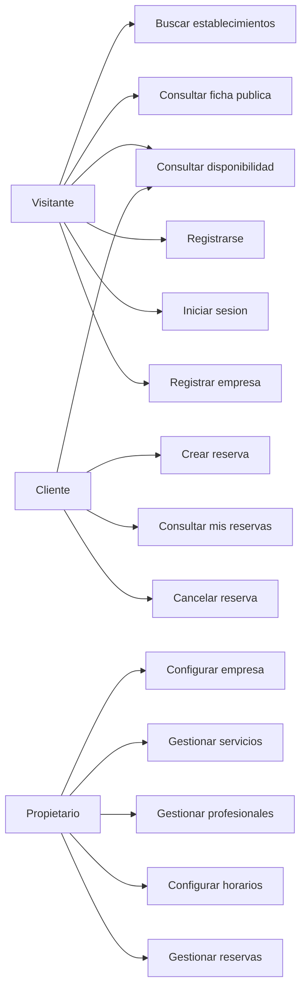

# Casos de uso

**Fase 1 — Modelado funcional.** Ubicación final: `docs/casos-uso.md`.

Documento complementario de `reglas-negocio.md`. Las reglas se citan como **RN-xx** y no se repiten aquí.
Fuente de alcance: `TFM_PlataformaReservas_SPEC.md` §5 (alcance) y §11 (rutas).

---

# 1. Actores

| Actor | Descripción | Autenticación |
|---|---|---|
| **Visitante** | Persona que llega a la plataforma sin identificarse. Puede descubrir establecimientos y consultar disponibilidad, pero no reservar. | No |
| **Cliente** | Usuario registrado con rol `Cliente`. Reserva y gestiona sus propias reservas. | Sí |
| **Propietario** | Usuario registrado con rol `Propietario` y una pertenencia (`MiembroEmpresa`). Configura su empresa y gestiona sus reservas. | Sí, con pertenencia |

**No existe el actor Administrador de plataforma.** El área de administración está fuera del MVP (SPEC §5.4) y el rol correspondiente se eliminó por no tener nada que administrar.

Un mismo usuario puede ser Cliente y Propietario a la vez. Son roles acumulativos, no excluyentes: el propietario de una peluquería puede reservar en un fisioterapeuta con la misma cuenta.

## 1.1. Diagrama de actores



---

# 2. Catálogo de casos de uso

Veintiún casos de uso que cubren exactamente el alcance de SPEC §5 y las 15 rutas de SPEC §11.

## 2.1. Descubrimiento y acceso

| ID | Caso de uso | Actor | Ruta | Detalle |
|---|---|---|---|---|
| CU-01 | Buscar establecimientos | Visitante, Cliente | `/businesses` | §3.1 |
| CU-02 | Consultar ficha pública | Visitante, Cliente | `/businesses/{slug}` | resumen |
| CU-03 | Consultar disponibilidad | Visitante, Cliente | `/book/{slug}` | §3.2 |
| CU-04 | Registrarse como cliente | Visitante | `/register` | resumen |
| CU-05 | Iniciar sesión | Visitante | `/login` | resumen |
| CU-06 | Cerrar sesión | Cliente, Propietario | — | resumen |
| CU-24 | Recuperar contraseña | Visitante | `/Account/ForgotPassword` | §3.9 |

## 2.2. Reserva y área de cliente

| ID | Caso de uso | Actor | Ruta | Detalle |
|---|---|---|---|---|
| CU-07 | Crear reserva | Cliente | `/book/{slug}` | §3.3 |
| CU-08 | Consultar mis reservas | Cliente | `/my-account/bookings` | resumen |
| CU-09 | Consultar detalle de reserva | Cliente | `/my-account/bookings/{id}` | resumen |
| CU-10 | Cancelar reserva (cliente) | Cliente | `/my-account/bookings/{id}` | §3.4 |
| CU-22 | Gestionar perfil y darse de baja | Cliente | `/my-account/profile` | §3.7 |

## 2.3. Alta y configuración de empresa

| ID | Caso de uso | Actor | Ruta | Detalle |
|---|---|---|---|---|
| CU-11 | Registrar empresa | Visitante | `/for-business/register` | §3.5 |
| CU-12 | Configurar datos y políticas | Propietario | `/app/settings` | resumen |
| CU-13 | Gestionar servicios | Propietario | `/app/services` | resumen |
| CU-14 | Gestionar profesionales | Propietario | `/app/staff` | resumen |
| CU-15 | Asociar profesionales a servicios | Propietario | `/app/staff` | resumen |
| CU-16 | Configurar horario semanal | Propietario | `/app/schedules` | §3.6 |
| CU-17 | Gestionar excepciones de horario | Propietario | `/app/schedules` | resumen |
| CU-23 | Dar de baja o reactivar la empresa | Propietario | `/app/settings` | §3.8 |

## 2.4. Operación diaria de la empresa

| ID | Caso de uso | Actor | Ruta | Detalle |
|---|---|---|---|---|
| CU-18 | Consultar panel de resumen | Propietario | `/app` | resumen |
| CU-19 | Consultar y filtrar reservas | Propietario | `/app/bookings` | resumen |
| CU-20 | Cancelar reserva (empresa) | Propietario | `/app/bookings` | resumen |
| CU-21 | Marcar reserva como completada | Propietario | `/app/bookings` | resumen |

## 2.5. Criterio de nivel de detalle

Se desarrollan en ficha completa (§3) los **nueve casos de uso que concentran reglas de negocio**: CU-01, CU-03, CU-07, CU-10, CU-11, CU-16, CU-22, CU-23 y CU-24. Son los que tienen flujos alternativos con consecuencias y los que alimentan las pruebas.

El resto son mantenimientos o consultas sin lógica propia y se resumen en §4. Desarrollarlos con la plantilla completa produciría quince páginas de "el usuario rellena el formulario y pulsa guardar" sin aportar información que no esté ya en las reglas de negocio.

---

# 3. Casos de uso detallados

## 3.1. CU-01 — Buscar establecimientos

**Actor principal:** Visitante
**Ruta:** `/businesses` (SSR estático)
**Precondiciones:** ninguna.
**Disparador:** el visitante usa el buscador de la landing o accede directamente a la ruta.

### Flujo principal

1. El sistema muestra el formulario de búsqueda con un campo de ciudad **obligatorio** y un selector de categorías opcional. No muestra ningún resultado todavía (RN-112).
2. El visitante introduce una ciudad de al menos 2 caracteres y, si quiere, selecciona una categoría.
3. El sistema recupera la primera página de empresas activas y publicables de esa ciudad que cumplen el filtro de categoría (RN-109, RN-110, RN-111, RN-113).
4. El sistema muestra el listado con nombre, categoría, ciudad y descripción breve de cada empresa, junto al número total de resultados y la paginación.
5. El visitante selecciona una empresa y continúa en CU-02.

### Flujos alternativos

- **2a. Sin ciudad, o con menos de 2 caracteres.** El sistema no busca. Indica que la ciudad es obligatoria y mantiene el foco en el campo (RN-110).
- **2b. Petición manipulada sin ciudad o con ciudad en blanco.** El servidor devuelve lista vacía, no un error (RN-112). La validación no depende del formulario.
- **3a. Sin resultados en esa ciudad.** El sistema lo indica y sugiere quitar el filtro de categoría si estaba puesto.
- **3b. Ciudad con distinta grafía.** La comparación ignora mayúsculas y acentos (RN-110): "malaga" encuentra "Málaga".
- **4a. Más resultados que el tamaño de página.** Se pagina. Un tamaño de página mayor solicitado desde el cliente se ignora y se aplica el máximo de servidor (RN-113).

### Postcondiciones

Ninguna. Es una consulta sin efectos.

### Reglas aplicadas

RN-04, RN-13, RN-16, RN-109 a RN-113.

### Criterios de aceptación

- [x] Sin ciudad, o con un solo carácter, no se devuelve ningún resultado, ni desde el formulario ni manipulando la petición.
- [x] Buscar `"Ea"` (2 caracteres) sí ejecuta la búsqueda: es un municipio real.
- [x] Buscar por ciudad existente devuelve solo empresas de esa ciudad.
- [x] Añadir categoría refina el resultado dentro de la ciudad.
- [x] Una empresa inactiva o no publicable nunca aparece en los resultados.
- [x] Una ciudad con muchas empresas devuelve como máximo el tamaño de página, aunque se pida más.
- [x] La búsqueda funciona sin autenticación.

*Cumplidos en la Fase 13 (`PruebasConsultasCatalogoPublico`, `PruebasBuscarEstablecimientos`, 2026-10-17).*

> **Consecuencia en la landing.** Las categorías de la portada ya no pueden enlazar a un listado directo. Enlazan a `/businesses` con la categoría preseleccionada y el campo de ciudad vacío, esperando a que el visitante la indique. Conviene que el campo recuerde la última ciudad usada en ese navegador para que el segundo uso sea de un clic.

---

## 3.2. CU-03 — Consultar disponibilidad

**Actor principal:** Visitante o Cliente
**Ruta:** `/book/{slug}` (InteractiveServer)
**Precondiciones:** la empresa existe, está activa y es publicable (RN-16, RN-109).
**Disparador:** el usuario pulsa "Reservar" en la ficha pública.

Es el caso de uso que ejercita el núcleo técnico del proyecto.

### Flujo principal

1. El sistema muestra los servicios activos de la empresa con su duración y precio.
2. El usuario selecciona un servicio.
3. El sistema muestra los profesionales activos que prestan ese servicio, más la opción "cualquier profesional" (RN-56).
4. El usuario selecciona profesional o deja la opción abierta.
5. El sistema muestra un selector de fecha limitado a la ventana máxima efectiva del servicio (RN-55).
6. El usuario selecciona una fecha.
7. El sistema invoca `IMotorDisponibilidad.ObtenerHuecosAsync` y muestra los huecos resultantes, ordenados (RN-59).
8. El usuario selecciona un hueco y continúa en CU-07.

### Flujos alternativos

- **1a. La empresa no tiene servicios activos.** El sistema informa de que el establecimiento no admite reservas en este momento.
- **3a. Ningún profesional presta el servicio.** El sistema informa de que el servicio no está disponible. Es un estado de configuración incompleta de la empresa, no un error.
- **7a. Sin huecos ese día.** El sistema lo indica y mantiene el selector de fecha activo. Puede deberse a excepción del profesional (RN-57), agenda llena (RN-53), ausencia de horario ese día o antelación mínima (RN-54). **El sistema no distingue el motivo ante el usuario público**: revelar la carga de agenda de un negocio es información que no le corresponde.
- **6a. Fecha fuera de la ventana máxima.** El selector no permite elegirla. Si llega por manipulación de la petición, el motor devuelve lista vacía (RN-55).
- **4a. "Cualquier profesional".** El sistema agrega los huecos de todos los profesionales candidatos; cada hueco conserva la identidad del profesional que lo presta (RN-59).

### Postcondiciones

Ninguna. **Consultar disponibilidad no reserva ni bloquea nada.** No existe reserva temporal de huecos; la competencia por un hueco se resuelve en CU-07 (RN-77).

### Reglas aplicadas

RN-23, RN-24, RN-33, RN-50 a RN-60, RN-101, RN-102.

### Criterios de aceptación

- [x] Los huecos respetan horario, duración, excepciones y reservas existentes.
- [x] Un servicio con intervalo propio ignora el de la empresa.
- [x] Un servicio sin intervalo propio usa el de la empresa.
- [x] Un intervalo menor que la duración produce huecos solapados entre sí.
- [x] Un profesional de vacaciones no aparece ese día.
- [x] La antelación mínima elimina los huecos demasiado próximos.
- [x] Dos consultas simultáneas del mismo hueco lo muestran disponible a ambas. *(Fase 17: `Dos_consultas_simultaneas_del_mismo_hueco_lo_muestran_disponible_a_ambas`)*

*Los cumple el motor de la Fase 10 (`PruebasMotorDisponibilidad`), que consultar disponibilidad no modifica ni bloquea. En la Fase 14 se exponen en `/book/{slug}` con `ConsultarDisponibilidad` (`PruebasConsultarDisponibilidad`), 2026-10-17.*

---

## 3.3. CU-07 — Crear reserva

**Actor principal:** Cliente
**Ruta:** `/book/{slug}` (InteractiveServer)
**Precondiciones:** el usuario ha completado CU-03 y ha seleccionado un hueco.
**Disparador:** el usuario pulsa "Confirmar reserva".

### Flujo principal

1. Si el usuario no está autenticado, el sistema lo lleva a iniciar sesión o registrarse y **retoma el flujo en el mismo punto** al volver (RN-70).
2. El sistema muestra el resumen: establecimiento, servicio, profesional, fecha, hora, duración y precio, junto con un campo de observaciones. Muestra también el nombre y el teléfono con los que se va a registrar la reserva. **Si el usuario no tiene teléfono en su perfil, el sistema se lo pide aquí y es obligatorio** (RN-81).
3. El usuario confirma.
4. El sistema deshabilita el botón de confirmación (protección de doble envío).
5. El sistema abre una transacción.
6. El sistema valida servicio, profesional, asociación entre ambos y políticas de antelación (RN-71 a RN-75).
7. El sistema calcula `FinUtc` en servidor (RN-74).
8. El sistema recomprueba la disponibilidad del hueco (RN-76).
9. El sistema inserta la reserva en estado `Confirmada`, copiando precio, duración, nombre y teléfono (RN-78, RN-79).
10. La restricción `EXCLUDE` de la base de datos acepta la inserción (RN-77).
11. El sistema confirma la transacción y **solo entonces** encola el evento `ReservaConfirmada` (RN-140).
12. El sistema muestra la pantalla de reserva creada con enlace a su detalle, **sin esperar al envío** (RN-142).
13. En segundo plano salen dos correos: confirmación al cliente (RN-146) y aviso de nueva reserva al negocio (RN-147).

### Flujos alternativos

- **1a. El usuario se registra durante el flujo.** Al completar el registro vuelve al paso 2 con la selección intacta. No se le obliga a rehacer la búsqueda.
- **2a. El usuario no tiene teléfono en su perfil.** El sistema lo pide en el propio resumen y, al confirmar, lo guarda **también en el perfil** para no volver a pedírselo (RN-81).
- **2b. Teléfono con formato inválido.** Se rechaza en el momento y no se permite confirmar.
- **8a. El hueco ya no está libre.** La transacción se deshace, el sistema muestra "esa hora ya no está disponible" y recarga los huecos del día.
- **10a. La restricción rechaza la inserción.** Otro cliente ganó la carrera entre los pasos 8 y 10. El sistema traduce el error de PostgreSQL a `HuecoYaNoDisponible` y actúa igual que en 8a (RN-80). **No se reintenta automáticamente:** el usuario elige otra hora.
- **6a. Alguna validación falla.** La transacción se deshace y el sistema informa del motivo concreto.
- **4a. Doble envío.** El segundo envío se ignora en cliente. Si aun así llegara al servidor, lo detiene la restricción del paso 10.
- **13a. El servidor de correo está caído.** **La reserva sigue creada.** El fallo se registra y no se reintenta (RN-141). El cliente tiene su reserva en `/my-account/bookings` aunque no le llegue el correo.

### Postcondiciones

Existe una `Reserva` en estado `Confirmada`. El hueco deja de ofrecerse a cualquier otro usuario. La reserva es visible para el cliente (CU-08) y para la empresa (CU-19).

### Reglas aplicadas

RN-70 a RN-83, RN-100, RN-140 a RN-142, RN-146, RN-147.

### Criterios de aceptación

- [x] No se puede reservar sin autenticación.
- [x] Un usuario sin teléfono debe indicarlo antes de confirmar, y queda guardado en su perfil. *El servidor lo cumple (`PruebasEstablecerTelefono`, Fase 14); la pantalla, comprobado a mano por el desarrollador el 2026-10-25.*
- [x] No se puede reservar con un profesional que no presta el servicio.
- [x] `FinUtc` se calcula en servidor y se ignora cualquier valor enviado por el cliente.
- [x] Reservar un hueco ya ocupado devuelve un error controlado, no una excepción sin tratar.
- [x] **N peticiones concurrentes sobre el mismo hueco producen exactamente una reserva.**
- [x] La reserva conserva el precio del momento aunque el servicio cambie después.
- [x] Salen dos correos: al cliente y al negocio.
- [x] **Con el servicio de correo caído, la reserva se crea igualmente** y el fallo queda registrado.

*Cumplidos en la Fase 11 (`PruebasCrearReserva`, `PruebasConcurrenciaReservas`). Los dos de correo, en la Fase 16b (`PruebasEnviarCorreosReservaConfirmada`, `PruebasProcesadorEventos`, 2026-10-24).*

---

## 3.4. CU-10 — Cancelar reserva (cliente)

**Actor principal:** Cliente
**Ruta:** `/my-account/bookings/{id}`
**Precondiciones:** la reserva existe, es del usuario y está `Confirmada`.
**Disparador:** el usuario pulsa "Cancelar reserva".

### Flujo principal

1. El sistema comprueba que la reserva pertenece al usuario (RN-95).
2. El sistema comprueba que está en estado `Confirmada` (RN-91).
3. El sistema comprueba que `InicioUtc > ahora` (RN-93).
4. El sistema pide confirmación explícita.
5. El usuario confirma.
6. El sistema pasa la reserva a `Cancelada` y registra `FechaCancelacion` (RN-98).
7. El hueco vuelve a estar disponible de inmediato (RN-97).
8. Tras confirmar la transacción se encola `ReservaCancelada` con origen `Cliente`, y el negocio recibe el aviso (RN-148).

### Flujos alternativos

- **1a. La reserva es de otro usuario.** "No encontrado" (RN-03, RN-95). No se revela su existencia.
- **2a. Ya está cancelada o completada.** El sistema informa de que no es posible y no ofrece la acción.
- **3a. La hora de inicio ya pasó.** El sistema no ofrece la acción y explica que hay que contactar con el establecimiento.

### Postcondiciones

La reserva queda en `Cancelada`, es terminal (RN-92) y su hueco vuelve a ofrecerse.

### Reglas aplicadas

RN-03, RN-91 a RN-93, RN-95, RN-97, RN-98, RN-148.

### Criterios de aceptación

- [x] Un cliente no puede cancelar la reserva de otro.
- [x] No se puede cancelar una reserva ya iniciada.
- [x] No se puede cancelar dos veces.
- [x] Tras cancelar, el hueco vuelve a aparecer en CU-03 y puede reservarse de nuevo. *(`PruebasCancelarReservaCliente`, Fase 11; con origen empresa, `PruebasCancelarReservaEmpresa`, y bajo concurrencia, `PruebasConcurrenciaReservas`, Fase 17)*
- [x] El negocio recibe el aviso de cancelación. *(Fase 16b: `PruebasEnviarCorreoReservaCancelada`)*

---

## 3.5. CU-11 — Registrar empresa

**Actor principal:** Visitante
**Ruta:** `/for-business/register` (SSR)
**Precondiciones:** el correo no está registrado.
**Disparador:** el visitante pulsa la llamada a la acción para negocios desde la landing.

### Flujo principal

1. El sistema muestra un **único formulario** con dos bloques: datos de la cuenta (nombre, correo, teléfono, contraseña) y datos de la empresa (nombre, categoría, descripción, dirección, ciudad, código postal, teléfono y correo de contacto).
2. El visitante lo completa y envía.
3. El sistema valida los datos (RN-12, RN-14).
4. El sistema genera el slug a partir del nombre y resuelve colisiones (RN-10, RN-11).
5. En **una sola operación atómica** el sistema crea el usuario, le asigna el rol `Propietario`, crea la empresa con las políticas por defecto y crea la pertenencia (RN-15).
6. El sistema inicia sesión al usuario y lo lleva a `/app`.
7. El panel avisa de que el establecimiento **aún no es visible** y muestra los pasos que faltan para publicarlo: crear un servicio, crear un profesional, asociarlos y definir su horario (RN-19).
8. Tras confirmar la transacción se encola `EmpresaRegistrada` y el propietario recibe un correo con el enlace a su futura ficha y los pasos pendientes (RN-152).

### Flujos alternativos

- **3a. El correo ya existe.** El sistema lo indica y ofrece iniciar sesión.
- **3b. El usuario ya tiene una empresa.** Se rechaza (RN-06).
- **5a. Fallo parcial.** No se crea nada. No puede quedar un usuario sin empresa ni una empresa sin propietario.
- **4a. Slug ocupado.** Se añade sufijo numérico de forma transparente.

### Postcondiciones

Existen `Usuario` con rol `Propietario`, `Empresa` activa y `MiembroEmpresa`.

La empresa **todavía no es visible al público**: no aparece en la búsqueda y su ficha devuelve "no encontrado" aunque se conozca el slug (RN-16, RN-17). Se publica automáticamente en cuanto exista un camino completo servicio → profesional → horario, sin ninguna acción explícita de publicación.

### Reglas aplicadas

RN-06, RN-10 a RN-19.

### Criterios de aceptación

- [x] El alta crea las cuatro cosas o ninguna. *(comprobado: `PruebasRegistrarEmpresa` y `PruebasUnidadTrabajo`; `fase-08.md` §7, 2026-10-10)*
- [x] Dos empresas con el mismo nombre obtienen slugs distintos. *(comprobado: `PruebasRegistrarEmpresa`; `fase-08.md` §7, 2026-10-10)*
- [x] El propietario aterriza en `/app` con sesión iniciada. *(comprobado: prueba manual; `fase-08.md` §7, 2026-10-10)*
- [x] Un usuario que ya tiene empresa no puede crear otra. *(comprobado: `PruebasRegistrarEmpresa` y `PruebasEsquema`; `fase-08.md` §7, 2026-10-10)*
- [x] Recién dada de alta, la empresa **no** aparece en la búsqueda ni por slug directo. *(Fase 13: `Una_empresa_solo_es_visible_mientras_es_publicable`)*
- [x] Al completar servicio, profesional, asociación y horario, la empresa aparece sin más pasos. *(Fase 13: la misma prueba)*

> **Publicación implícita.** No existe un botón de "publicar". La visibilidad es consecuencia de tener la configuración mínima para poder reservar, y se recalcula sola. Esto evita un estado más que mantener y elimina el caso de "publicada pero sin huecos", que es el que da mala impresión de verdad: no una ficha ausente, sino una ficha presente en la que no se puede reservar nada.

---

## 3.6. CU-16 — Configurar horario semanal

**Actor principal:** Propietario
**Ruta:** `/app/schedules` (InteractiveServer)
**Precondiciones:** la empresa tiene al menos un profesional.
**Disparador:** el propietario accede a la pantalla de horarios.

### Flujo principal

1. El sistema muestra un selector de profesional y, debajo, la semana completa.
2. El propietario selecciona un profesional.
3. El sistema muestra los intervalos existentes de cada día.
4. El propietario añade un intervalo indicando día, hora de inicio y hora de fin.
5. El sistema valida que el inicio sea anterior al fin (RN-41) y que no se solape con otro intervalo del mismo profesional y día (RN-42).
6. El sistema guarda el intervalo.
7. El propietario repite hasta completar la semana, añadiendo varios intervalos por día si tiene jornada partida (RN-43).

### Flujos alternativos

- **5a. Inicio posterior o igual al fin.** Se rechaza con mensaje concreto.
- **5b. Solapamiento con un intervalo existente.** Se rechaza indicando con cuál.
- **4a. Eliminar un intervalo.** Se borra físicamente (RN-121) y no afecta a las reservas ya creadas (RN-47).
- **1a. Sin profesionales.** El sistema indica que hay que crear un profesional antes y enlaza a `/app/staff`.

### Postcondiciones

El profesional tiene horario semanal y comienza a generar huecos en CU-03.

### Reglas aplicadas

RN-40 a RN-43, RN-47, RN-121.

### Criterios de aceptación

- [x] Se pueden crear dos intervalos el mismo día sin solaparse. *(comprobado: `PruebasProfesional` y `PruebasAgregarIntervalo`; `fase-09.md` §7, 2026-10-10)*
- [x] Un intervalo solapado se rechaza. *(comprobado: `PruebasIntervaloHorario`, `PruebasProfesional` y `PruebasAgregarIntervalo`; `fase-09.md` §7, 2026-10-10)*
- [x] Un intervalo con inicio posterior al fin se rechaza. *(comprobado: `PruebasIntervaloHorario` y `PruebasAgregarIntervalo`; `fase-09.md` §7, 2026-10-10)*
- [x] Al guardar un horario, los huecos aparecen en CU-03 para ese profesional. *(comprobado: `PruebasAgregarIntervalo.Tras_guardar_el_intervalo_sus_huecos_aparecen_en_la_disponibilidad_de_ese_profesional`; auditoría 17, 2026-10-24)*
- [x] Eliminar un horario no cancela reservas existentes. *(comprobado: `PruebasEliminarIntervalo`; `fase-09.md` §7, 2026-10-10)*

---

## 3.7. CU-22 — Gestionar perfil y darse de baja

**Actor principal:** Cliente
**Ruta:** `/my-account/profile` (InteractiveServer)
**Precondiciones:** usuario autenticado.
**Disparador:** el usuario accede a su perfil desde el menú de cuenta.

### Flujo principal

1. El sistema muestra nombre completo, correo y teléfono.
2. El usuario edita nombre o teléfono y guarda.
3. El sistema valida y actualiza el perfil.

Los cambios **no afectan a las reservas existentes**, que conservan la copia hecha en el momento de reservar (RN-78).

### Flujo de baja de cuenta

4. El usuario pulsa "Dar de baja mi cuenta".
5. El sistema comprueba que no sea propietario de una empresa activa (RN-138).
6. El sistema indica **cuántas reservas futuras confirmadas se van a cancelar** y advierte de que la baja no se puede revertir desde la aplicación (RN-139).
7. El usuario confirma de forma explícita.
8. En una sola transacción, el sistema pone `Activo = false` y pasa a `Cancelada` todas sus reservas confirmadas con `InicioUtc > ahora` (RN-136, RN-137).
9. Tras confirmar, se encolan `CuentaDadaDeBaja` y un `ReservaCancelada` con origen `BajaCuenta` por cada cita. El usuario recibe la confirmación (RN-155) y **cada negocio afectado recibe el aviso** (RN-151).
10. El sistema cierra la sesión y lleva al usuario a la portada.

### Flujos alternativos

- **5a. Es propietario de una empresa activa.** No se permite la baja. El sistema lo explica y enlaza a `/app/settings` para que dé de baja la empresa primero (RN-138).
- **8a. Fallo parcial.** No se aplica nada: ni la desactivación ni las cancelaciones.
- **9a. El usuario intenta volver a entrar.** No puede: el inicio de sesión rechaza cuentas inactivas (RN-135).

### Postcondiciones

El usuario queda inactivo y no puede iniciar sesión. Sus reservas pasadas y completadas se conservan; las futuras quedan canceladas y sus huecos liberados para las empresas afectadas. El correo sigue ocupado (RN-139).

### Reglas aplicadas

RN-78, RN-81, RN-135 a RN-139, RN-151, RN-155.

### Criterios de aceptación

- [x] Editar el perfil no altera las reservas ya creadas.
- [x] Un propietario con empresa activa no puede darse de baja.
- [x] La baja cancela solo las reservas futuras confirmadas, nunca las pasadas ni las completadas.
- [x] Tras la baja, el inicio de sesión se rechaza.

*Cumplidos en la Fase 15 (`PruebasActualizarPerfil`, `PruebasDarDeBajaCuenta`, 2026-10-18). Los de CU-10, en las fases 11 y 15 (`PruebasCancelarReservaCliente`, `PruebasConsultarDetalleReserva`).*
- [x] Los huecos de las reservas canceladas vuelven a ofrecerse de inmediato. *(`PruebasDarDeBajaCuenta`, Fase 15)*

> **Limitación a declarar en la memoria.** Esto es una desactivación, no un borrado. El derecho de supresión del RGPD no queda cubierto: haría falta decidir qué ocurre con el histórico de las empresas y anonimizar en lugar de borrar. Ver el aviso de §11 bis de `reglas-negocio.md`.

---

## 3.8. CU-23 — Dar de baja o reactivar la empresa

**Actor principal:** Propietario
**Ruta:** `/app/settings` (InteractiveServer)
**Precondiciones:** el usuario es propietario de la empresa.
**Disparador:** el propietario accede a la configuración de su empresa.

### Flujo de baja

1. El sistema muestra, al final de la configuración, la acción de dar de baja el establecimiento, separada visualmente del resto.
2. El propietario la pulsa.
3. El sistema indica **cuántas reservas futuras confirmadas se van a cancelar** (RN-131).
4. El propietario confirma de forma explícita.
5. En una sola transacción, el sistema pone `Activa = false` y pasa a `Cancelada` todas las reservas confirmadas de la empresa con `InicioUtc > ahora` (RN-130, RN-132).
6. El establecimiento desaparece del catálogo público de inmediato (RN-13, RN-109).
7. Tras confirmar la transacción se encolan **N + 1 eventos**: `EmpresaDadaDeBaja` y un `ReservaCancelada` con origen `BajaEmpresa` por cada cita anulada.
8. El propietario recibe la confirmación con el recuento (RN-153) y **cada cliente afectado recibe el aviso de que su cita queda anulada porque el establecimiento ha cerrado** (RN-150).
9. El propietario conserva el acceso a `/app` para consultar el histórico y reactivar (RN-134).

### Flujo de reactivación

8. Con la empresa inactiva, el panel muestra el aviso de baja y la acción de reactivar.
9. Al reactivar, `Activa = true`. Las reservas canceladas por la baja **no se restauran** (RN-133).
10. El establecimiento vuelve al catálogo si además es publicable (RN-16).

### Flujos alternativos

- **5a. Fallo parcial.** No se aplica nada.
- **3a. Sin reservas futuras.** El sistema lo indica y la confirmación es igualmente explícita.
- **10a. Reactivada pero no publicable.** Vuelve el estado "aún no visible" con los requisitos que faltan (RN-19).

### Postcondiciones

La empresa queda fuera del catálogo público y sin reservas futuras pendientes. El propietario mantiene acceso a su área privada.

### Reglas aplicadas

RN-13, RN-16, RN-19, RN-109, RN-120, RN-130 a RN-134, RN-150, RN-153.

### Criterios de aceptación

- [x] La baja cancela solo las reservas futuras confirmadas. *(comprobado: `PruebasDarDeBajaEmpresa` y `PruebasRepositorioReservas`; `fase-08.md` §7, 2026-10-10)*
- [x] Tras la baja, la empresa no aparece en la búsqueda ni por slug directo. *(Fase 13: `Una_empresa_inactiva_no_aparece_ni_por_slug_y_reactivada_vuelve`)*
- [x] El propietario sigue entrando en `/app` y ve el histórico. *(sigue entrando en `/app`: comprobado a mano, `fase-08.md` §7, 2026-10-10. El histórico, Fase 16: `El_panel_de_una_empresa_inactiva_sigue_devolviendo_sus_reservas` y `/app/bookings` con selector de fecha, que no filtra por `Activa`)*
- [x] Reactivar devuelve la empresa al catálogo si es publicable, y no restaura las reservas canceladas. *(no restaura las reservas: `PruebasReactivarEmpresa`, `fase-08.md` §7, 2026-10-10; vuelve al catálogo: `Una_empresa_inactiva_no_aparece_ni_por_slug_y_reactivada_vuelve`, Fase 13)*
- [x] La empresa nunca se borra físicamente. *(comprobado: ningún caso de uso ni repositorio borra; `fase-08.md` §7, 2026-10-10)*
- [x] Cada cliente con cita futura recibe su aviso. *(Fase 16b: `PruebasDarDeBajaEmpresa` y `PruebasEnviarCorreoReservaCancelada`)*
- [x] **Con 300 reservas futuras, el botón responde igual de rápido que con 3.** *(Fase 16b: `Con_300_reservas_futuras_publica_301_eventos…`; el caso de uso solo encola)*

> **Por qué aquí sí hay cascada y en RN-46 no.** Si el establecimiento cierra, esas reservas no se van a atender: dejarlas confirmadas sería mentir al cliente. Una excepción de horario, en cambio, es un cambio de agenda que la empresa puede querer resolver caso por caso. La diferencia está en si desaparece una de las dos partes o solo cambia la disponibilidad.
>
> **Este caso de uso es el que justifica la cola de eventos.** Enviar N correos en línea dejaría el botón colgado minutos enteros; encolarlos cuesta microsegundos y el envío ocurre fuera de la petición.

---

## 3.9. CU-24 — Recuperar contraseña

**Actor principal:** Visitante
**Rutas:** `/Account/ForgotPassword` y `/Account/ResetPassword` (SSR, páginas de la plantilla de Identity)
**Precondiciones:** ninguna.
**Disparador:** el usuario pulsa "He olvidado mi contraseña" en el inicio de sesión.

Vale por igual para clientes y para propietarios: **es el mismo flujo y la misma entidad `Usuario`** (RN-157). Identity no distingue por rol, así que no hay dos mecanismos que mantener.

### Flujo principal

1. El usuario introduce su correo.
2. El sistema responde **siempre lo mismo**: "si ese correo está registrado, recibirás un enlace" (RN-158).
3. Si la cuenta existe y está activa, se genera un token de un solo uso y se envía el correo en ese momento, sin pasar por la cola, con un enlace construido sobre `Correo:UrlBase`. Si el envío falla, se registra y la respuesta es la misma (RN-156, RN-158, RN-159; `arquitectura.md` §13.6, Fase 16b duda 2 y revisión).
4. El usuario abre el enlace, que lo lleva a `/Account/ResetPassword` con el token.
5. Introduce la contraseña nueva dos veces.
6. El sistema valida el token y la política de contraseña, y la cambia.
7. El sistema **renueva el sello de seguridad**, con lo que cualquier sesión abierta queda invalidada (RN-161).
8. El usuario inicia sesión con la contraseña nueva.

### Flujos alternativos

- **2a. El correo no está registrado.** Respuesta idéntica y no se envía nada. Enumerar cuentas registradas es una fuga de información.
- **3a. La cuenta está inactiva.** No se envía correo, y la respuesta sigue siendo indistinguible (RN-160). Una cuenta dada de baja no se recupera por esta vía.
- **4a. Token caducado o ya usado.** Mensaje claro y enlace para volver a solicitarlo.
- **6a. La contraseña no cumple la política.** Se rechaza indicando el requisito concreto.

### Postcondiciones

La contraseña queda cambiada y las sesiones previas invalidadas.

### Reglas aplicadas

RN-135, RN-156 a RN-161.

### Criterios de aceptación

- [x] Un cliente y un propietario usan el mismo flujo con idéntico resultado. *(Fase 16b: `Un_propietario_usa_el_mismo_flujo…`, `PruebasRemitenteIdentity`)*
- [x] La respuesta es indistinguible exista o no la cuenta. *(comprobado: `PruebasSolicitudRestablecimientoClave` y comprobación manual; `fase-06.md` §7, 2026-10-04)*
- [x] Una cuenta inactiva no recibe correo. *(comprobado: `Una_cuenta_inactiva_no_genera_enlace_de_restablecimiento`; `fase-06.md` §7, 2026-10-04)*
- [x] El token caduca y no se puede reutilizar. *(sin prueba propia: lo gestiona Identity (RN-159, `fase-06.md` §10); comprobado a mano por el desarrollador el 2026-10-25)*
- [x] Tras restablecer, una sesión abierta en otro navegador deja de valer. *(comprobado: `Restablecer_la_contrasena_renueva_el_sello_de_seguridad` y `La_cookie_revalida_el_sello_cada_cinco_minutos`: la sesión deja de valer en la siguiente revalidación, como mucho a los 5 minutos (A-06); `fase-06.md` §7, 2026-10-04)*

> **Coste real: una hora.** Las dos páginas ya las genera la plantilla `dotnet new blazor --auth Individual` y los proveedores de token vienen con `AddDefaultTokenProviders()`. Hoy no funcionan **solo** porque falta un `IEmailSender<Usuario>`. Implementarlo las activa.
>
> Sin esto, un usuario que olvida su contraseña no tiene ninguna vía de recuperarla — y es una pregunta fácil de hacer en una defensa.

---

# 4. Casos de uso resumidos

## Descubrimiento y acceso

| ID | Resumen | Reglas | Nota |
|---|---|---|---|
| **CU-02** | El visitante abre `/businesses/{slug}` y ve nombre, categoría, descripción, dirección, teléfono, servicios activos, profesionales activos y horario resumido, con botón de reserva. Slug inexistente, empresa inactiva o no publicable → "no encontrado" (404). | RN-13, RN-16, RN-114 a RN-116 | El horario mostrado es la unión de los horarios de los profesionales |
| **CU-04** | Registro de cliente con nombre, correo, contraseña y **teléfono opcional**. Se asigna el rol `Cliente` y se encola el correo de bienvenida. Pantalla estándar de Identity. | RN-81, RN-154 | El teléfono se deja opcional para no fricionar el registro; se exige más tarde, al reservar. **No hay verificación del correo**: `RequireConfirmedAccount` sigue en `false` |
| **CU-05** | Inicio de sesión con correo y contraseña. **Una cuenta inactiva se rechaza** con un mensaje genérico, sin revelar que existe pero está dada de baja. Redirige al destino previo y, si no lo hay, al área privada según el rol: propietario a `/app`, cliente a `/my-account/bookings`; con los dos roles gana el propietario (*decidido por el desarrollador el 2026-10-25*). | RN-135 | La comprobación va en la autenticación, no en la interfaz. Enlaza con CU-24 |
| **CU-06** | Cierre de sesión. Invalida la cookie y vuelve a la portada. | — | |

## Área de cliente

| ID | Resumen | Reglas | Nota |
|---|---|---|---|
| **CU-08** | Listado de las reservas del usuario en dos pestañas: próximas (`InicioUtc >= ahora`, ordenadas ascendente) e históricas (el resto, descendente). Muestra establecimiento, servicio, profesional, fecha, hora y estado. | RN-05 | Filtra por `UsuarioId`, nunca por empresa |
| **CU-09** | Detalle de una reserva propia con todos sus datos y el precio aplicado. Reserva ajena → "no encontrado". | RN-03, RN-95 | El precio mostrado es `PrecioAplicado`, no el actual del servicio |

## Configuración de empresa

| ID | Resumen | Reglas | Nota |
|---|---|---|---|
| **CU-12** | Edición de datos de la empresa y de sus tres políticas de reserva, con los rangos válidos de RN-26 a RN-28. Los cambios de política afectan solo a la disponibilidad futura, nunca a las reservas existentes. | RN-14, RN-26 a RN-29, RN-47 | Un intervalo de huecos fuera de rango se rechaza en el dominio, no solo en el formulario |
| **CU-13** | Alta, edición y desactivación de servicios. Las tres políticas se dejan vacías para heredar de la empresa y, si se rellenan, respetan los mismos rangos. Sin borrado físico. | RN-20 a RN-29 | La interfaz debe dejar claro que vacío significa "heredar", no "sin límite". Desactivar el último servicio publicado despublica la empresa (RN-16) |
| **CU-14** | Alta, edición y desactivación de profesionales. Sin borrado físico. | RN-30, RN-33, RN-34 | Desactivar el último profesional con horario despublica la empresa (RN-16) |
| **CU-15** | Marcado de qué servicios presta cada profesional, desde la ficha del profesional. Solo servicios de la misma empresa. | RN-31, RN-32 | Desasociar no cancela reservas existentes, pero puede despublicar la empresa (RN-16) |
| **CU-17** | Alta y eliminación de excepciones (día completo no disponible) con motivo opcional. Una por profesional y fecha. No cancela reservas existentes de ese día. | RN-44 a RN-46 | La interfaz debe avisar si ya hay reservas ese día |

## Operación diaria

| ID | Resumen | Reglas | Nota |
|---|---|---|---|
| **CU-18** | Panel con las reservas de hoy y las próximas de la empresa, más accesos a la configuración. Si la empresa no es publicable, muestra en primer lugar el aviso de no visibilidad y los requisitos que faltan. | RN-02, RN-19 | Sin gráficos ni métricas: fuera de alcance |
| **CU-19** | Listado de reservas de la empresa con selector de fecha y filtro por profesional y estado. | RN-02, RN-03 | Reserva de otra empresa por id → "no encontrado" |
| **CU-20** | Cancelación de una reserva `Confirmada` de la empresa, sin restricción temporal. Libera el hueco y **avisa al cliente por correo**. | RN-91, RN-94, RN-97, RN-149 | El correo se encola tras confirmar la transacción, nunca dentro |
| **CU-21** | Marcado manual de una reserva como `Completada`, solo si ya terminó. | RN-91, RN-96 | La acción no se ofrece si `FinUtc >= ahora` |

*CU-18 a CU-21, implementados en la Fase 16 (2026-10-18): `/app` (`ConsultarPanelEmpresa`) y `/app/bookings` (`ConsultarReservasEmpresa`, `CancelarReservaEmpresa`, `CompletarReserva`). Pruebas: `PruebasConsultasReservasEmpresa`, `PruebasConsultarPanelEmpresa`, `PruebasConsultarReservasEmpresa`, `PruebasCancelarReservaEmpresa` y `PruebasCompletarReserva`; las pantallas, a mano (`fase-16.md` §6).*

---

# 5. Cobertura

## 5.1. Casos de uso por ruta

Las 16 vistas propias de SPEC §11 quedan cubiertas. Las páginas de recuperación de contraseña las genera la plantilla de Identity y no cuentan en ese presupuesto.

| Ruta | Casos de uso |
|---|---|
| `/` | — (contenido estático y categorías de `IConsultasCatalogoPublico`; *Fase 12, duda 2*) |
| `/businesses` | CU-01 |
| `/businesses/{slug}` | CU-02 |
| `/book/{slug}` | CU-03, CU-07 |
| `/login` | CU-05 |
| `/register` | CU-04 |
| `/Account/ForgotPassword` y `/Account/ResetPassword` | CU-24 (páginas de la plantilla) |
| `/for-business/register` | CU-11 |
| `/my-account/bookings` | CU-08 |
| `/my-account/bookings/{id}` | CU-09, CU-10 |
| `/my-account/profile` | CU-22 |
| `/app` | CU-18 |
| `/app/bookings` | CU-19, CU-20, CU-21 |
| `/app/services` | CU-13 |
| `/app/staff` | CU-14, CU-15 |
| `/app/schedules` | CU-16, CU-17 |
| `/app/settings` | CU-12, CU-23 |

CU-06 (cerrar sesión) no tiene ruta propia: es una acción del menú de usuario.

## 5.2. Reglas sin caso de uso asociado

Son reglas estructurales, no de interacción. Se verifican con pruebas, no con flujos:

RN-01, RN-40, RN-60, RN-90, RN-92, RN-100 a RN-104, RN-120, RN-122, RN-123.

## 5.3. Casos de uso críticos

Los que deben funcionar para que el MVP se considere terminado (SPEC §21):

```text
CU-11  →  CU-13  →  CU-14  →  CU-15  →  CU-16     (la empresa se configura y se publica)
CU-01  →  CU-02  →  CU-03  →  CU-07               (el cliente reserva)
CU-08  →  CU-10                                    (el cliente gestiona)
CU-19  →  CU-20                                    (la empresa gestiona)
CU-23                                              (la empresa se da de baja y cancela en cascada)
```

Este encadenamiento es el guion de la prueba de aceptación manual del Control 4 (`PROJECT_PLAN.md` §3).

---

# 6. Decisiones que este documento deja abiertas

Ninguna.

## 6.1. Decisiones cerradas durante la revisión

| Hallazgo | Resolución |
|---|---|
| Las tres políticas de reserva no tenían rango válido, y un intervalo de huecos a cero cuelga el motor con un bucle infinito | Rangos obligatorios como **invariantes de dominio** en `PoliticasReserva`, no como validación de formulario (RN-26 a RN-29) |
| El teléfono era opcional en el usuario pero la reserva lo copiaba y lo necesita | Opcional al registrarse, **obligatorio al reservar**; si falta se pide en el flujo y se guarda en el perfil (RN-81, RN-82) |
| `Empresa.Activa` y `Usuario.Activo` tenían reglas pero ninguna funcionalidad podía cambiarlos | Nuevos CU-22 y CU-23, con **cancelación en cascada** de las reservas futuras (RN-130 a RN-139) |
| RN-04 y RN-109 decían cosas distintas sobre la misma condición | Fusionadas: RN-04 trata solo del aislamiento, RN-109 de la visibilidad |
| Creación manual de reservas por la empresa | Fuera del MVP, documentada como la limitación funcional más relevante |
| Longitud mínima de la ciudad | **2 caracteres**, no 3 ni 4: *Ea* (Vizcaya) es un municipio real de dos letras y hay unos treinta de tres |

## 6.2. Coste de los cambios

De la revisión crítica:

| Concepto | h |
|---|---|
| Rangos de políticas como invariantes + pruebas | 0,5 |
| Teléfono obligatorio al reservar | 0,5 |
| Baja y reactivación de empresa con cascada (CU-23) | 1,5 |
| Baja de cuenta, `/my-account/profile` y bloqueo de acceso (CU-22) | 1,5 |
| Bloqueo de cuentas inactivas en la autenticación (RN-135) | 0,5 |
| Petición de teléfono en el flujo de reserva | 0,5 |
| | **+4,5 h** |

De la incorporación del correo (§6.3):

| Concepto | h |
|---|---|
| Eventos de dominio, publicador, cola en memoria y procesador, con pruebas | 6 |
| `IServicioEmail`, implementación SMTP, configuración, implementación falsa | 2 |
| 11 plantillas de correo | 3,5 |
| Manejadores e integración en los casos de uso | 2 |
| Pruebas de notificación | 1,5 |
| Recuperación de contraseña (CU-24) | 1 |
| Documentación | 1 |
| | **+17 h** |

El presupuesto pasa de 90 h a **115,5 h** y la interfaz se queda en **16 vistas propias** más las de la plantilla de Identity. Nada de esto toca el núcleo (fases 10, 11 y 17).

## 6.3. Por qué el correo entró en el MVP

Estaba fuera de alcance. Se reconsideró y entra, con el razonamiento registrado:

- **Sin aviso de nueva reserva, el negocio tiene que refrescar `/app` para enterarse de que le han reservado.** Es lo que separa un producto usable de una maqueta.
- **Las cancelaciones en cascada eran silenciosas.** Dar de baja una empresa anulaba las citas de decenas de clientes que solo se enteraban si entraban a mirar. Era la peor limitación funcional del MVP.
- **Sin recuperación de contraseña no había forma de volver a entrar** tras olvidarla. Las páginas ya existían sin funcionar.

Y una consecuencia técnica que resultó ser el mejor argumento: las cascadas obligan a **desacoplar el envío de la transacción**, porque 300 correos en línea dejan el botón colgado minutos. Eso convierte los eventos de dominio y la cola en una necesidad demostrable, no en una elección de estilo.

---

# 7. Salida de la Fase 1

- [x] Actores identificados.
- [x] 24 casos de uso catalogados y trazados a las 16 vistas propias.
- [x] 9 casos de uso detallados con flujos alternativos y criterios de aceptación.
- [x] 140 reglas de negocio catalogadas en `reglas-negocio.md` (numeradas hasta RN-179), 29 de ellas críticas, todas con origen en el SPEC y con prueba que las verifica. *Recuento actualizado en la Fase 20.*
- [x] Revisión crítica realizada: 5 huecos detectados y cerrados (§6.1).
- [x] Notificaciones por correo incorporadas al alcance, con su justificación (§6.3).
- [x] Ninguna decisión abierta.

**Siguiente:** Fase 2 — modelo de dominio y diagrama entidad-relación, a partir de SPEC §9 y de las invariantes que se derivan de las reglas RN-xx.
