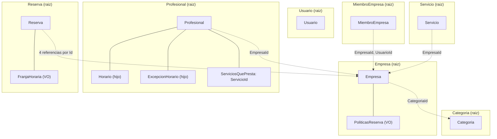
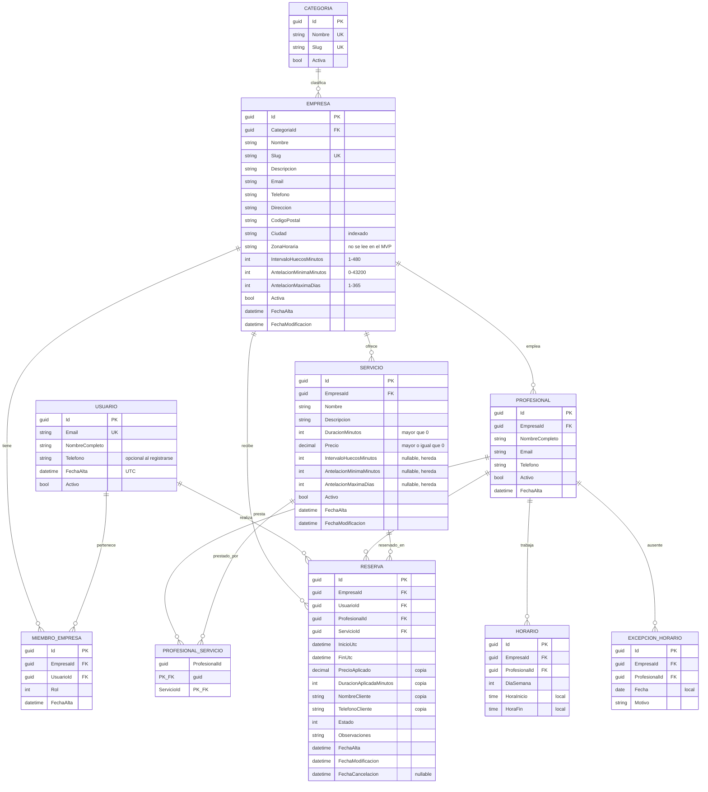

# Modelo de dominio

**Fase 2.** Ubicación final: `docs/modelo-dominio.md`.

Cierra el modelo antes de escribir una línea de código. A partir de aquí, **cambiar una entidad cuesta migración + configuración EF + pruebas + pantallas**; cambiarla ahora cuesta editar un párrafo.

Entradas: `TFM_PlataformaReservas_SPEC.md` §9, `reglas-negocio.md` (RN-xx), `casos-uso.md` (CU-xx).
Nomenclatura: castellano sin tildes ni eñes en identificadores (SPEC §3).

---

# 1. Decisiones de modelado

| # | Decisión | Resolución |
|---|---|---|
| M-01 | Estilo de modelo | **Modelo rico.** Las entidades protegen sus propias invariantes con métodos; no hay propiedades con `set` público ni constructores sin validar |
| M-02 | Límites de agregado | **Siete agregados pequeños** (§2). Las referencias entre agregados son por identificador, nunca por navegación |
| M-03 | Identificadores | `Guid` **versión 7** (`Guid.CreateVersion7()`), generados en la capa de aplicación |
| M-04 | Identificadores tipados | **No.** `Guid` desnudo. Los tipos fuertes por entidad se descartan por coste (§9.2) |
| M-05 | Objetos de valor | Veintidós: `PoliticasReserva`, `IntervaloHorario`, `FranjaHoraria`, `Slug`, `Email`, `Telefono`, `CodigoPostal`, `Precio`, `Duracion`, `NombreCategoria`, `NombreEmpresa`, `DescripcionEmpresa`, `Direccion`, `Ciudad`, `NombreServicio`, `DescripcionServicio`, `NombrePersona`, `Observaciones`, `IntervaloHuecos`, `AntelacionMinimaReserva`, `AntelacionMaximaReserva` y `MotivoExcepcion` (§5). Las fábricas y los métodos los reciben ya construidos. *Reabierta dos veces el 2026-10-04 (eran cuatro, luego nueve y diecisiete), otra en la Fase 8 (dudas 5 y 6) y otra en la Fase 9 (duda 2)* |
| M-06 | Invariantes entre agregados | No se pueden proteger en el dominio. Van al caso de uso o a la base de datos, y se declara cuál en cada caso (§6) |
| M-07 | Eventos de dominio | **Sí.** Las entidades los registran; el caso de uso los publica **después del commit** (§10 bis) |

---

# 2. Agregados

Un agregado es la unidad de consistencia transaccional: todo lo que hay dentro se carga, se valida y se guarda junto, y sus invariantes se cumplen siempre.

La regla que se ha seguido: **un agregado existe cuando hay una invariante que abarca a varios objetos.** Si dos objetos no comparten ninguna invariante, no tienen por qué compartir agregado.



Las flechas discontinuas son **referencias por identificador**, no propiedades de navegación entre raíces.

## 2.1. Por qué `Profesional` contiene sus horarios

RN-42 dice que dos intervalos de horario del mismo profesional y el mismo día **no pueden solaparse**.

Esa invariante abarca a varios `Horario` a la vez. Para garantizarla hay que poder verlos todos juntos en el momento de añadir uno nuevo — y eso solo se consigue si viven dentro del mismo agregado. Si `Horario` fuese una raíz independiente, dos peticiones simultáneas podrían insertar intervalos solapados y nadie se enteraría.

Lo mismo con `ExcepcionHorario` y RN-45 (una por profesional y fecha).

Por eso `Profesional` es la raíz y ambos son hijos: se cargan con él, se validan con él y se guardan con él. No tienen repositorio propio.

## 2.2. Por qué `Servicio` **no** está dentro de `Empresa`

No hay ninguna invariante que relacione unos servicios con otros. Un servicio no necesita saber nada de sus hermanos para ser válido.

Meterlo dentro de `Empresa` obligaría a cargar todos los servicios, todos los profesionales y todos los horarios cada vez que se toca un precio, y convertiría la empresa en un punto de contención donde toda edición compite con todas las demás. El mismo razonamiento vale para `Profesional` y para `Reserva`.

## 2.3. Por qué la asociación profesional-servicio vive en `Profesional`

`ProfesionalServicio` es una relación N:M entre dos raíces. Podría modelarse como entidad propia, pero se gestiona siempre desde la ficha del profesional (CU-15), y desde el profesional es donde se consulta ("¿presta este servicio?", RN-73).

Se modela como una **colección de `ServicioId` dentro de `Profesional`**. En base de datos sigue siendo su tabla de unión; en el dominio es una colección de identificadores, no de objetos.

La invariante RN-31 (profesional y servicio de la misma empresa) **cruza agregados**: `Profesional` no puede comprobarla porque no tiene acceso al `Servicio`. Se valida en el caso de uso (§6).

## 2.4. Por qué `Reserva` es una raíz aparte — y la consecuencia importante

Una reserva se crea, se cancela y se completa sola. No necesita a ninguna otra reserva para ser válida.

**Pero su invariante más importante sí las necesita.** RN-77 dice que dos reservas no canceladas del mismo profesional nunca pueden solaparse: es una invariante **entre instancias distintas del mismo agregado**, el caso que el modelo de dominio no sabe resolver por sí solo. Las tres salidas clásicas son:

| Salida | Por qué no, o por qué sí |
|---|---|
| Agrandar el agregado: `Profesional` contiene sus reservas | Habría que cargar la agenda completa del profesional para crear una cita, y todas las reservas de ese profesional competirían entre sí. Inviable |
| Aceptar consistencia eventual y compensar después | Significa aceptar reservas dobles y llamar al cliente para deshacer una. Inaceptable en este dominio |
| **Delegar la invariante en la base de datos** | Es lo que se hace: restricción `EXCLUDE` de PostgreSQL (SPEC §13) |

Esta es la justificación de diseño que conecta la Fase 2 con la Fase 11, y conviene desarrollarla en la memoria: la restricción de base de datos **no es un atajo**, es la respuesta correcta a una invariante que por definición no cabe dentro de un agregado.

## 2.5. Agregados y multi-tenancy

Toda raíz salvo `Usuario` y `Categoria` lleva `EmpresaId`. Ese identificador **se fija al crear y nunca cambia**: no existe ningún método que lo modifique, así que una entidad no puede migrar de empresa ni por error ni por manipulación (RN-01).

`Horario` y `ExcepcionHorario` llevan también `EmpresaId` desnormalizado, heredado de su profesional, para poder filtrar sin join.

---

# 3. Diagrama entidad-relación



---

# 4. Entidades

Convenciones de todas las fichas:

- Propiedades con `get` público y `set` **privado**. Ningún estado se cambia sin pasar por un método.
- Constructor privado sin parámetros para EF Core; constructor público o método de fábrica que valida.
- Los métodos que no pueden cumplir su contrato **lanzan una excepción de dominio**, no devuelven `false`.

## 4.1. `Usuario` — raíz

Hereda de `IdentityUser<Guid>`. Identity gestiona credenciales, correo y bloqueo.

**Propiedades propias:** `NombreCompleto`, `Telefono`, `FechaAlta`, `Activo`.

**Invariantes**

| Invariante | Regla |
|---|---|
| `NombreCompleto` no vacío, máx. 120 | — |
| `Telefono` puede ser nulo, pero no cadena vacía | RN-81 |
| Un usuario inactivo no puede autenticarse | RN-135 |

**Comportamiento**

```csharp
void ActualizarPerfil(NombrePersona nombreCompleto, Telefono? telefono);   // un telefono nulo lo quita (Fase 15)
void EstablecerTelefono(Telefono telefono); // usado al reservar si falta (RN-81); lanza si ya tiene telefono (Fase 14)
void DarDeBaja();                            // Activo = false (RN-136); lanza si ya esta dada de baja
```

`DarDeBaja()` **no cancela las reservas**: eso cruza agregados y lo orquesta el caso de uso (§6).

## 4.2. `Categoria` — raíz

Datos maestros. Se cargan por datos iniciales y no se mantienen desde la aplicación (RN-122).

**Propiedades:** `Nombre`, `Slug`, `Activa`. Sin comportamiento.

## 4.3. `Empresa` — raíz

**Propiedades:** `Nombre`, `Slug`, `Descripcion`, `CategoriaId`, `Email` (VO), `Telefono` (VO), `Direccion`, `CodigoPostal` (VO), `Ciudad`, `ZonaHoraria`, `Politicas` (VO), `Activa`, `FechaAlta`, `FechaModificacion`.

**Invariantes**

| Invariante | Regla |
|---|---|
| `Nombre` no vacío, máx. 120 | RN-10 |
| `Slug` con formato válido y único en la plataforma | RN-10, RN-11 |
| Exactamente una `CategoriaId` | RN-12 |
| `Politicas` siempre presente y dentro de rango | RN-14, RN-26 a RN-29 |
| `EmpresaId` de sus hijos nunca cambia | RN-01 |

**Comportamiento**

```csharp
static Empresa Crear(Guid id, NombreEmpresa nombre, Slug slug, Guid categoriaId, DescripcionEmpresa? descripcion,
    Email email, Telefono telefono, Direccion direccion, CodigoPostal codigoPostal, Ciudad ciudad, DateTime ahoraUtc);
void ActualizarDatos(NombreEmpresa nombre, DescripcionEmpresa? descripcion, Email email, Telefono telefono,
    Direccion direccion, CodigoPostal codigoPostal, Ciudad ciudad, DateTime ahoraUtc);   // el slug no cambia (RN-11)
void CambiarCategoria(Guid categoriaId, DateTime ahoraUtc);
void CambiarPoliticas(PoliticasReserva politicas, DateTime ahoraUtc);
void DarDeBaja(DateTime ahoraUtc);     // Activa = false (RN-130); lanza si ya esta dada de baja
void Reactivar(DateTime ahoraUtc);     // Activa = true  (RN-133); lanza si ya esta activa
```

**La unicidad del slug no es una invariante de `Empresa`**: abarca a todas las empresas, así que la entidad no puede comprobarla. La garantiza el índice único de base de datos y la comprueba el caso de uso antes de intentarlo (§6).

**`Empresa` no conoce su condición de publicable.** RN-16 depende de sus servicios, sus profesionales y los horarios de estos, que viven en otros agregados. Es una consulta de lectura (`IConsultasCatalogoPublico`), no una propiedad del dominio (RN-18).

## 4.4. `MiembroEmpresa` — raíz

Vincula un usuario con una empresa. Es lo que resuelve `IContextoEmpresa.EmpresaActualId`.

**Propiedades:** `EmpresaId`, `UsuarioId`, `Rol` (`RolMiembro`), `FechaAlta`.

**Invariantes:** único por `(EmpresaId, UsuarioId)`, garantizado por índice único (RN-06). `Rol` tiene que ser un valor definido de `RolMiembro`: `Crear` rechaza cualquier otro. Sin comportamiento: se crea y se consulta.

## 4.5. `Servicio` — raíz

**Propiedades:** `EmpresaId`, `Nombre`, `Descripcion`, `Duracion` (VO), `Precio` (VO), las tres políticas opcionales, `Activo`, fechas.

**Invariantes**

| Invariante | Regla |
|---|---|
| `Duracion.Minutos > 0`, garantizado por `Duracion` | RN-20 |
| `Precio.Importe >= 0`, garantizado por `Precio` | RN-21 |
| Cada política opcional, si no es nula, dentro del rango correspondiente | RN-22, RN-26 a RN-29 |
| `EmpresaId` inmutable | RN-01 |

**Comportamiento**

```csharp
static Servicio Crear(Guid id, Guid empresaId, NombreServicio nombre, Duracion duracion, Precio precio, DateTime ahoraUtc);
void ActualizarDatos(NombreServicio nombre, DescripcionServicio? descripcion, Duracion duracion, Precio precio, DateTime ahoraUtc);
void EstablecerPoliticas(IntervaloHuecos? intervalo, AntelacionMinimaReserva? antelacionMinima,
    AntelacionMaximaReserva? antelacionMaxima, DateTime ahoraUtc);   // nulo = heredar (RN-22)
void Desactivar(DateTime ahoraUtc);   // RN-24, RN-25; lanza si ya esta desactivado
```

> **Las tres políticas opcionales no se agrupan en un objeto de valor.** Un `PoliticasReserva` con los tres campos anulables no representa nada coherente: sería "un conjunto de políticas donde puede no haber ninguna política". Se dejan como tres propiedades anulables y es `PoliticasReserva.Resolver` quien las combina con las de la empresa para producir un valor completo y válido (SPEC §4.1). Cada una valida su rango por separado al asignarse.

## 4.6. `Profesional` — raíz, con hijos

**Propiedades:** `EmpresaId`, `NombreCompleto`, `Email` (VO, opcional), `Telefono` (VO, opcional), `Activo`, `FechaAlta`.

**Colecciones hijas:** `Horarios` (`IReadOnlyCollection<Horario>`), `Excepciones` (`IReadOnlyCollection<ExcepcionHorario>`), `ServiciosQuePresta` (`IReadOnlySet<Guid>`).

Las tres se exponen como solo lectura. Se modifican únicamente por métodos.

**Invariantes**

| Invariante | Regla |
|---|---|
| `NombreCompleto` no vacío | — |
| Dos intervalos del mismo día no se solapan | **RN-42** |
| `HoraInicio < HoraFin` en cada intervalo | RN-41 |
| Una sola excepción por fecha | RN-45 |
| Sin duplicados en `ServiciosQuePresta` | RN-32 |
| `EmpresaId` inmutable | RN-01 |

**Comportamiento**

```csharp
static Profesional Crear(Guid id, Guid empresaId, NombrePersona nombreCompleto, DateTime ahoraUtc);
void ActualizarDatos(NombrePersona nombreCompleto, Email? email, Telefono? telefono);
void Desactivar();                                        // RN-33, RN-34; lanza si ya esta desactivado

void AgregarIntervalo(Guid horarioId, DayOfWeek dia, IntervaloHorario intervalo);     // valida RN-41 y RN-42
void EliminarIntervalo(Guid horarioId);                             // RN-121
void MarcarNoDisponible(Guid excepcionId, DateOnly fecha, MotivoExcepcion? motivo);   // valida RN-45
void QuitarExcepcion(DateOnly fecha);

void AsociarServicio(Guid servicioId);      // RN-32; lanza si ya lo presta
void DesasociarServicio(Guid servicioId);   // lanza si no lo presta
bool Presta(Guid servicioId);               // RN-73
```

Los Id de `Horario` y `ExcepcionHorario` llegan desde el caso de uso (`Guid.CreateVersion7()`, D-16) y en EF van con `ValueGeneratedNever()`: si no, un hijo nuevo añadido a la colección de un agregado rastreado se toma por existente y el guardado falla. *Fase 9, duda 5.*

`AgregarIntervalo` es el método que justifica el agregado: recorre los intervalos existentes de ese día y lanza si alguno se solapa con el nuevo, reutilizando `IntervaloHorario.SeSolapaCon`. Esa comprobación **solo es posible porque los intervalos están dentro**.

`AsociarServicio` **no puede comprobar RN-31** (que el servicio sea de la misma empresa): no tiene el `Servicio` delante. Lo valida el caso de uso (§6).

## 4.7. `Horario` — entidad hija

**Propiedades:** `Id`, `EmpresaId`, `ProfesionalId`, `DiaSemana`, `Intervalo` (VO `IntervaloHorario`).

Sin ciclo de vida propio: nace y muere con las llamadas a su profesional. No tiene repositorio.

En base de datos, `Intervalo` se mapea como tipo propiedad a dos columnas, `hora_inicio` y `hora_fin`.

## 4.8. `ExcepcionHorario` — entidad hija

**Propiedades:** `Id`, `EmpresaId`, `ProfesionalId`, `Fecha`, `Motivo` (VO `MotivoExcepcion`, opcional).

Solo indisponibilidad de día completo (RN-44). No lleva horas: si las llevara, sería el horario personalizado que quedó fuera de alcance.

## 4.9. `ProfesionalServicio` — sin ficha propia

**No existe como entidad de dominio.** Es la colección `ServiciosQuePresta` de `Profesional` (§2.3), y solo reaparece como tabla de unión en la base de datos (§8).

Si en el futuro la asociación necesitara datos propios —un precio distinto por profesional, por ejemplo— dejaría de ser una colección de identificadores y pasaría a ser entidad hija de `Profesional`. No hace falta anticiparlo ahora.

## 4.10. `Reserva` — raíz

**Propiedades:** `EmpresaId`, `UsuarioId`, `ProfesionalId`, `ServicioId`, `Franja` (VO `FranjaHoraria`), `PrecioAplicado` (VO `Precio`), `DuracionAplicada` (VO `Duracion`), `NombreCliente`, `TelefonoCliente` (VO `Telefono`), `Estado`, `Observaciones`, `FechaAlta`, `FechaModificacion`, `FechaCancelacion`.

**Invariantes**

| Invariante | Regla |
|---|---|
| `FinUtc > InicioUtc` | RN-50 |
| `FinUtc = InicioUtc + DuracionAplicada.Minutos` | RN-74 |
| Nace `Confirmada` | RN-79 |
| Solo transiciones legales | RN-91, RN-92 |
| `NombreCliente` y `TelefonoCliente` obligatorios | RN-82 |
| Todas las referencias y las copias son inmutables tras la creación | RN-78 |

**Comportamiento**

```csharp
static Reserva Crear(
    Guid id, Guid empresaId, Guid usuarioId, Guid profesionalId, Servicio servicio,
    DateTime inicioUtc, NombrePersona nombreCliente, Telefono telefonoCliente, Observaciones? observaciones, DateTime ahoraUtc);

static Reserva Crear(
    Guid id, Guid empresaId, Guid usuarioId, Guid profesionalId, Guid servicioId, Duracion duracion, Precio precio,
    DateTime inicioUtc, NombrePersona nombreCliente, Telefono telefonoCliente, Observaciones? observaciones, DateTime ahoraUtc);

void CancelarPorCliente(DateTime ahoraUtc, OrigenCancelacion origen);   // Cliente o BajaCuenta; exige EsCancelablePorCliente (RN-93)
static bool EsCancelablePorCliente(EstadoReserva estado, FranjaHoraria franja, DateTime ahoraUtc);   // Confirmada e InicioUtc > ahora; unica definicion, tambien para los DTO proyectados (Fase 15)
void CancelarPorEmpresa(DateTime ahoraUtc, OrigenCancelacion origen);   // exige Confirmada, sin limite temporal (RN-94); origen Empresa o BajaEmpresa (fase 11b, duda 6)
void Completar(DateTime ahoraUtc);            // exige EsCompletable (RN-96)
static bool EsCompletable(EstadoReserva estado, FranjaHoraria franja, DateTime ahoraUtc);   // Confirmada y FinUtc < ahora; unica definicion, tambien para los DTO proyectados (Fase 16)
```

La primera sobrecarga, `Crear(Servicio)`, recibe el **`Servicio` completo**: lee `Duracion` y `Precio` para calcular `FinUtc` y hacer las copias, y comprueba que el servicio es de la empresa. Con ella o con la sobrecarga de abajo, `FinUtc` nunca puede venir del cliente: la duración se lee siempre en servidor (RN-74).

**Sobrecarga para el eje cliente (Fase 11, duda 3).** `CrearReserva` no puede cargar la entidad `Servicio`, porque `IRepositorioServicios` filtra por empresa y el cliente no tiene empresa. Usa la sobrecarga que recibe `servicioId`, `Duracion` y `Precio`, leídos en servidor de `IConsultasDisponibilidad`; `FinUtc` lo sigue calculando el dominio (RN-74). `Crear(Servicio)` comprueba que el servicio es de la empresa y delega en ella.

Los dos métodos de cancelación existen por separado porque **sus reglas son distintas**: el cliente no puede cancelar una reserva ya empezada y la empresa sí. Un único `Cancelar(quien)` obligaría a meter el rol dentro del dominio, que no es asunto suyo.

**`Reserva` no puede garantizar RN-77.** Ver §2.4.

---

# 5. Objetos de valor

Inmutables, sin identidad, iguales por valor. Se implementan como `record` y **validan en el constructor**: no existe una instancia inválida.

## 5.1. `PoliticasReserva`

Los tres parámetros efectivos, ya resueltos y dentro de rango. Definición completa en SPEC §4.1.

| Campo | Rango | Consecuencia de no validarlo |
|---|---|---|
| `IntervaloHuecosMinutos` | 1 – 480 | **Bucle infinito** en el motor (§12.2 del SPEC) |
| `AntelacionMinimaMinutos` | 0 – 43 200 | Reservas en el pasado si fuese negativo |
| `AntelacionMaximaDias` | 1 – 365 | La empresa no recibiría ninguna reserva |

No se persiste como tal: se construye al vuelo desde `Empresa` y `Servicio` (RN-23). El constructor comprueba los tres rangos y lanza `DominioException` si alguno está fuera (RN-29).

## 5.2. `IntervaloHorario`

```csharp
public sealed record IntervaloHorario(TimeOnly HoraInicio, TimeOnly HoraFin)
{
    // Invariante: HoraInicio < HoraFin  (RN-41)
    public bool SeSolapaCon(IntervaloHorario otro);   // RN-42, semiabierto
    public int DuracionMinutos { get; }
}
```

Hora local. Usado dentro de `Horario` y por el motor al generar candidatos.

## 5.3. `FranjaHoraria`

```csharp
public sealed record FranjaHoraria(DateTime InicioUtc, DateTime FinUtc)
{
    // Invariantes: ambos con Kind = Utc, y FinUtc > InicioUtc
    public bool SeSolapaCon(FranjaHoraria otra);   // RN-51
    public int DuracionMinutos { get; }
}
```

Instantes absolutos. Usado por `Reserva` y por `HuecoDisponible`.

**Aquí vive la regla de solapamiento**, en un único punto de todo el sistema (RN-51):

```csharp
public bool SeSolapaCon(FranjaHoraria otra)
    => InicioUtc < otra.FinUtc && FinUtc > otra.InicioUtc;
```

Es la misma semántica que `tstzrange(inicio, fin, '[)') && tstzrange(...)` en PostgreSQL, de modo que aplicación y base de datos **no pueden discrepar** (SPEC §13).

La comprobación de `Kind == Utc` en el constructor es barata y ataja de raíz la clase de error más frecuente con Npgsql, que rechaza en tiempo de ejecución cualquier `DateTime` no UTC destinado a un `timestamptz` (RN-100).

## 5.4. `Slug`

```csharp
public sealed record Slug
{
    // Invariante: minusculas, digitos y guiones; sin guiones al principio, al final ni dobles; 3-120
    public static Slug Desde(string texto);          // normaliza: quita tildes, sustituye espacios
    public Slug ConSufijo(int n);                    // para resolver colisiones (RN-11)
}
```

Es objeto de valor y no un `string` porque aparece en la URL pública: un slug mal formado rompe el enrutado y es difícil de corregir una vez publicado e indexado.

## 5.5. `Email`, `Telefono` y `CodigoPostal`

Datos de contacto con formato propio. Recortan espacios y validan en el constructor:

| Objeto | Invariantes | Regla |
|---|---|---|
| `Email` | Obligatorio, máx. 160, formato de dirección de correo sin nombre visible | RN-177 |
| `Telefono` | Obligatorio, máx. 20; dígitos, espacios y guiones, `+` solo al principio; de 6 a 15 dígitos | RN-178 |
| `CodigoPostal` | Exactamente 5 dígitos | RN-179 |

`Empresa` los usa obligatorios; `Profesional`, opcionales. `Reserva.TelefonoCliente` es un `Telefono` cifrado en base de datos: el conversor del objeto de valor se encadena con el de cifrado (RN-163). `Usuario` vive en `Infraestructura` y guarda el teléfono como `string`, porque Identity lo exige para cifrarlo, pero lo valida con `Telefono` al crearse.

## 5.6. `Precio` y `Duracion`

| Objeto | Invariantes | Regla |
|---|---|---|
| `Precio` (`Importe`) | `>= 0`, como mucho 2 decimales y como máximo 99 999 999,99: los límites de la columna `decimal(10,2)` | RN-21 |
| `Duracion` (`Minutos`) | `> 0` | RN-20 |

Los usan `Servicio` (`Precio`, `Duracion`) y `Reserva` (`PrecioAplicado`, `DuracionAplicada`), de modo que la copia que hace la reserva hereda la misma garantía.

**Persistencia:** los cinco se guardan con un conversor de EF Core en la misma columna que tenía el primitivo. El esquema no cambia (`base-datos.md`).

*Reapertura de M-05 el 2026-10-04:* la validación de estos campos estaba repartida en las fábricas de las entidades. Se lleva a objetos de valor para que cada regla viva en un único sitio y se pruebe por separado.

## 5.7. Textos

Todo texto validado de una entidad es un objeto de valor. Recortan espacios, exigen contenido y comprueban la longitud máxima; el opcional se expresa con una propiedad anulable.

| Objeto | Máx. | Lo usan |
|---|---|---|
| `NombreCategoria` | 80 | `Categoria.Nombre` |
| `NombreEmpresa` | 120 | `Empresa.Nombre` |
| `DescripcionEmpresa` | 1000 | `Empresa.Descripcion` (opcional) |
| `Direccion` | 200 | `Empresa.Direccion` |
| `Ciudad` | 80 | `Empresa.Ciudad` |
| `NombreServicio` | 120 | `Servicio.Nombre` |
| `NombrePersona` | 120 | `Profesional.NombreCompleto`, `Reserva.NombreCliente` y, como validación, `Usuario.NombreCompleto` |
| `Observaciones` | 500 | `Reserva.Observaciones` (opcional) |

`DescripcionServicio` (500, `Servicio.Descripcion`, opcional) se añade en la Fase 8 (duda 5).

`MotivoExcepcion` (200, `ExcepcionHorario.Motivo`, opcional) se añade en la Fase 9 (duda 2).

**Las fábricas reciben los objetos de valor ya construidos** (*decidido el 2026-10-04*). La entidad no traduce primitivos: lo hace el caso de uso a partir del comando. En las fábricas solo quedan las comprobaciones de identificadores no vacíos, instantes UTC y las invariantes entre valores (servicio de otra empresa, slug de categoría ≤ 80, rol definido).

## 5.7 bis. Políticas opcionales del servicio

`IntervaloHuecos` (1-480 minutos), `AntelacionMinimaReserva` (0-43 200 minutos) y `AntelacionMaximaReserva` (1-365 días) validan cada política por separado. `Servicio.EstablecerPoliticas` los recibe anulables, porque cada una puede heredarse por separado (RN-22), y `PoliticasReserva` delega en ellos sus rangos, que siguen en un único sitio (RN-29). Las propiedades de `Servicio` siguen siendo `int?`. *Fase 8, duda 6: la quinta prueba de arquitectura prohíbe `int?` en los métodos de una entidad.*

**`Activar()` de `Servicio` y `Profesional` no se implementa**: ningún caso de uso del MVP reactiva un servicio ni un profesional (CU-13, CU-14). *Fase 8, duda 10.*

## 5.8. Objetos de valor descartados

| Candidato | Por qué no |
|---|---|
| `Dinero` (importe + divisa) | Divisa única en el MVP (§6.2 del SPEC). `Precio` cubre el importe sin divisa |
| Identificadores tipados e `InstanteUtc` | Ver §9.2. Siguen como `Guid` y `DateTime`, validados con `Validacion` |
| `Direccion` como objeto de valor | Se consideró para agrupar calle, código postal y ciudad. Se descarta porque `Ciudad` se consulta y se indexa por separado (RN-110) y quedaría enterrada dentro de un tipo propiedad |

---

# 6. Invariantes que el dominio no puede proteger

Son las que abarcan más de un agregado o más de una instancia. Cada una declara **quién** la garantiza. Esta tabla es el contrato entre el dominio y las capas superiores.

| Invariante | Regla | Quién la garantiza |
|---|---|---|
| Dos reservas no canceladas del mismo profesional no se solapan | RN-77 | **Base de datos**: restricción `EXCLUDE` (SPEC §13) |
| Slug único en toda la plataforma | RN-10 | **Base de datos**: índice único, más comprobación previa en el caso de uso para dar un mensaje decente |
| Un usuario tiene como máximo una pertenencia | RN-06 | **Base de datos**: índice único |
| Una excepción por profesional y fecha | RN-45 | **Agregado** `Profesional`, reforzado con índice único |
| Profesional y servicio de la misma empresa | RN-31 | **Caso de uso**: carga ambos y compara `EmpresaId` |
| El profesional presta el servicio reservado | RN-73 | **Caso de uso**: carga el profesional y llama a `Presta(servicioId)` |
| La empresa es publicable | RN-16 | **Consulta de lectura**: `EXISTS` en `IConsultasCatalogoPublico` (RN-18) |
| El alta de empresa crea usuario, rol, empresa y pertenencia, o nada | RN-15 | **Caso de uso**: una transacción |
| Dar de baja una empresa cancela sus reservas futuras | RN-132 | **Caso de uso**: una transacción sobre varios agregados |
| Darse de baja cancela las reservas futuras del usuario | RN-137 | **Caso de uso**: una transacción sobre varios agregados |
| Un usuario inactivo no puede autenticarse | RN-135 | **Infraestructura**: comprobación en la autenticación de Identity |
| Todo recurso pertenece a una sola empresa y nadie ve la ajena | RN-02, RN-03 | **Repositorios filtrados en origen** más validación explícita (SPEC §10.3) |

> **Una transacción puede abarcar varios agregados aunque la ortodoxia recomiende lo contrario.** Las cascadas de RN-132 y RN-137 modifican una empresa (o un usuario) y N reservas a la vez. La alternativa canónica sería consistencia eventual entre agregados mediante eventos de dominio, que se descartó por coste. Los eventos sí existen (M-07), pero solo para efectos secundarios después del commit, no para repartir la cascada entre transacciones. Se deja constancia de que es una desviación consciente: en un monolito con una sola base de datos, una transacción sobre varias raíces es correcta y barata; el precio se paga solo si algún día esos agregados viven en bases de datos distintas.

---

# 7. Enumeraciones

```csharp
public enum EstadoReserva { Confirmada = 0, Cancelada = 1, Completada = 2 }
public enum RolMiembro   { Propietario = 0 }
```

Se persisten **como entero**, no como texto: la restricción `EXCLUDE` filtra por `estado <> 1` (SPEC §13) y los valores deben ser estables.

`DiaSemana` usa `System.DayOfWeek` del BCL (domingo = 0). No se define una enumeración propia: sería un tipo paralelo a uno existente y una fuente segura de errores de conversión.

`RolMiembro` tiene un único valor hoy. Existe para que añadir `Gestor` mañana sea una línea y no una migración de esquema.

---

# 8. Mapa a base de datos

Convención `snake_case` (SPEC D-13). Todas las claves primarias son `uuid`.

| Agregado / entidad | Tabla | Notas |
|---|---|---|
| `Usuario` | `asp_net_users` | Identity, con las columnas propias añadidas |
| `Categoria` | `categorias` | |
| `Empresa` | `empresas` | `Politicas` se aplana en tres columnas |
| `MiembroEmpresa` | `miembros_empresa` | único `(empresa_id, usuario_id)` |
| `Servicio` | `servicios` | tres columnas anulables de política |
| `Profesional` | `profesionales` | |
| `Profesional.ServiciosQuePresta` | `profesional_servicio` | clave primaria compuesta |
| `Horario` | `horarios` | `Intervalo` se aplana en `hora_inicio` y `hora_fin` |
| `ExcepcionHorario` | `excepciones_horario` | único `(profesional_id, fecha)` |
| `Reserva` | `reservas` | `Franja` se aplana en `inicio_utc` y `fin_utc`; restricción `EXCLUDE` |

**Los objetos de valor se aplanan como tipos propiedad** (`ComplexProperty` / `OwnsOne`), no como tablas aparte. Los de un solo valor (`Ciudad`, `Email`, `Slug`, los textos…) se guardan en una columna con un conversor de EF Core; los compuestos (`PoliticasReserva`, `IntervaloHorario`, `FranjaHoraria`) se aplanan en varias columnas. Es imprescindible para `Franja`: la restricción `EXCLUDE` necesita `inicio_utc` y `fin_utc` como columnas de la propia tabla `reservas`.

**Repositorios**, uno por raíz que se escribe (SPEC D-09): `IRepositorioEmpresas`, `IRepositorioServicios`, `IRepositorioProfesionales`, `IRepositorioReservas`, `IRepositorioMiembros`. **No hay `IRepositorioHorarios`**: los horarios se guardan con su profesional. El SPEC §10.3 lo listaba; queda corregido aquí. Los contratos viven en `Dominio/Repositorios` (`arquitectura.md` §2.3, decidido en la Fase 8); las implementaciones, en `Infraestructura/Repositorios`.

---

# 9. Alternativas descartadas

## 9.1. Modelo anémico con la lógica en servicios

Sería más rápido de escribir y es lo que la IA genera por defecto si no se le dice otra cosa. Se descarta porque el TFM defiende justo lo contrario: que las reglas de negocio sean comprobables sin interfaz ni base de datos (SPEC §2.4). Con setters públicos, nada impide que una pantalla ponga `reserva.Estado = Completada` en una cita que aún no ha empezado.

**Es la desviación más probable de todo el proyecto**, y un aviso en el prompt no basta. Se defiende en cuatro capas, de más a menos efectiva:

### Capa 1 — Pruebas de arquitectura (Fase 4)

Cinco pruebas en `PruebasUnitarias`, sin paquetes adicionales, que hacen fallar la suite de pruebas. La quinta, `Ningun_metodo_publico_de_una_entidad_recibe_primitivos_validables`, se añadió el 2026-10-04 para vigilar que las fábricas reciben objetos de valor (§5.7):

Clase `PruebasArquitectura`, en `tests/PlataformaReservas.PruebasUnitarias/Arquitectura/PruebasArquitectura.cs`.

```csharp
// El ancla es EntidadBase, no una entidad concreta: existe desde la Fase 4,
// antes que cualquier entidad, y es la unica clase que no va a desaparecer.
static readonly Assembly EnsambladoDominio = typeof(EntidadBase).Assembly;

static IEnumerable<Type> Entidades() =>
    EnsambladoDominio.GetTypes()
        .Where(t => t.IsClass && !t.IsAbstract && typeof(EntidadBase).IsAssignableFrom(t));

[Fact]
public void Ninguna_entidad_expone_setters_publicos()
{
    Entidades()
        .SelectMany(t => t.GetProperties(BindingFlags.Public | BindingFlags.Instance))
        .Where(p => p.SetMethod is { IsPublic: true })      // detecta tambien init
        .Select(p => $"{p.DeclaringType!.Name}.{p.Name}")
        .Should().BeEmpty();
}

[Fact]
public void Ninguna_entidad_expone_colecciones_mutables()
{
    var mutables = new[] { typeof(List<>), typeof(ICollection<>), typeof(HashSet<>), typeof(ISet<>) };

    Entidades()
        .SelectMany(t => t.GetProperties(BindingFlags.Public | BindingFlags.Instance))
        .Where(p => p.PropertyType.IsGenericType
                 && mutables.Contains(p.PropertyType.GetGenericTypeDefinition()))
        .Select(p => $"{p.DeclaringType!.Name}.{p.Name}")
        .Should().BeEmpty();
}

[Fact]
public void Toda_entidad_tiene_constructor_privado_sin_parametros()
{
    // Mismo patron que las otras tres: se buscan las infractoras y se exige que no haya.
    // No se usa OnlyContain: FluentAssertions falla con una coleccion vacia y la
    // suite quedaria en rojo mientras no existan entidades.
    Entidades()
        .Where(t => t.GetConstructor(BindingFlags.NonPublic | BindingFlags.Instance,
                                     null, Type.EmptyTypes, null) is null)
        .Select(t => t.Name)
        .Should().BeEmpty();
}

[Fact]
public void El_dominio_no_depende_de_infraestructura()
{
    EnsambladoDominio.GetReferencedAssemblies().Select(a => a.Name!)
        .Should().NotContain(n => n.StartsWith("Microsoft.EntityFrameworkCore")
                               || n.StartsWith("Npgsql")
                               || n.StartsWith("Microsoft.AspNetCore"));
}
```

La segunda es la que más veces va a saltar: `public ICollection<Horario> Horarios { get; set; }` es lo que la IA escribe por inercia, y con eso **RN-42 deja de existir** porque cualquiera puede hacer `.Add()` sin pasar por `AgregarIntervalo`.

Ojo con `init`: un `init` público permite `new Empresa { Nombre = "x" }` saltándose la fábrica, por eso `IsPublic` sobre el `SetMethod` es la comprobación correcta.

> **Con cero entidades, las cuatro pruebas pasan en verde sin probar nada.** Es la situación de la Fase 4, donde solo existe `EntidadBase`. Por eso la Fase 4 incluye una **comprobación negativa obligatoria**: se añade temporalmente una entidad anémica (setter público, `List<>` pública y sin constructor privado), se comprueba que las tres primeras pruebas **fallan**, y se borra antes del commit. Una prueba que nunca se ha visto fallar no demuestra nada.
>
> *Corrección aplicada al revisar la especificación de la Fase 4: la versión anterior anclaba las pruebas en `typeof(Reserva)`, que no existe hasta la Fase 5, y usaba `OnlyContain`, que falla con colecciones vacías.*

### Capa 2 — Que la forma correcta sea la única posible

`EntidadBase` con `Id` protegido · entidades `sealed` · **sin constructor público**, solo `Crear(...)` · colecciones como campo privado `_horarios` expuesto como `IReadOnlyCollection<Horario>` con `PropertyAccessMode.Field` · `DominioException` propia para obligar a lanzar en vez de devolver `bool`.

**EF Core no necesita setters públicos**: escribe en setters privados y en campos de respaldo. No hay excusa técnica.

### Capa 3 — Dirigir a la IA donde sí lee

`AGENTS.md` en la raíz, con `CLAUDE.md` importándolo. Claude Code lee `CLAUDE.md` en cada sesión de forma automática; el SPEC no lo lee salvo que se le pida.

Y la palanca más fuerte: **escribir `Reserva` a mano, la primera.** Un modelo de lenguaje imita el código existente mucho antes que una descripción en prosa. Con `Reserva.cs` bien hecho, "sigue el patrón de `Reserva.cs`" funciona mejor que cualquier párrafo. Es el caso ideal para empezar porque concentra las copias, la fábrica que recibe el `Servicio` completo y las tres transiciones de estado.

### Capa 4 — Proceso

Una línea en la definición de terminado: ninguna propiedad pública con `set` o `init`, ninguna colección mutable expuesta. Gratis, pero es la capa más débil porque depende de acordarse.

## 9.2. Identificadores tipados (`EmpresaId`, `ReservaId`)

Impedirían en tiempo de compilación pasar un `ServicioId` donde se espera un `ProfesionalId` — un error real y fácil de cometer con siete entidades cuyos identificadores son todos `Guid`.

Se descartan por coste: un conversor de EF Core por tipo, fricción con Identity (que impone `Guid` en `Usuario`), ruido en los objetos de transferencia y en el enlace de formularios de Blazor. Estimado en 2-3 h más rozamiento continuo, sobre un presupuesto que ya va justo.

**Mitigación:** los métodos de dominio reciben parámetros con nombre explícito y las pruebas usan identificadores distintos entre sí, de modo que un cruce se detecte.

## 9.3. `Guid` versión 4 frente a versión 7

Se elige **versión 7** (`Guid.CreateVersion7()`, disponible desde .NET 9). Un `Guid` v4 es aleatorio, de modo que cada inserción cae en una página arbitraria del índice B-tree; con el volumen de `reservas` eso fragmenta el índice y ensucia la caché. El v7 lleva marca de tiempo en la cabecera y es monótono creciente, así que las inserciones van al final.

Coste: cero, es una llamada distinta. Beneficio real a partir de decenas de miles de filas — que este proyecto no va a tener, pero la decisión es gratis y se justifica sola en la memoria.

**Advertencia:** el orden de bytes de un `Guid` de .NET no coincide con el de un `uuid` de PostgreSQL en los tres primeros grupos. La monotonía se conserva en la representación de .NET; conviene comprobar en la Fase 5 que también se conserva tal y como Npgsql lo almacena, y si no, dejarlo documentado en vez de fingir un beneficio que no está.

## 9.4. `ClienteEmpresa` como entidad

Permitiría a la empresa guardar notas privadas sobre cada cliente. Se descartó en el SPEC (D-03) y aquí se confirma: `Reserva` referencia directamente a `Usuario` y guarda las copias necesarias. Los clientes de una empresa se derivan agrupando sus reservas.

---

# 10. Trazabilidad

## 10.1. Regla estructural → dónde vive

| Regla | Dónde se implementa |
|---|---|
| RN-01 | `EmpresaId` inmutable en toda raíz |
| RN-40 | `Horario` y `ExcepcionHorario` cuelgan solo de `Profesional` |
| RN-50, RN-51 | `FranjaHoraria.SeSolapaCon` e `IntervaloHorario.SeSolapaCon` |
| RN-60 | Una única implementación de `IMotorDisponibilidad` en `Aplicacion` |
| RN-90, RN-92 | `EstadoReserva` y los tres métodos de transición |
| RN-100 a RN-104 | `FranjaHoraria` valida `Kind = Utc`; la conversión de zona vive en el motor |
| RN-120 | Ausencia de métodos de borrado; `Desactivar()` en su lugar |
| RN-122, RN-123 | Datos iniciales, no dominio |

## 10.2. Cobertura

Las 10 entidades y las 2 enumeraciones de SPEC §9 tienen ficha. Las reglas de negocio (140 en `reglas-negocio.md` a la Fase 20) están asignadas a un agregado, a un caso de uso, a la base de datos o a la infraestructura.

---

# 10 bis. Eventos de dominio

Existen para desacoplar los casos de uso de sus efectos secundarios — en el MVP, el envío de correo (RN-140 a RN-161).

## 10bis.1. Quién los registra y quién los publica

**La entidad los registra. El caso de uso los publica, y solo después de confirmar la transacción.**

```csharp
public abstract class EntidadBase
{
    private readonly List<IEventoDominio> _eventos = [];
    public IReadOnlyCollection<IEventoDominio> Eventos => _eventos.AsReadOnly();

    protected void RegistrarEvento(IEventoDominio evento) => _eventos.Add(evento);
    public void LimpiarEventos() => _eventos.Clear();
}
```

`Eventos` se expone como `IReadOnlyCollection`, de modo que **la prueba de arquitectura de colecciones mutables sigue pasando** (§9.1).

```csharp
// Dentro de Reserva
public void CancelarPorCliente(DateTime ahoraUtc, OrigenCancelacion origen)   // Cliente o BajaCuenta (Fase 15)
{
    if (!EsCancelablePorCliente(Estado, Franja, ahoraUtc))
        throw new DominioException("El cliente solo cancela reservas confirmadas que aun no han comenzado.");

    Estado = EstadoReserva.Cancelada;
    FechaCancelacion = ahoraUtc;
    RegistrarEvento(new ReservaCancelada(Id, origen, ahoraUtc));
}
```

## 10bis.2. Por qué el despacho va después del commit

Es **el** punto de todo este diseño, y la implementación que sale por defecto lo hace mal.

Lo habitual es recolectar y despachar los eventos dentro de `SaveChangesAsync`, sobrescribiéndolo en el contexto. Con eso, **un manejador que falla sigue tumbando la operación**: se habría montado toda la infraestructura para acabar exactamente igual que con el envío en línea, que es el problema que se quería resolver.

Aquí el caso de uso es explícito:

```csharp
await _db.SaveChangesAsync(ct);
await tx.CommitAsync(ct);          // la reserva ya existe, pase lo que pase

await _publicador.PublicarAsync(reserva.Eventos, ct);   // encolar, no enviar
reserva.LimpiarEventos();
```

La publicación **encola**, no envía: es una escritura en memoria que no puede fallar por causas externas. El envío ocurre en otro hilo y en otro ámbito (`arquitectura.md` §13).

Consecuencia deliberada: **una reserva nunca se pierde porque el servidor de correo esté caído.** Como mucho se pierde el correo, y eso queda registrado.

## 10bis.3. Los seis eventos

```csharp
public interface IEventoDominio { DateTime OcurridoEnUtc { get; } }

public sealed record EmpresaRegistrada(Guid EmpresaId, DateTime OcurridoEnUtc)                          : IEventoDominio;
public sealed record EmpresaDadaDeBaja(Guid EmpresaId, DateTime OcurridoEnUtc)                          : IEventoDominio;
public sealed record CuentaRegistrada(Guid UsuarioId, DateTime OcurridoEnUtc)                           : IEventoDominio;
public sealed record CuentaDadaDeBaja(Guid UsuarioId, DateTime OcurridoEnUtc)                           : IEventoDominio;
public sealed record ReservaConfirmada(Guid ReservaId, DateTime OcurridoEnUtc)                          : IEventoDominio;
public sealed record ReservaCancelada(Guid ReservaId, OrigenCancelacion Origen, DateTime OcurridoEnUtc) : IEventoDominio;

public enum OrigenCancelacion { Cliente, Empresa, BajaEmpresa, BajaCuenta }
```

`OcurridoEnUtc` es el `ahoraUtc` del método que registra el evento. Los eventos de empresa no llevan `UsuarioId`: la entidad no conoce a su propietario, y el manejador lo vuelve a leer (RN-143). *Fase 11b, dudas 1 y 5.*

Quién registra cada uno: `Reserva.Crear` → `ReservaConfirmada`; `CancelarPorCliente` → `ReservaCancelada` (`Cliente` o `BajaCuenta`); `CancelarPorEmpresa` → `ReservaCancelada` (`Empresa` o `BajaEmpresa`); `Empresa.Crear` → `EmpresaRegistrada`; `Empresa.DarDeBaja` → `EmpresaDadaDeBaja`. `CuentaDadaDeBaja` lo crea y publica el caso de uso `DarDeBajaCuenta` después del commit (Fase 15, duda 4), y `CuentaRegistrada` lo crea y publica `RegistroCliente` después de confirmar el alta (Fase 16b, duda 7), porque `Usuario` no hereda de `EntidadBase`. `Completar` y `Reactivar` no registran nada.

**Los eventos llevan identificadores, no entidades.** Se procesan más tarde, en otro ámbito, cuando el `ContextoDatos` que cargó la entidad ya no existe. El manejador vuelve a leer lo que necesita con su propio contexto.

`OrigenCancelacion` es lo que convierte un evento en cuatro correos distintos: no es lo mismo *"has cancelado tu cita"* que *"el establecimiento ha cerrado y tu cita del jueves queda anulada"*. Sin ese dato, el manejador tendría que adivinar por qué se canceló.

## 10bis.4. Las cascadas

`DarDeBajaEmpresa` (RN-132) cancela N reservas futuras. Cada una registra su propio `ReservaCancelada` con origen `BajaEmpresa`, y el caso de uso publica los N después del commit. El bucle de envío ocurre fuera de la petición, de modo que **el botón responde igual de rápido con 3 reservas que con 300**.

Ese es justamente el caso que hacía inviable el envío en línea y el que justifica la cola.

## 10bis.5. Limitación: la cola es volátil

Si el proceso muere entre el commit y el envío, **el correo se pierde en silencio**: hay una reserva confirmada cuyo aviso nunca sale, y nadie se entera.

Es aceptable en un MVP y hay que **declararlo en la memoria**. La respuesta de producción es el patrón *outbox* transaccional: persistir el evento en la misma transacción y que un proceso lo lea y lo marque como enviado. Queda como trabajo futuro con su diseño esbozado, no como descuido (`arquitectura.md` §13.8).

---

# 11. Cambios que este documento introduce sobre el SPEC

| Cambio | Motivo |
|---|---|
| `IRepositorioHorarios` **desaparece** | Los horarios se guardan con su profesional (§2.1). SPEC §10.3 lo listaba por error |
| Se añade `IRepositorioMiembros` | Necesario para resolver `IContextoEmpresa` y para el alta de empresa |
| `Horario.Intervalo` y `Reserva.Franja` pasan a ser objetos de valor | Las columnas no cambian: se aplanan (§8) |
| `Guid` versión 7 | §9.3 |
| `EntidadBase` incorpora registro de eventos de dominio | §10 bis |

Ninguno afecta al esquema de base de datos. Los eventos de dominio sí afectan al presupuesto: ver SPEC §19.

---

# 12. Salida de la Fase 2

- [x] Siete agregados con sus límites justificados por invariantes, no por intuición.
- [x] Diagrama entidad-relación completo con tipos y restricciones.
- [x] Ficha de las 10 entidades con invariantes y comportamiento.
- [x] Cuatro objetos de valor, y justificación de los descartados. *Diecisiete desde las reaperturas de M-05 (2026-10-04); veintiuno desde la Fase 8; veintidós desde la Fase 9 (duda 2).*
- [x] Tabla explícita de las 12 invariantes que el dominio no puede proteger y de quién las garantiza.
- [x] Alternativas descartadas con su coste.
- [x] Ninguna decisión abierta.

**Siguiente:** Fase 3 — arquitectura técnica: proyectos, dependencias, inyección, flujo de datos y resolución del contexto de empresa.
